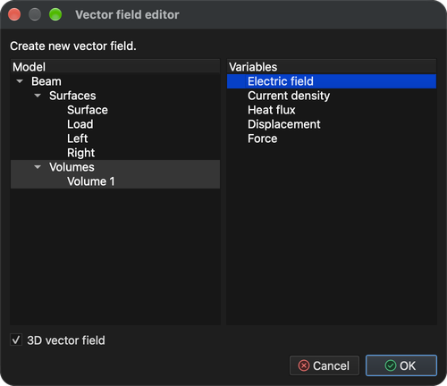

# Multiphysique

Ce tutoriel montre comment résoudre plusieurs problèmes couplés sur un même modèle. On réutilise le modèle **Beam** du tutoriel **Analyse des contraintes et des déformations**. Cette fois, un courant électrique traverse la poutre, le courant échauffe la poutre (effet Joule) et la chaleur fait dilater et déformer la poutre.

Trois types de problèmes sont nécessaires ; ils sont résolus dans cet ordre :

1. **Electro-statics** (électrostatique) – calcule le potentiel électrique, le champ électrique, la densité de courant et la chaleur Joule produite par le courant.
2. **Heat transfer** (transfert de chaleur) – calcule la répartition de température due à la chaleur Joule.
3. **Stress analysis** (analyse des contraintes) – calcule la dilatation thermique (déplacements) et la contrainte qui en résulte.

Chaque problème utilise les résultats du précédent ; l'ordre des problèmes est donc important.

## 1. Charger le modèle

**Menu :** _Fichier -> Ouvrir un modèle_

Dans la fenêtre **Ouvrir un modèle**, sélectionnez **Beam.tmsh** et cliquez sur **Ouvrir**.

Comme aucun type de problème n'est encore affecté au modèle, la fenêtre **Enchaînement des tâches du problème** s'ouvre automatiquement une fois le chargement terminé.

## 2. Enchaînement des tâches du problème

1. Dans la fenêtre **Enchaînement des tâches du problème**, cliquez sur **Ajouter un type de problème**.
2. Dans le **Sélecteur de type de problème**, cochez **Electro-statics**, **Heat transfer** et **Stress analysis**, puis cliquez sur **OK**.

L'**Enchaînement des tâches du problème** doit maintenant lister les trois problèmes dans un seul groupe d'itérations, dans l'ordre indiqué ci-dessous. Si l'ordre est différent ou s'il y a des entrées en trop, sélectionnez une entrée et corrigez avec les boutons **Monter**, **Descendre** et **Supprimer**. Confirmez avec **OK**.

La fenêtre peut être rouverte à tout moment avec le bouton **Enchaînement des tâches des problèmes** de la barre d'outils.

## 3. Générer le maillage 3D

Les trois problèmes sont résolus sur un maillage volumique.

**Menu :** _Géométrie -> Volume -> Générer un maillage tétraédrique_

Les valeurs préremplies dans la fenêtre **Générer un maillage 3D** suffisent. Cliquez sur **OK**. Une fois le maillage terminé, une nouvelle entité **Volume 1** apparaît sous **Volumes** dans l'arbre **Modèle**.

## 4. Affecter le matériau

Un matériau doit être affecté à toutes les entités du modèle. Le matériau doit fournir les propriétés nécessaires aux trois problèmes ; c'est le cas de **Iron** (fer).

1. Dans l'arbre **Modèle**, cliquez sur **Surface**, puis cliquez sur **Volume 1** en maintenant _Maj_ enfoncée pour sélectionner toutes les entités.
2. Ouvrez l'onglet **Matériau** sur le côté droit de la fenêtre principale.
3. Cochez **Iron**.

## 5. Affecter les conditions aux limites

Comme plusieurs types de problèmes sont sélectionnés, l'onglet **Conditions aux limites** propose maintenant les conditions de chacun d'eux, et plusieurs conditions peuvent être affectées à une même entité – une par problème. Affectez les conditions suivantes aux entités **surface** :

1. **Surface** (la surface extérieure de la poutre)
    - _Simple convection_ (convection simple)
        - Convection coefficient = 100 `[W/(m^2*K)]`
        - Fluid temperature = 293.15 `[K]`
2. **Load** (la face au milieu de la poutre)
    - _Electric potential_ (potentiel électrique)
        - Electric potential = 0.4 `[V]`
    - _Simple convection_ (valeurs comme pour **Surface**)
3. **Left** et **Right** (les faces aux deux extrémités de la poutre)
    - _Displacement_ (déplacement)
        - Displacement in X, Y and Z direction = 0 `[m]`
    - _Electric potential_
        - Electric potential = -0.4 `[V]`
    - _Simple convection_ (valeurs comme pour **Surface**)

Le courant circule donc du milieu de la poutre vers ses deux extrémités, et toutes les faces cèdent de la chaleur à l'air environnant par convection.

Pour chaque entité : sélectionnez-la dans l'arbre **Modèle** (maintenez _Ctrl_ / _⌘ Cmd_ enfoncée pour sélectionner à la fois **Left** et **Right**), cochez la condition dans l'onglet **Conditions aux limites**, sélectionnez la condition pour afficher ses propriétés sous la liste, puis double-cliquez sur la valeur, saisissez la nouvelle et appuyez sur _Entrée_. Les valeurs par défaut de **Simple convection** (100 `[W/(m^2*K)]` et 293.15 `[K]`) et de **Displacement** (0 `[m]`) conviennent déjà ; seul **Electric potential** doit être modifié.

## 6. Vérifier les conditions d'environnement

Les conditions d'environnement s'appliquent à tout le modèle et ne se cochent pas comme les conditions aux limites. Ouvrez l'onglet **Conditions d'environnement** et sélectionnez chaque condition pour vérifier ses valeurs :

- _Gravitational acceleration_ (accélération de la pesanteur)
    - 0, 0 et -9.80665 `[m/s^2]` dans les directions X, Y et Z
- _Temperature_ (température)
    - Temperature = 293.15 `[K]`

## 7. Résoudre le problème

**Menu :** _Solution -> Démarrer le solveur_

Le modèle doit être enregistré avant de pouvoir démarrer le solveur. S'il n'a pas encore été enregistré, la fenêtre **Enregistrer le modèle** s'affiche d'abord ; confirmez avec **Enregistrer** (si un fichier du même nom existe déjà, confirmez son remplacement). La fenêtre **Démarrer le solveur pour le modèle** s'affiche ensuite.

La fenêtre liste quelques avertissements, comme **Heat transfer: No explicit boundary condition assigned.** Ils sont attendus pour cette configuration et peuvent être ignorés. Cliquez sur **OK** pour démarrer le solveur.

Le solveur s'exécute en arrière-plan et sa sortie est affichée dans l'onglet **Sortie du processus**. Les problèmes sont résolus l'un après l'autre dans l'ordre de l'enchaînement des tâches ; l'exécution est terminée lorsque la sortie se termine par **SOLVER - END**.

## 8. Créer un champ vectoriel

Un **champ vectoriel** est une entité d'affichage qui trace une variable vectorielle sous forme de flèches. Il sert ici à montrer le champ électrique à l'intérieur de la poutre.

**Menu :** _Géométrie -> Champ vectoriel -> Créer un champ vectoriel_

Dans la fenêtre **Éditeur de champ vectoriel**, sélectionnez **Volume 1** dans la liste **Modèle** et **Electric field** (champ électrique) dans la liste **Variables**, et laissez **Champ vectoriel 3D** coché.

Cliquez sur **OK** pour créer le champ vectoriel. Il est ajouté à l'arbre **Modèle** sous **Champs vectoriels**, et les résultats calculés peuvent y être appliqués comme à toute autre entité du modèle.

## 9. Appliquer les résultats

Les résultats s'appliquent dans l'onglet **Résultats** à l'entité sélectionnée dans l'arbre **Modèle**, comme dans le tutoriel **Analyse des contraintes et des déformations**.

### 9.1. Température et déformation du volume

1. Dans l'arbre **Modèle**, cochez **Volumes** (en laissant les surfaces décochées), puis sélectionnez **Volume 1**.
2. Dans l'onglet **Résultats**, choisissez **Temperature - Scalar** dans la liste déroulante, cochez **Scalar** et **Afficher la plage de valeurs**. Si la plage affichée ne correspond pas aux résultats, cliquez sur **Définir les valeurs min/max par défaut**.
3. Choisissez **Displacement - Vector [3]** dans la liste déroulante, cochez **Displacement** et réglez l'**Échelle** sur **20** pour que la déformation soit visible (les déplacements calculés ne sont que d'environ 1.3 mm).

La température varie d'environ 505 K à 620 K ; la poutre est la plus chaude au milieu de ses deux tronçons extérieurs, et elle fléchit vers le haut parce que les extrémités bloquées l'empêchent de se dilater librement.

### 9.2. Température sur le champ vectoriel

1. Dans l'arbre **Modèle**, décochez **Volumes**, cochez **Champs vectoriels** et sélectionnez **Electric field**.
2. Dans l'onglet **Résultats**, choisissez **Temperature - Scalar**, cochez **Scalar** et **Afficher la plage de valeurs**. Les flèches sont maintenant colorées selon la température à leur emplacement.
3. Dans les **Propriétés d'affichage** sous l'arbre, cochez **Dessiner les pointes des flèches** pour montrer la direction du champ électrique.

