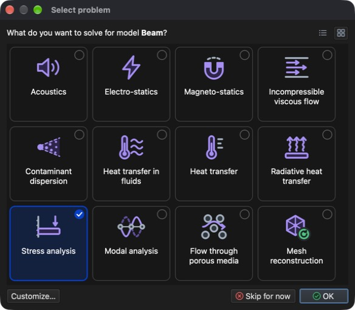
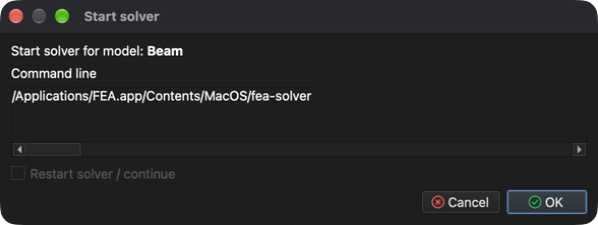
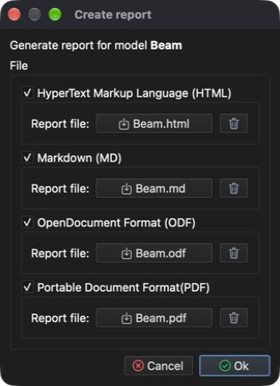

# Analyse des contraintes et des déformations

Ce tutoriel montre comment configurer et résoudre un problème **Stress analysis** (analyse des contraintes). Une poutre simple sera appuyée à ses deux extrémités et chargée en son milieu.

## 1. Charger le modèle

**Menu :** _Fichier -> Ouvrir un modèle_

La boîte de dialogue **Ouvrir un modèle** s'affiche. Sélectionnez le fichier **Beam.rbm** et cliquez sur **Open** (Ouvrir) pour charger le modèle.

Comme aucun problème physique n'est affecté à ce modèle, la boîte de dialogue **Sélectionner le problème** s'affiche peu après la fin du chargement.

Cliquez sur la tuile **Stress analysis** et validez avec **OK**.

## 2. Générer le maillage 3D

Pour résoudre ce problème, un maillage volumique doit être généré.

**Menu :** _Géométrie -> Volume -> Générer un maillage tétraédrique_

Cette action affiche la boîte de dialogue **Générer un maillage 3D**.

Pour l'instant, les valeurs préremplies suffisent. Validez avec le bouton **OK**.

Une fois le maillage généré, une nouvelle entité **Volume** apparaît dans l'**arbre du modèle**. Pour voir le maillage généré, masquez les entités surfaciques, n'affichez que les **Volumes** et cochez **En fil de fer** dans les **Propriétés d'affichage**.

## 3. Affecter le matériau

Un matériau ne peut être affecté qu'à une entité sélectionnée du modèle. Les entités se sélectionnent dans l'**arbre du modèle**. Pour sélectionner plusieurs entités, maintenez la touche _Ctrl_ (_⌘ Cmd_ sous macOS) pendant la sélection, ou la touche _Maj_ pour sélectionner une plage. Une fois toutes les entités sélectionnées, le matériau peut être affecté dans l'onglet **Matériau** à droite de la fenêtre principale.

L'**arbre du modèle** et la **liste des matériaux** sont visibles sur la capture d'écran ci-dessous.

Le matériau est affecté lorsque la case devant son nom est cochée. Dans ce tutoriel, **Iron** (fer) est utilisé.

_Remarque : un matériau doit être affecté à toutes les entités du modèle._

## 4. Affecter les conditions aux limites

Les conditions aux limites sont les valeurs imposées des variables de champ (ou de grandeurs associées telles que les dérivées) sur les frontières du champ. Elles se divisent en conditions **explicites** et **implicites**. Les conditions **explicites** sont mises en évidence en **gras**.

Dans ce tutoriel, les conditions aux limites sont affectées aux entités **surfaciques** comme suit :

1. **Load**
    - _Weight_ (poids)
        - Weight = 1000 `[kg]`
2. **Left** et **Right**
    - _Displacement_ (déplacement)
        - Displacement in X direction = 0 `[m]`
        - Displacement in Y direction = 0 `[m]`
        - Displacement in Z direction = 0 `[m]`

Pour affecter la condition aux limites **Weight** :

1. Sélectionnez l'entité **Load** dans l'**arbre du modèle**.
2. Ouvrez l'onglet **Conditions aux limites**, puis sélectionnez et cochez la condition **Weight**.
3. Remplacez **1** par **1000** `[kg]` dans le champ de valeur de la propriété **Weight**.

Pour affecter la condition aux limites **Displacement** :

1. Sélectionnez les entités **Left** et **Right** dans l'**arbre du modèle** (maintenez _Ctrl_ / _⌘ Cmd_ pour sélectionner les deux).
2. Sélectionnez et cochez la condition **Displacement** dans l'onglet **Conditions aux limites**.
3. Vérifiez que toutes les valeurs des propriétés sont à **0** `[m]`.

## 5. Affecter les conditions d'environnement

Pour que la condition aux limites **Weight** fonctionne correctement, la bonne condition d'environnement **Gravitational acceleration** (accélération de la pesanteur) doit être affectée.

Les conditions d'environnement ne se cochent pas comme les conditions aux limites. Ouvrez l'onglet **Conditions d'environnement** et sélectionnez **Gravitational acceleration** pour vérifier ses valeurs : 0, 0 et -9,80665 `[m/s^2]` dans les directions X, Y et Z.

## 6. Résoudre le problème

Une fois le problème correctement configuré, il peut être résolu.

**Menu :** _Solution -> Démarrer le solveur_

Le modèle doit être enregistré avant que le solveur puisse démarrer. Le modèle **Beam** a été ouvert depuis un fichier, il y est donc enregistré automatiquement ; un modèle jamais enregistré affiche d'abord la boîte de dialogue **Enregistrer le modèle** (cliquez sur **Save** (Enregistrer) et, si un fichier du même nom existe déjà, confirmez son remplacement). La boîte de dialogue **Démarrer le solveur** s'affiche ensuite.

Cliquez sur le bouton **OK** pour lancer le processus du solveur.

Le processus du solveur s'exécute en arrière-plan et toute sa sortie est affichée dans l'onglet **Sortie du processus**, sous la zone 3D, comme on le voit sur la capture d'écran ci-dessous. Le calcul est terminé lorsque la sortie se termine par **SOLVER - END**.

## 7. Afficher les résultats calculés

Une fois le processus du solveur terminé avec succès, les résultats calculés devraient être chargés automatiquement. Pour les afficher, il faut les appliquer aux entités du modèle. Cela se fait dans l'onglet **Résultats**. Les résultats sont affichés sur les entités sélectionnées du modèle. Pour cela, revenez à l'onglet **Modèle** sous la zone 3D, masquez toutes les entités surfaciques, n'affichez que les **Volumes** et sélectionnez **Volume 1** dans l'**arbre du modèle**.

### 7.1. Déplacement

Dans le menu déroulant, sélectionnez **Displacement** (si ce n'est pas déjà fait). **Displacement** est une variable vectorielle ; elle peut être affichée sous forme de **Carte de couleurs** (l'entité est colorée selon la norme du déplacement) et/ou de **Forme déformée** (l'entité se courbe). Cette fois, cochez **Forme déformée** et réglez **Échelle de déformation et des flèches** sur **500** pour voir la déformation.

### 7.2. Contrainte de von Mises

Comme pour **Displacement**, affichez **Von Mises stress** sur l'entité **Volume** sélectionnée : choisissez **Von Mises stress - Scalar** dans le menu déroulant et cochez **Carte de couleurs**. La forme déformée réglée pour **Displacement** reste visible. Cochez en outre **Afficher la légende** pour afficher la plage de valeurs dans la zone 3D.

**Von Mises stress** est calculée sur les éléments, chaque élément est donc dessiné d'une seule couleur. Cochez **Affichage lissé** pour moyenner les valeurs des éléments aux nœuds et obtenir une image continue ; cela ne modifie que l'affichage, pas les résultats.

## 8. Créer un rapport

Il est parfois nécessaire de créer un rapport pour publier les résultats calculés.

**Menu :** _Rapport -> Créer un rapport_

Le logiciel peut produire des rapports dans plusieurs formats (HTML, Markdown, ODF et PDF), tous cochés par défaut. Cette fois, un document **PDF** suffit : décochez tous les formats sauf **Portable Document Format(PDF)** et cliquez sur le bouton **Ok**.

Une fois le rapport créé, le message **Documents have been generated.** (Les documents ont été créés) s'affiche. Fermez-le en cliquant sur **OK**.

Les documents créés ne sont pas affichés automatiquement. Pour les voir, ouvrez l'onglet **Documents** à gauche de la fenêtre principale ; ils y sont listés sous le nom du modèle (**Beam**) : le rapport sous **Documents** et l'image de la zone 3D utilisée dans le rapport sous **Images**. Double-cliquez sur le document à afficher.

