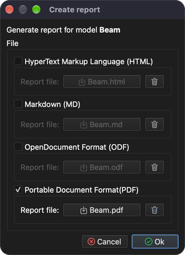

# Analyse des contraintes et des déformations

Ce tutoriel montre comment configurer et résoudre un problème de type **Stress analysis** (analyse des contraintes). Pour cela, une poutre simple est appuyée à ses deux extrémités et chargée en son milieu.

## 1. Charger le modèle

**Menu :** _Fichier -> Ouvrir un modèle_

La fenêtre **Ouvrir un modèle** s'ouvre. Sélectionnez le fichier **Beam.tmsh** et cliquez sur **Ouvrir** pour charger le modèle.

Comme aucun problème physique n'est affecté à ce modèle, la fenêtre **Enchaînement des tâches du problème** apparaît peu après la fin du chargement du modèle.

Cliquez sur le bouton **Ajouter un type de problème** : la fenêtre **Sélecteur de type de problème** s'affiche. Trouvez et cochez **Stress analysis**, puis confirmez avec **OK**.

L'**Enchaînement des tâches du problème** doit maintenant afficher 1 itération de **Stress analysis**. Confirmez avec **OK**.

## 2. Générer le maillage 3D

Pour résoudre ce problème, un maillage volumique doit être généré.

**Menu :** _Géométrie -> Volume -> Générer un maillage tétraédrique_

Cette action ouvre la fenêtre **Générer un maillage 3D**.

Pour l'instant, les valeurs préremplies suffisent. Confirmez avec **OK**.

Une fois le maillage généré, une nouvelle entité **Volume** apparaît dans l'arbre du modèle (onglet **Modèle**). Pour voir le maillage généré, masquez les entités surface, n'affichez que les **Volumes** et cochez **Dessiner en fil de fer** dans les **Propriétés d'affichage**.

## 3. Affecter le matériau

Un matériau ne peut être affecté qu'à une entité du modèle sélectionnée. Les entités se sélectionnent dans l'arbre du modèle. Pour sélectionner plusieurs entités, maintenez la touche _Ctrl_ (_⌘ Cmd_ sous macOS) enfoncée pendant la sélection, ou maintenez la touche _Maj_ pour sélectionner une plage. Une fois toutes les entités sélectionnées, le matériau peut être affecté dans l'onglet **Matériau**, sur le côté droit de la fenêtre principale.

L'arbre **Modèle** et la liste des matériaux sont visibles sur la capture d'écran ci-dessous.

Le matériau est affecté lorsque la case devant son nom est cochée. Dans ce tutoriel, on utilise **Iron** (fer).

_Remarque : un matériau doit être affecté à toutes les entités du modèle._

## 4. Affecter les conditions aux limites

Les conditions aux limites sont les valeurs imposées des variables de champ (ou de grandeurs associées comme les dérivées) sur les frontières du champ. Les conditions aux limites se divisent en conditions **explicites** et **implicites**. Les conditions **explicites** sont mises en évidence en **gras**.

Dans ce tutoriel, les conditions aux limites sont appliquées aux entités **surface** comme décrit ci-dessous :

1. **Load**
    - _Weight_ (poids)
        - Weight = 1000 `[kg]`
2. **Left** et **Right**
    - _Displacement_ (déplacement)
        - Displacement in X direction = 0 `[m]`
        - Displacement in Y direction = 0 `[m]`
        - Displacement in Z direction = 0 `[m]`

Pour appliquer la condition aux limites **Weight**, procédez comme suit :

1. Sélectionnez l'entité **Load** dans l'arbre du modèle.
2. Ouvrez l'onglet **Conditions aux limites**, puis sélectionnez et cochez la condition aux limites **Weight**.
3. Dans le champ de valeur de la propriété **Weight**, remplacez **1** par **1000** `[kg]`.

Pour appliquer la condition aux limites **Displacement**, procédez comme suit :

1. Sélectionnez les entités **Left** et **Right** dans l'arbre du modèle (maintenez _Ctrl_ / _⌘ Cmd_ enfoncée pour sélectionner les deux).
2. Sélectionnez et cochez la condition aux limites **Displacement** dans l'onglet **Conditions aux limites**.
3. Vérifiez que toutes les valeurs des propriétés sont réglées sur **0** `[m]`.

## 5. Affecter les conditions d'environnement

Pour que la condition aux limites **Weight** fonctionne correctement, la condition d'environnement **Gravitational acceleration** (accélération de la pesanteur) doit être correctement définie.

Les conditions d'environnement ne se cochent pas comme les conditions aux limites. Ouvrez l'onglet **Conditions d'environnement** et sélectionnez **Gravitational acceleration** pour vérifier ses valeurs : 0, 0 et -9.80665 `[m/s^2]` dans les directions X, Y et Z.

## 6. Résoudre le problème

Une fois le problème correctement configuré, il peut être résolu.

**Menu :** _Solution -> Démarrer le solveur_

Le modèle doit être enregistré avant de pouvoir démarrer le solveur. S'il n'a pas encore été enregistré, la fenêtre **Enregistrer le modèle** s'affiche d'abord ; confirmez avec **Enregistrer** (si un fichier du même nom existe déjà, confirmez son remplacement). La fenêtre **Démarrer le solveur pour le modèle** s'affiche ensuite.

Cliquez sur **OK** pour lancer le processus du solveur.

Le processus du solveur s'exécute en arrière-plan et toute sa sortie est affichée dans l'onglet **Sortie du processus**, comme on peut le voir sur la capture d'écran ci-dessous.

## 7. Appliquer les résultats calculés

Une fois le processus du solveur terminé avec succès, les résultats calculés doivent être chargés automatiquement. Pour les afficher, il faut les appliquer aux entités du modèle. Cela se fait dans l'onglet **Résultats**. Les résultats sont appliqués aux entités du modèle sélectionnées. Pour cela, masquez toutes les entités surface et n'affichez que les **Volumes**.

### 7.1. Déplacement

Dans le menu déroulant, choisissez **Displacement** (s'il n'est pas déjà sélectionné). **Displacement** est une variable vectorielle ; elle peut être appliquée comme **Scalar** (l'entité est colorée selon la norme) et/ou comme **Displacement** (l'entité se déforme). Cette fois, cochez la case **Displacement** et réglez l'**Échelle** sur **500** pour voir la déformation.

### 7.2. Contrainte de von Mises

De la même manière que **Displacement**, appliquez **Von Mises Stress** (contrainte de von Mises) à l'entité **Volume** sélectionnée. Cochez en outre la case **Afficher la plage de valeurs** pour afficher la plage de valeurs dans la zone 3D.

## 8. Produire un rapport

Il est parfois nécessaire de produire un rapport pour publier les résultats calculés.

**Menu :** _Rapport -> Créer un rapport_

Le logiciel peut produire des rapports dans plusieurs formats (HTML, Markdown, ODF et PDF), tous cochés par défaut. Cette fois, un document **PDF** suffit ; décochez donc tous les formats sauf **Portable Document Format(PDF)** et cliquez sur **Ok**.

Une fois le rapport généré, le message **Documents have been generated.** (documents générés) s'affiche. Fermez-le avec **OK**.

Les documents générés ne s'affichent pas automatiquement. Pour cela, allez dans l'arbre **Documents** et double-cliquez sur le document que vous souhaitez afficher.

