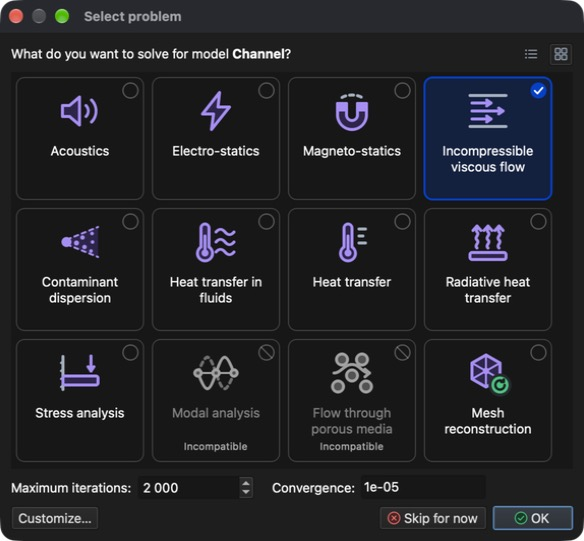
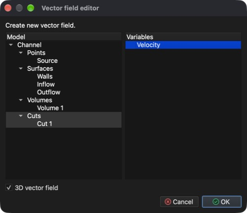
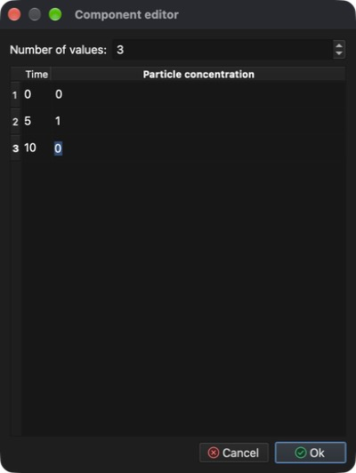
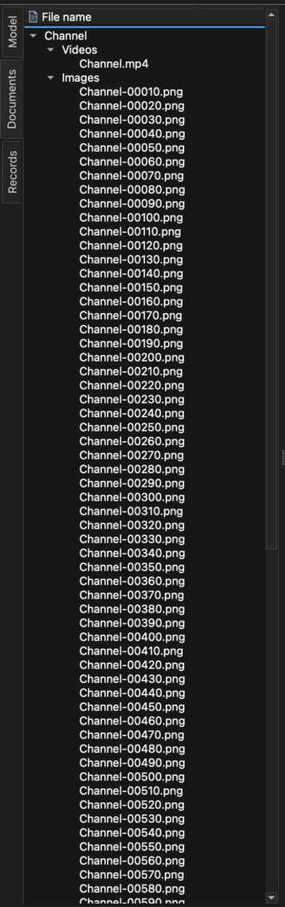

# Dispersione di contaminanti nei fluidi

Questo tutorial mostra come impostare e risolvere una simulazione multifisica che combina un problema non lineare e iterativo – la **CFD (Computational Fluid Dynamics, fluidodinamica computazionale)** – con il trasporto di un contaminante trascinato dal flusso.

Sono necessari due tipi di problema:

1. **Incompressible viscous flow** (flusso viscoso incomprimibile) – calcola la velocità e la pressione del fluido (flusso stazionario o transitorio di fluidi newtoniani).
2. **Contaminant dispersion** (dispersione di contaminante) – calcola come un contaminante si diffonde in quel campo di flusso.

Poiché il problema di flusso è non lineare, viene risolto in modo iterativo. La simulazione si svolge quindi in due fasi:

1. **Flusso stazionario** – prima si calcolano, senza contaminante, un campo di flusso «iniziale» convergente e la distribuzione della pressione.
2. **Simulazione transitoria** – poi, partendo da quel campo di flusso, si usa l'**avanzamento nel tempo** per seguire come un impulso di contaminante che entra nel canale viene trasportato al suo interno.

## 1. Caricare il modello

**Menu:** _File -> Apri modello_

Nella finestra di dialogo **Apri modello** selezionare **Channel.rbm** e fare clic su **Open** (Apri).

Il modello è composto da un'entità punto – **Source** – e da tre entità superficie – **Walls**, **Inflow** e **Outflow**. Poiché al modello non è ancora assegnato alcun tipo di problema, la finestra di dialogo **Seleziona problema** si apre automaticamente al termine del caricamento.

## 2. Selezionare il problema (fase 1 – flusso stazionario)

Nella prima fase si risolve solo il flusso, con molte iterazioni non lineari affinché possa convergere.

1. Nella finestra di dialogo **Seleziona problema** fare clic sul riquadro **Incompressible viscous flow**.
2. Lasciare **Iterazioni massime** a **2000** e **Convergenza** a **1e-05**, che sono i valori predefiniti per un flusso stazionario.
3. Chiudere la finestra con **OK**.

La finestra di dialogo può essere riaperta in qualsiasi momento con il pulsante **Seleziona problema** della barra degli strumenti.

## 3. Generare la mesh di volume

Il modello è definito solo dalle sue superfici. Per risolvere un flusso al suo interno occorre prima generare una mesh di volume (tetraedrica).

**Menu:** _Geometria -> Volume -> Genera mesh tetraedrica_

I valori precompilati nella finestra di dialogo **Genera mesh 3D** sono sufficienti. Fare clic su **OK**. Al termine della generazione, nell'**albero del modello** appare una nuova entità **Volume 1** sotto **Volumi**.

## 4. Assegnare il materiale

A tutte le entità del modello deve essere assegnato un materiale.

1. Nell'**albero del modello** espandere **Volumi**, fare clic su **Source** e poi fare clic su **Volume 1** tenendo premuto _Maiusc_ per selezionare tutte le entità.
2. Aprire la scheda **Materiale** sul lato destro della finestra principale.
3. Selezionare **Water** (acqua; si trova alla fine dell'elenco).

## 5. Condizioni al contorno (fase 1)

Le condizioni al contorno si assegnano nella scheda **Condizioni al contorno** all'entità selezionata nell'**albero del modello**. Assegnare le seguenti condizioni alle entità **superficie**:

1. **Walls**
    - _Wall_ (parete; nessun valore necessario)
2. **Inflow**
    - _Volumetric flow rate (inflow)_ (portata volumetrica, ingresso)
        - Volumetric flow rate = 50 `[m^3/s]`
3. **Outflow**
    - _Pressure (implicit)_ (pressione, implicita)
        - Pressure = 0 `[Pa]` (il valore predefinito è 1000 `[Pa]`)

Per ogni entità: selezionarla nell'**albero del modello**, spuntare la condizione nella scheda **Condizioni al contorno**, selezionare la condizione per mostrarne le proprietà sotto l'elenco, quindi fare doppio clic sul valore, digitare quello nuovo e premere _Invio_.

## 6. Risolvere il flusso stazionario

**Menu:** _Soluzione -> Avvia solutore_

Il modello **Channel** è stato aperto da un file, quindi viene salvato automaticamente in esso. Fare clic su **OK** nella finestra di dialogo **Avvia solutore**. Se la finestra elenca un errore come **Entity Source has no material assigned.**, il pulsante **OK** è disattivato; assegnare prima il materiale a quell'entità.

Il solutore viene eseguito in background e il suo output è mostrato nella scheda **Output del processo**. Il calcolo di tutte le 2000 iterazioni richiede alcuni minuti; è terminato quando l'output finisce con **SOLVER - END**. La convergenza della soluzione può essere verificata in qualsiasi momento con:

**Menu:** _Report -> Convergenza del solutore_

## 7. Creare una sezione

Un buon modo per esaminare un flusso è mostrare la velocità come **campo vettoriale**, in cui ogni freccia indica direzione e modulo del flusso in un punto. Un campo vettoriale disegnato in tutto il volume diventa però rapidamente una nuvola densa di frecce sovrapposte, difficile da leggere. Di solito è più chiaro tagliare prima il modello con una **sezione** – un piano che attraversa il volume – e mostrare il campo vettoriale solo su quel piano.

_Suggerimento: prima di iniziare selezionare **Volumi** nell'**albero del modello**, in modo che il volume sia visibile mentre si posiziona la sezione._

**Menu:** _Geometria -> Sezione -> Crea sezione_

Nella finestra di dialogo **Editor della sezione**:

1. Selezionare **Volume 1** nell'elenco **Modello**. La sezione verrà creata attraverso questo volume.
2. **Posizione del piano** definisce un punto per cui passa il piano di sezione. I valori predefiniti lo pongono al centro del modello (**X** = 7,5, **Y** = 2,5, **Z** = 1,5 `[m]`); mantenerli.
3. **Normale del piano** definisce l'orientamento del piano. La normale predefinita (**X** = 1) dà un piano verticale; cambiarla in **X** = 0, **Y** = 0, **Z** = 1 per ottenere un piano orizzontale che taglia il canale a metà altezza. Spostarsi tra i campi con _Tab_: premere _Invio_ conferma l'intera finestra di dialogo.

Il piano di sezione viene mostrato in anteprima nell'**area 3D del modello** mentre si modificano i valori. Fare clic su **OK** per creare la sezione. Nell'**albero del modello** appare una nuova entità **Cut 1** sotto **Sezioni**.

## 8. Creare un campo vettoriale

Ora mostrare la velocità calcolata come frecce sul piano di sezione.

**Menu:** _Geometria -> Campo vettoriale -> Crea campo vettoriale_

Nella finestra di dialogo **Editor del campo vettoriale**:

1. Selezionare **Cut 1** nell'elenco **Modello**. Le frecce verranno disegnate sul piano di sezione creato nel passo precedente.
2. Selezionare **Velocity** (velocità) nell'elenco **Variabili**.
3. Lasciare selezionato **Campo vettoriale 3D**. Le frecce mostrano allora il vettore velocità completo. Se deselezionato, ogni freccia viene proiettata sul piano di sezione e viene mostrata solo la componente del flusso nel piano.

Fare clic su **OK** per creare il campo vettoriale. Appare nell'**albero del modello** sotto **Campi vettoriali** con il nome **Velocity**. Deselezionare **Volumi** in modo che il volume pieno non nasconda le frecce e selezionare **Campi vettoriali**.

Le frecce possono essere troppo corte per essere ben visibili, perché la loro lunghezza è proporzionale alla velocità del flusso. Per allungarle, selezionare il campo vettoriale nell'**albero del modello**, aprire la scheda **Risultati** e aumentare il valore nella sezione **Scala di deformazione e frecce**, ad esempio a **100**. Digitare il valore o trascinare il cursore accanto.

## 9. Selezionare il problema (fase 2 – transitoria)

Con un campo di flusso convergente disponibile, si può impostare la simulazione **transitoria** che include **Contaminant dispersion**.

In una simulazione transitoria i problemi vengono risolti una volta per passo temporale. **Incompressible viscous flow** resta non lineare, quindi necessita di proprie iterazioni non lineari a ogni passo temporale, mentre **Contaminant dispersion** viene risolto una volta per passo temporale dopo il flusso. Riaprire la finestra di dialogo **Seleziona problema** (pulsante **Seleziona problema** della barra degli strumenti) e impostarla come segue:

1. Fare clic sul riquadro **Contaminant dispersion** (**Incompressible viscous flow** resta selezionato ed è contrassegnato come **Richiesto**), quindi fare clic su **Personalizza…** per mostrare il flusso delle attività.
2. Selezionare **Incompressible viscous flow** e fare clic sul pulsante **>**. In questo modo viene spostato in un nuovo gruppo di iterazioni annidato.
3. Fare doppio clic sul valore del **# of iterations:** esterno e cambiarlo da **2000** a **1**. Poi cambiare il **# of iterations:** interno (annidato) da **1** a **10**.

Confermare con **OK**.

## 10. Impostazione del solutore temporale

Aprire la scheda **Problema** sul lato destro della finestra principale e impostare (spostarsi tra i campi con _Tab_):

1. Selezionare **Solutore temporale**.
2. **Approssimazione**: **Backward difference (stable)** (differenza all'indietro, stabile).
3. **Dimensione del passo temporale**: **0,01** `[s]`.
4. **Numero di passi temporali**: **2000**.
5. **Frequenza di output**: **10** – un record dei risultati viene scritto ogni 10 passi temporali.

Il **Tempo finale** viene calcolato automaticamente (2000 × 0,01 s = 20 s).

Nella sezione **Impostazioni della dispersione di contaminanti** impostare **Maximum saturation** a **2,4** `[kg/m^3]` e **Diffusion coefficient** a **0,01** `[m^2/s]`. Per maggiori informazioni consultare il manuale di teoria.

## 11. Condizioni al contorno (fase 2)

Il contaminante entra nel canale dall'ingresso. Selezionare **Inflow** nell'**albero del modello** e nella scheda **Condizioni al contorno** spuntare **Particle concentration** (concentrazione di particelle; lasciare spuntato **Volumetric flow rate (inflow)**).

Invece di un valore costante verrà usato un valore dipendente dal tempo. Espandere la proprietà **Particle concentration** (freccia davanti al nome) e fare clic su **Modifica valori dipendenti dal tempo**.

Nella finestra di dialogo **Editor dei componenti** impostare **Numero di valori** a **3** e inserire i valori seguenti (fare doppio clic su una cella per modificarla), quindi fare clic su **Ok**.

| Tempo `[s]` | Particle concentration `[kg/m^3]` |
| ----------- | --------------------------------- |
| 0           | 0                                 |
| 5           | 1                                 |
| 10          | 0                                 |

Tra due istanti specificati il valore viene interpolato linearmente e, dopo l'ultimo istante specificato, viene mantenuto l'ultimo valore. Con questi valori la concentrazione in ingresso sale da 0 a 1 `[kg/m^3]` nei primi 5 secondi e torna a 0 tra 5 e 10 secondi.

## 12. Risolvere il problema transitorio (riavvio)

**Menu:** _Soluzione -> Avvia solutore_

Nella finestra di dialogo **Avvia solutore** selezionare **Riavvia solutore / continua** e fare clic su **OK**. Il solutore usa allora il flusso stazionario già calcolato come punto di partenza e prosegue con la simulazione di avanzamento nel tempo.

L'avviso **Contaminant dispersion: No implicit boundary condition assigned.** è previsto e può essere ignorato.

## 13. Visualizzare i risultati durante il calcolo

Il solutore transitorio viene eseguito in background, quindi i risultati possono essere esaminati mentre il calcolo è ancora in corso. Non appena vengono scritti i primi record, sul lato sinistro della finestra principale appare la scheda **Record**. I risultati del calcolo transitorio vengono mostrati solo dopo aver caricato un record: aprire la scheda **Record**, fare doppio clic sul record più recente e tornare alla scheda **Modello** (vedere il passo 14 per maggiori informazioni sui record). Altre entità di visualizzazione come sezioni, ISO, linee di flusso, campi vettoriali o scalari possono essere create in qualsiasi momento e i risultati calcolati possono esservi visualizzati. Qui vengono riutilizzati la sezione e il campo vettoriale dei passi 7 e 8.

### 13.1 Concentrazione del contaminante sulla sezione

1. Nell'**albero del modello** espandere **Sezioni**, spuntare **Cut 1** in modo che sia visibile e selezionarla.
2. Aprire la scheda **Risultati** e scegliere **Particle concentration - Scalar** nel menu a discesa in alto. Se l'elenco offre solo **Velocity** e **Pressure**, non è ancora stato caricato alcun record del calcolo transitorio.
3. In **Mostra sulle entità selezionate** selezionare **Mappa colori**. La sezione è ora colorata in base alla concentrazione del contaminante.
4. In **Intervallo colori** impostare **Max** a **1** e **Min** a **0** (digitare il valore e premere _Invio_). Ciò corrisponde all'intervallo della concentrazione in ingresso, quindi gli stessi colori indicano la stessa concentrazione in ogni passo temporale.
5. Selezionare **Mostra legenda** per mostrare la scala dei colori nell'**area 3D del modello**.

### 13.2 Frecce del campo vettoriale

Per leggere meglio la direzione del flusso sulla sezione colorata, disegnare le frecce con le punte e in bianco:

1. Selezionare **Campi vettoriali** e selezionare il campo vettoriale (**Velocity** sotto **Campi vettoriali**) nell'**albero del modello**.
2. Nelle **Proprietà di visualizzazione** sotto l'albero selezionare **Punte delle frecce**.
3. Fare clic sul selettore di colore sotto le caselle e scegliere il bianco (**#ffffffff**).

Le altre proprietà di visualizzazione determinano se tutte le frecce hanno la stessa lunghezza (**Frecce di uguale lunghezza**) e se le frecce partono dal punto in cui viene valutata la velocità (**Frecce uscenti dal punto**).

## 14. Record del modello (risultati nel tempo)

Ogni 10 passi temporali (la **Frequenza di output**) il solutore scrive un record del modello contenente la soluzione per quell'istante. I record sono elencati nella scheda **Record** sul lato sinistro della finestra principale; la colonna **Record** mostra il numero del passo temporale (il record **500** contiene la soluzione all'istante 500 × 0,01 s = 5 s). Fare doppio clic su un record per caricare i risultati del suo passo temporale; il record caricato è contrassegnato da una freccia e i risultati applicati nella scheda **Risultati** vengono mantenuti e ridisegnati per esso. La legenda nell'**area 3D del modello** mostra il passo temporale e l'istante del record caricato (ad es. **Time-step 520 · 5,19 s**). I pulsanti in basso nella scheda riproducono i record uno dopo l'altro.

Il calcolo di tutti i 2000 passi temporali richiede un po' di tempo (circa 20 minuti su un computer attuale). Il solutore può essere arrestato in qualsiasi momento e i record scritti fino a quel momento vengono mantenuti:

**Menu:** _Soluzione -> Arresta solutore_ (confermare con **Yes** (Sì))

Quando il solutore si arresta, viene caricato l'ultimo record scritto.

## 15. Registrare un video

Un video viene creato da ciò che è attualmente mostrato nell'**area 3D del modello**, quindi impostare prima la vista e i risultati visualizzati (vedere il passo 13). Le impostazioni di visualizzazione non vengono salvate con il modello e devono essere reimpostate dopo averlo riaperto. Aprire poi la scheda **Record**, scegliere l'intervallo di record con i campi **Da** e **A** in basso e fare clic sul pulsante rosso di registrazione.

Appare la finestra di dialogo **Impostazioni video**, in cui si possono impostare codec video, formato file, fotogrammi al secondo e fotogrammi per record; sotto vengono mostrati la durata stimata del video e il numero di record. Con 98 record (il solutore è stato arrestato a circa 9,8 s), 24 fotogrammi al secondo e 1 fotogramma per record il video dura circa 4,1 secondi; tutti i 200 record di un calcolo completo danno circa 8,3 secondi. Fare clic su **OK** per avviare la registrazione.

La registrazione può richiedere un po' di tempo, perché ogni record del modello viene caricato a turno e una schermata dell'**area 3D del modello** viene acquisita come fotogramma del video.

Il video e tutti i fotogrammi (un'immagine PNG per record) si trovano nella scheda **Documenti** sotto **Channel**: il video **Channel.mp4** sotto **Video** e i fotogrammi sotto **Immagini**. Fare doppio clic sul video per riprodurlo.

