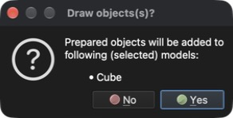

# Disegnare un cubo

Questo tutorial mostra come disegnare (generare) una geometria semplice, ad esempio un cubo.

## 1. Creare un nuovo modello

**Menu:** _File -> Nuovo modello_

Inserire **Cube** come nome del modello (la descrizione è facoltativa) e fare clic su **OK**. Viene creato un nuovo modello vuoto chiamato **Cube**. Poiché al modello appena creato non è assegnato alcun problema, viene mostrata la finestra di dialogo **Seleziona problema**.

### 1.1 Assegnare il tipo di problema

Per assegnare un tipo di problema fare clic sul riquadro **Heat transfer** e poi sul pulsante **OK**.

## 2. Disegnare un cubo

**Menu:** _Geometria -> Disegna -> Disegna esaedro_

Una volta attivata la voce di menu, sul lato destro della finestra principale viene mostrato il pannello **Disegna oggetto**, in cui si possono modificare la posizione e le dimensioni dell'oggetto e il numero di suddivisioni nelle direzioni X, Y e Z. L'oggetto predefinito è un cubo con lato di 1 `[m]` posto nell'origine.

L'oggetto visualizzato cambia contemporaneamente ai valori modificati nel pannello **Disegna oggetto**. Lasciare selezionato **Unisci nodi vicini** e fare clic sul pulsante **OK** per aggiungere l'oggetto al modello. Viene mostrata una finestra di conferma **Draw objects(s)?** con l'elenco dei modelli selezionati a cui l'oggetto verrà aggiunto.

Fare clic su **Yes** (Sì) per confermare: il cubo viene aggiunto al modello **Cube** come un'unica entità **Superficie**.

## 3. Salvare il modello

Per salvare il modello eseguire la seguente azione.

**Menu:** _File -> Salva modello_

Se il modello non è mai stato salvato, il programma mostra la finestra di dialogo **Salva modello** con un nome di file proposto (**Cube.rbm**) e una cartella in cui salvarlo. Fare clic su **Save** (Salva) per confermare.
