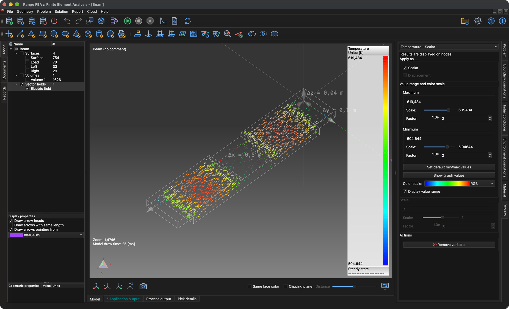

# Multifisica

Questo tutorial mostra come risolvere più problemi accoppiati su un unico modello. Si usa di nuovo il modello **Beam** del tutorial **Analisi delle tensioni e delle deformazioni**. Questa volta nella trave scorre una corrente elettrica, la corrente riscalda la trave (effetto Joule) e il calore fa dilatare e deformare la trave.

Sono necessari tre tipi di problema, risolti in questo ordine:

1. **Electro-statics** (elettrostatica) – calcola il potenziale elettrico, il campo elettrico, la densità di corrente e il calore Joule prodotto dalla corrente.
2. **Heat transfer** (trasmissione del calore) – calcola la distribuzione di temperatura causata dal calore Joule.
3. **Stress analysis** (analisi delle tensioni) – calcola la dilatazione termica (spostamenti) e la tensione che ne risulta.

Ogni problema usa i risultati del precedente, quindi l'ordine dei problemi è importante.

## 1. Caricare il modello

**Menu:** _File -> Apri modello_

Nella finestra **Apri modello** seleziona **Beam.tmsh** e fai clic su **Apri**.

Poiché al modello non è ancora assegnato alcun tipo di problema, al termine del caricamento si apre automaticamente la finestra **Flusso dei task del problema**.

## 2. Flusso dei task del problema

1. Nella finestra **Flusso dei task del problema** fai clic su **Aggiungi tipo di problema**.
2. Nel **Selettore del tipo di problema** attiva **Electro-statics**, **Heat transfer** e **Stress analysis** e fai clic su **OK**.

Il **Flusso dei task del problema** dovrebbe ora elencare i tre problemi in un unico gruppo di iterazioni, nell'ordine mostrato sotto. Se l'ordine è diverso o ci sono voci in più, seleziona una voce e correggila con i pulsanti **Su**, **Giù** e **Rimuovi**. Conferma con **OK**.

La finestra può essere riaperta in qualsiasi momento con il pulsante **Flusso dei task dei problemi** della barra degli strumenti.

## 3. Generare la mesh 3D

Tutti e tre i problemi vengono risolti su una mesh di volume.

**Menu:** _Geometria -> Volume -> Genera mesh tetraedrica_

I valori precompilati nella finestra **Genera mesh 3D** sono sufficienti. Fai clic su **OK**. Al termine della generazione della mesh, nell'albero **Modello** sotto **Volumi** compare una nuova entità **Volume 1**.

## 4. Assegnare il materiale

A tutte le entità del modello deve essere assegnato un materiale. Il materiale deve fornire le proprietà richieste da tutti e tre i problemi; **Iron** (ferro) le fornisce.

1. Nell'albero **Modello** fai clic su **Surface** e poi, tenendo premuto _Maiusc_, fai clic su **Volume 1** per selezionare tutte le entità.
2. Apri la scheda **Materiale** sul lato destro della finestra principale.
3. Attiva **Iron**.

## 5. Assegnare le condizioni al contorno

Poiché sono selezionati più tipi di problema, la scheda **Condizioni al contorno** offre ora le condizioni di tutti, e a un'entità possono essere assegnate più condizioni – una per ogni problema. Assegna alle entità **superficie** le condizioni seguenti:

1. **Surface** (la superficie esterna della trave)
    - _Simple convection_ (convezione semplice)
        - Convection coefficient = 100 `[W/(m^2*K)]`
        - Fluid temperature = 293.15 `[K]`
2. **Load** (la faccia al centro della trave)
    - _Electric potential_ (potenziale elettrico)
        - Electric potential = 0.4 `[V]`
    - _Simple convection_ (valori come per **Surface**)
3. **Left** e **Right** (le facce alle due estremità della trave)
    - _Displacement_ (spostamento)
        - Displacement in X, Y and Z direction = 0 `[m]`
    - _Electric potential_
        - Electric potential = -0.4 `[V]`
    - _Simple convection_ (valori come per **Surface**)

La corrente scorre quindi dal centro della trave verso entrambe le estremità, e tutte le facce cedono calore all'aria circostante per convezione.

Per ogni entità: selezionala nell'albero **Modello** (tieni premuto _Ctrl_ / _⌘ Cmd_ per selezionare insieme **Left** e **Right**), attiva la condizione nella scheda **Condizioni al contorno**, seleziona la condizione per mostrarne le proprietà sotto l'elenco, poi fai doppio clic sul valore, digita quello nuovo e premi _Invio_. I valori predefiniti di **Simple convection** (100 `[W/(m^2*K)]` e 293.15 `[K]`) e di **Displacement** (0 `[m]`) sono già corretti, quindi va modificato solo **Electric potential**.

## 6. Verificare le condizioni ambientali

Le condizioni ambientali valgono per l'intero modello e non si attivano come le condizioni al contorno. Apri la scheda **Condizioni ambientali** e seleziona ogni condizione per verificarne i valori:

- _Gravitational acceleration_ (accelerazione di gravità)
    - 0, 0 e -9.80665 `[m/s^2]` in direzione X, Y e Z
- _Temperature_ (temperatura)
    - Temperature = 293.15 `[K]`

## 7. Risolvere il problema

**Menu:** _Soluzione -> Avvia solutore_

Il modello deve essere salvato prima di poter avviare il solutore. Se non è ancora stato salvato, viene mostrata prima la finestra **Salva modello**; conferma con **Salva** (se esiste già un file con lo stesso nome, conferma la sostituzione). Poi viene mostrata la finestra **Avvia solutore per il modello**.

La finestra elenca alcuni avvisi, come **Heat transfer: No explicit boundary condition assigned.** Sono previsti per questa configurazione e possono essere ignorati. Fai clic su **OK** per avviare il solutore.

Il solutore viene eseguito in background e il suo output è mostrato nella scheda **Output del processo**. I problemi vengono risolti uno dopo l'altro nell'ordine del flusso dei task; l'esecuzione è terminata quando l'output si conclude con **SOLVER - END**.

## 8. Creare un campo vettoriale

Un **campo vettoriale** è un'entità di visualizzazione che disegna una variabile vettoriale come frecce. Qui serve a mostrare il campo elettrico all'interno della trave.

**Menu:** _Geometria -> Campo vettoriale -> Crea campo vettoriale_

Nella finestra **Editor del campo vettoriale** seleziona **Volume 1** nell'elenco **Modello** ed **Electric field** (campo elettrico) nell'elenco **Variabili**, e lascia attivo **Campo vettoriale 3D**.

Fai clic su **OK** per creare il campo vettoriale. Viene aggiunto all'albero **Modello** sotto **Campi vettoriali**, e i risultati calcolati possono essere applicati a esso come a qualsiasi altra entità del modello.

## 9. Applicare i risultati

I risultati si applicano nella scheda **Risultati** all'entità selezionata nell'albero **Modello**, come nel tutorial **Analisi delle tensioni e delle deformazioni**.

### 9.1. Temperatura e deformazione del volume

1. Nell'albero **Modello** attiva **Volumi** (lasciando disattivate le superfici), poi seleziona **Volume 1**.
2. Nella scheda **Risultati** scegli **Temperature - Scalar** nell'elenco a discesa, attiva **Scalar** e **Mostra intervallo di valori**. Se l'intervallo mostrato non corrisponde ai risultati, fai clic su **Imposta valori min/max predefiniti**.
3. Scegli **Displacement - Vector [3]** nell'elenco a discesa, attiva **Displacement** e imposta **Scala** a **20** in modo che la deformazione sia visibile (gli spostamenti calcolati sono solo di circa 1.3 mm).

La temperatura varia da circa 505 K a 620 K; la trave è più calda al centro dei suoi due tratti esterni e si inflette verso l'alto perché le estremità vincolate non le permettono di dilatarsi liberamente.

### 9.2. Temperatura sul campo vettoriale

1. Nell'albero **Modello** disattiva **Volumi**, attiva **Campi vettoriali** e seleziona **Electric field**.
2. Nella scheda **Risultati** scegli **Temperature - Scalar**, attiva **Scalar** e **Mostra intervallo di valori**. Le frecce vengono ora colorate in base alla temperatura nella loro posizione.
3. In **Proprietà di visualizzazione** sotto l'albero attiva **Disegna punte delle frecce** per mostrare la direzione del campo elettrico.

