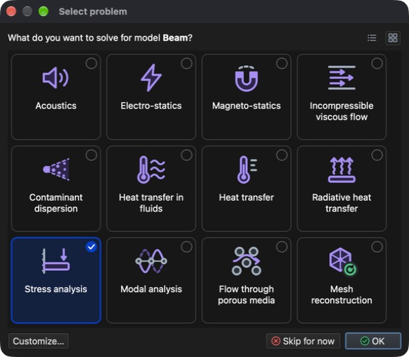
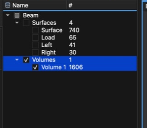
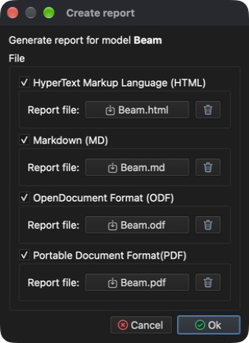

# Analisi delle tensioni e delle deformazioni

Questo tutorial mostra come impostare e risolvere un problema **Stress analysis** (analisi delle tensioni). A tale scopo una semplice trave verrà appoggiata alle due estremità e caricata al centro.

## 1. Caricare il modello

**Menu:** _File -> Apri modello_

Viene mostrata la finestra di dialogo **Apri modello**. Selezionare il file **Beam.rbm** e fare clic su **Open** (Apri) per caricare il modello.

Poiché a questo modello non è assegnato alcun problema fisico, poco dopo il termine del caricamento appare la finestra di dialogo **Seleziona problema**.

Fare clic sul riquadro **Stress analysis** e confermare con **OK**.

## 2. Generare la mesh 3D

Per risolvere questo problema occorre generare una mesh di volume.

**Menu:** _Geometria -> Volume -> Genera mesh tetraedrica_

Questa azione mostra la finestra di dialogo **Genera mesh 3D**.

Per ora sono sufficienti i valori precompilati. Confermare con il pulsante **OK**.

Una volta generata la mesh, nell'**albero del modello** appare una nuova entità **Volume**. Per vedere la mesh generata, nascondere le entità superficie, mostrare solo i **Volumi** e selezionare **Come wireframe** nelle **Proprietà di visualizzazione**.

## 3. Assegnare il materiale

Il materiale può essere assegnato solo a un'entità del modello selezionata. Le entità si selezionano nell'**albero del modello**. Per selezionare più entità, tenere premuto il tasto _Ctrl_ (_⌘ Cmd_ su macOS) durante la selezione, oppure il tasto _Maiusc_ per selezionare un intervallo. Una volta selezionate tutte le entità, il materiale può essere assegnato nella scheda **Materiale** sul lato destro della finestra principale.

L'**albero del modello** e l'**elenco dei materiali** sono visibili nella schermata seguente.

Il materiale è assegnato quando la casella davanti al suo nome è selezionata. In questo tutorial si usa **Iron** (ferro).

_Nota: a tutte le entità del modello deve essere assegnato un materiale._

## 4. Assegnare le condizioni al contorno

Le condizioni al contorno sono i valori prescritti delle variabili di campo (o di grandezze correlate come le derivate) sui contorni del campo. Si dividono in condizioni **esplicite** e **implicite**. Le condizioni **esplicite** sono evidenziate in **grassetto**.

In questo tutorial le condizioni al contorno vengono assegnate alle entità **superficie** come descritto di seguito:

1. **Load**
    - _Weight_ (peso)
        - Weight = 1000 `[kg]`
2. **Left** e **Right**
    - _Displacement_ (spostamento)
        - Displacement in X direction = 0 `[m]`
        - Displacement in Y direction = 0 `[m]`
        - Displacement in Z direction = 0 `[m]`

Per assegnare la condizione al contorno **Weight** seguire questi passi:

1. Selezionare l'entità **Load** nell'**albero del modello**.
2. Aprire la scheda **Condizioni al contorno**, quindi selezionare e spuntare la condizione **Weight**.
3. Sostituire **1** con **1000** `[kg]` nel campo valore della proprietà **Weight**.

Per assegnare la condizione al contorno **Displacement** seguire questi passi:

1. Selezionare le entità **Left** e **Right** nell'**albero del modello** (tenere premuto _Ctrl_ / _⌘ Cmd_ per selezionarle entrambe).
2. Selezionare e spuntare la condizione **Displacement** nella scheda **Condizioni al contorno**.
3. Verificare che tutti i valori delle proprietà siano impostati a **0** `[m]`.

## 5. Assegnare le condizioni ambientali

Affinché la condizione al contorno **Weight** funzioni correttamente, deve essere assegnata la corretta condizione ambientale **Gravitational acceleration** (accelerazione di gravità).

Le condizioni ambientali non si spuntano come le condizioni al contorno. Aprire la scheda **Condizioni ambientali** e selezionare **Gravitational acceleration** per verificarne i valori: 0, 0 e -9,80665 `[m/s^2]` nelle direzioni X, Y e Z.

## 6. Risolvere il problema

Una volta impostato correttamente, il problema può essere risolto.

**Menu:** _Soluzione -> Avvia solutore_

Il modello deve essere salvato prima che il solutore possa essere avviato. Il modello **Beam** è stato aperto da un file, quindi viene salvato automaticamente in esso; un modello mai salvato mostra prima la finestra di dialogo **Salva modello** (fare clic su **Save** (Salva) e, se esiste già un file con lo stesso nome, confermarne la sostituzione). Viene poi mostrata la finestra di dialogo **Avvia solutore**.

Fare clic sul pulsante **OK** per avviare il processo del solutore.

Il processo del solutore viene eseguito in background e tutto il suo output è mostrato nella scheda **Output del processo** sotto l'area 3D, come si vede nella schermata seguente. Il calcolo è terminato quando l'output finisce con **SOLVER - END**.

## 7. Visualizzare i risultati calcolati

Al termine corretto del processo del solutore, i risultati calcolati dovrebbero essere caricati automaticamente. Per visualizzarli occorre applicarli alle entità del modello. Ciò si fa nella scheda **Risultati**. I risultati vengono visualizzati sulle entità del modello selezionate. A tale scopo tornare alla scheda **Modello** sotto l'area 3D, nascondere tutte le entità superficie, mostrare solo i **Volumi** e selezionare **Volume 1** nell'**albero del modello**.

### 7.1. Spostamento

Nel menu a discesa selezionare **Displacement** (se non è già selezionato). **Displacement** è una variabile vettoriale; può essere mostrata come **Mappa colori** (l'entità viene colorata in base al modulo) e/o come **Forma deformata** (l'entità si flette). Questa volta selezionare la casella **Forma deformata** e impostare **Scala di deformazione e frecce** a **500** per vedere la deformazione.

### 7.2. Tensione di von Mises

Come per **Displacement**, visualizzare **Von Mises stress** sull'entità **Volume** selezionata: scegliere **Von Mises stress - Scalar** nel menu a discesa e selezionare **Mappa colori**. La forma deformata impostata per **Displacement** resta visibile. Selezionare inoltre la casella **Mostra legenda** per mostrare l'intervallo di valori nell'area 3D.

**Von Mises stress** è calcolata sugli elementi, quindi ogni elemento viene disegnato con un solo colore. Selezionare **Visualizzazione levigata** per mediare i valori degli elementi nei nodi e ottenere un'immagine continua; questo cambia solo la visualizzazione, non i risultati.

## 8. Creare un report

A volte è necessario creare un report per pubblicare i risultati calcolati.

**Menu:** _Report -> Crea report_

Il programma può produrre report in più formati (HTML, Markdown, ODT e PDF), tutti selezionati per impostazione predefinita. Questa volta basta produrre solo un documento **PDF**: deselezionare tutti i formati tranne **Portable Document Format(PDF)** e fare clic sul pulsante **Ok**.

Una volta creato il report, viene mostrato il messaggio **Documents have been generated.** (I documenti sono stati generati). Chiuderlo facendo clic su **OK**.

I documenti creati non vengono mostrati automaticamente. Per vederli, aprire la scheda **Documenti** sul lato sinistro della finestra principale, dove sono elencati sotto il nome del modello (**Beam**): il report sotto **Documenti** e l'immagine dell'area 3D usata nel report sotto **Immagini**. Fare doppio clic sul documento da visualizzare.

