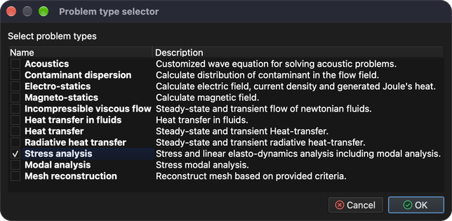
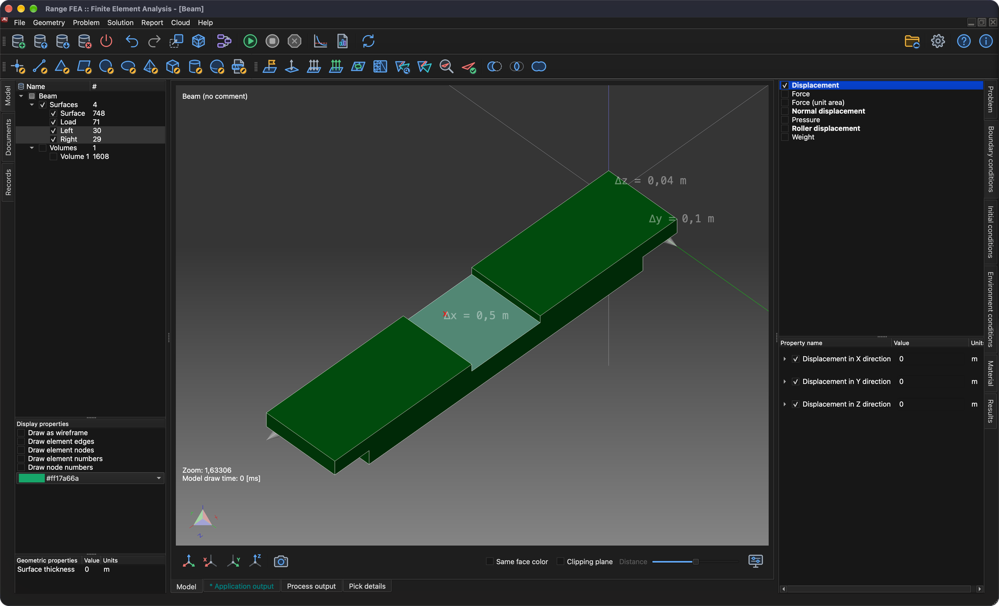
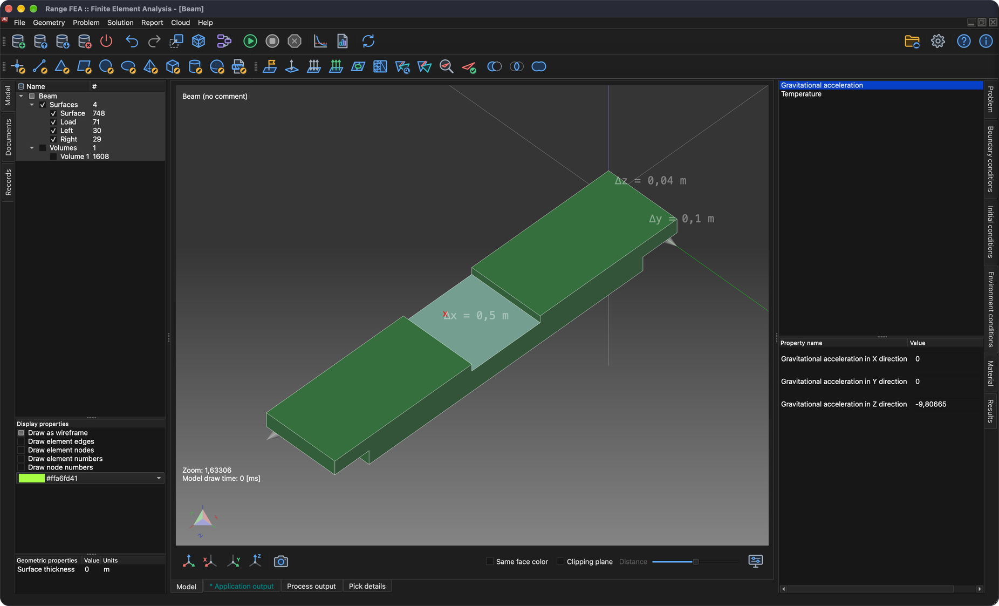

# Analisi delle tensioni e delle deformazioni

Questo tutorial mostra come impostare e risolvere un problema di tipo **Stress analysis** (analisi delle tensioni). A tale scopo una semplice trave viene appoggiata a entrambe le estremità e caricata al centro.

## 1. Caricare il modello

**Menu:** _File -> Apri modello_

Si apre la finestra **Apri modello**. Seleziona il file **Beam.tmsh** e fai clic su **Apri** per caricare il modello.

Poiché a questo modello non è assegnato alcun problema fisico, poco dopo il caricamento del modello compare la finestra **Flusso dei task del problema**.

Fai clic sul pulsante **Aggiungi tipo di problema**: viene visualizzata la finestra **Selettore del tipo di problema**. Trova e attiva **Stress analysis** e conferma con **OK**.

Il **Flusso dei task del problema** dovrebbe ora mostrare 1 iterazione di **Stress analysis**. Conferma con **OK**.

## 2. Generare la mesh 3D

Per risolvere questo problema è necessario generare una mesh di volume.

**Menu:** _Geometria -> Volume -> Genera mesh tetraedrica_

Questa azione apre la finestra **Genera mesh 3D**.

Per ora i valori precompilati sono sufficienti. Conferma con **OK**.

Una volta generata la mesh, nell'albero del modello (scheda **Modello**) compare una nuova entità **Volume**. Per vedere la mesh generata, nascondi le entità superficie, mostra solo i **Volumi** e attiva **Disegna come wireframe** nelle **Proprietà di visualizzazione**.

## 3. Assegnare il materiale

Un materiale può essere assegnato solo a un'entità del modello selezionata. Le entità si selezionano nell'albero del modello. Per selezionare più entità tieni premuto il tasto _Ctrl_ (_⌘ Cmd_ su macOS) durante la selezione, oppure tieni premuto il tasto _Maiusc_ per selezionare un intervallo. Una volta selezionate tutte le entità, il materiale può essere assegnato nella scheda **Materiale** sul lato destro della finestra principale.

L'albero **Modello** e l'elenco dei materiali sono visibili nello screenshot seguente.

Il materiale è assegnato quando la casella di controllo davanti al suo nome è attiva. In questo tutorial si usa **Iron** (ferro).

_Nota: a tutte le entità del modello deve essere assegnato un materiale._

## 4. Assegnare le condizioni al contorno

Le condizioni al contorno sono i valori specificati delle variabili di campo (o di grandezze correlate come le derivate) sui contorni del campo. Le condizioni al contorno si dividono in condizioni **esplicite** e **implicite**. Le condizioni **esplicite** sono evidenziate in **grassetto**.

In questo tutorial le condizioni al contorno vengono applicate alle entità **superficie** come descritto di seguito:

1. **Load**
    - _Weight_ (peso)
        - Weight = 1000 `[kg]`
2. **Left** e **Right**
    - _Displacement_ (spostamento)
        - Displacement in X direction = 0 `[m]`
        - Displacement in Y direction = 0 `[m]`
        - Displacement in Z direction = 0 `[m]`

Per applicare la condizione al contorno **Weight** procedi come segue:

1. Seleziona l'entità **Load** nell'albero del modello.
2. Apri la scheda **Condizioni al contorno**, quindi seleziona e attiva la condizione al contorno **Weight**.
3. Nel campo del valore della proprietà **Weight** sostituisci **1** con **1000** `[kg]`.

Per applicare la condizione al contorno **Displacement** procedi come segue:

1. Seleziona le entità **Left** e **Right** nell'albero del modello (tieni premuto _Ctrl_ / _⌘ Cmd_ per selezionarle entrambe).
2. Seleziona e attiva la condizione al contorno **Displacement** nella scheda **Condizioni al contorno**.
3. Verifica che tutti i valori delle proprietà siano impostati a **0** `[m]`.

## 5. Assegnare le condizioni ambientali

Perché la condizione al contorno **Weight** funzioni correttamente, deve essere impostata la corretta condizione ambientale **Gravitational acceleration** (accelerazione di gravità).

Le condizioni ambientali non si attivano come le condizioni al contorno. Apri la scheda **Condizioni ambientali** e seleziona **Gravitational acceleration** per verificarne i valori: 0, 0 e -9.80665 `[m/s^2]` in direzione X, Y e Z.

## 6. Risolvere il problema

Una volta configurato correttamente, il problema può essere risolto.

**Menu:** _Soluzione -> Avvia solutore_

Il modello deve essere salvato prima di poter avviare il solutore. Se non è ancora stato salvato, viene mostrata prima la finestra **Salva modello**; conferma con **Salva** (se esiste già un file con lo stesso nome, conferma la sostituzione). Poi viene mostrata la finestra **Avvia solutore per il modello**.

Fai clic su **OK** per avviare il processo del solutore.

Il processo del solutore viene eseguito in background e tutto il suo output viene visualizzato nella scheda **Output del processo**, come si vede nello screenshot seguente.

## 7. Applicare i risultati calcolati

Al termine corretto del processo del solutore, i risultati calcolati dovrebbero essere caricati automaticamente. Per visualizzarli, i risultati devono essere applicati alle entità del modello. Ciò avviene nella scheda **Risultati**. I risultati vengono applicati alle entità del modello selezionate. A tale scopo nascondi tutte le entità superficie e mostra solo i **Volumi**.

### 7.1. Spostamento

Dal menu a discesa scegli **Displacement** (se non è già selezionato). **Displacement** è una variabile vettoriale; può essere applicata come **Scalar** (l'entità viene colorata in base al modulo) e/o come **Displacement** (l'entità si deforma). Questa volta attiva la casella **Displacement** e imposta **Scala** a **500** per vedere la deformazione.

### 7.2. Tensione di von Mises

Analogamente a **Displacement**, applica **Von Mises Stress** (tensione di von Mises) all'entità **Volume** selezionata. Inoltre attiva la casella **Mostra intervallo di valori** per visualizzare l'intervallo di valori nell'area 3D.

## 8. Creare un report

A volte è necessario creare un report per pubblicare i risultati calcolati.

**Menu:** _Report -> Crea report_

Il software può creare report in più formati (HTML, Markdown, ODF e PDF), tutti attivi per impostazione predefinita. Questa volta basta un documento **PDF**, quindi disattiva tutti i formati tranne **Portable Document Format(PDF)** e fai clic su **Ok**.

Una volta generato il report, viene mostrato il messaggio **Documents have been generated.** (documenti generati). Chiudilo con **OK**.

I documenti generati non vengono visualizzati automaticamente. Per farlo, passa all'albero **Documenti** e fai doppio clic sul documento che vuoi visualizzare.

