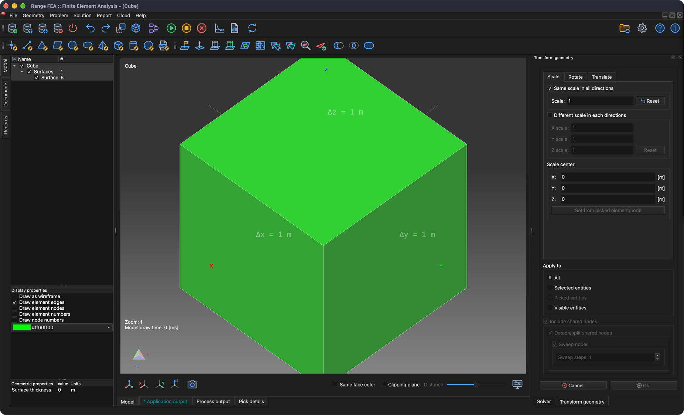

# Trasformare la geometria

Questo tutorial è il seguito del tutorial **Disegnare un cubo** e mostra come scalare, ruotare e traslare l'intera geometria o solo alcune sue parti.

## 1. Caricare il modello

Se il modello **Cube** non è ancora caricato, è possibile farlo con l'azione di menu **_Apri modello_**.

**Menu:** _File -> Apri modello_

Si apre la finestra **Apri modello**. Seleziona il file **Cube.rbm** e fai clic su **Apri**.

Una volta pronto il modello, la sua geometria (intera o in parte) può essere modificata (trasformata).

## 2. Preparazione

**Menu:** _Geometria -> Scala, trasla, ruota_

Una volta attivata la voce di menu, sul lato destro della finestra principale viene mostrato il pannello **Trasforma geometria** con tre schede: **Scala**, **Ruota** e **Trasla**.

In questo tutorial tutte le trasformazioni vengono applicate in successione a un lato del cubo.

Al momento tutti i lati del modello **Cube** sono raggruppati nella stessa **entità superficie**. Per questo un lato deve essere **marcato** come **entità superficie** separata, in modo che le trasformazioni vengano applicate solo a questo lato e non agli altri. Ciò si ottiene con l'azione di menu **_Marca superficie_**. Prima però occorre selezionare il lato del cubo.

## 3. Selezionare un lato

Tieni premuto il tasto **_Ctrl_** (**_⌘ Cmd_** su macOS) e fai clic con il **_pulsante sinistro del mouse_** su un lato del cubo. L'elemento selezionato viene evidenziato. Poiché il modello **Cube** è composto da 6 elementi rettangolari (quadrilateri), un elemento corrisponde a un lato del cubo.

## 4. Marcare una superficie

**Menu:** _Geometria -> Superficie -> Marca superficie_

Questa azione apre la finestra **Marca entità (superficie)**. Poiché nel passo precedente è stato **selezionato** un elemento, l'opzione **_Marca solo gli elementi selezionati e correlati_** è preselezionata. Facendo clic su **Ok** un lato del modello **Cube** viene marcato come **entità superficie** separata.

_**Nota:** qualsiasi entità può essere rinominata con un **doppio clic** del **pulsante sinistro del mouse** sul suo nome nell'**albero del modello** sul lato sinistro della finestra principale._

## 5. Scalare l'entità selezionata (lato del cubo)

Seleziona la superficie marcata (**_Ctrl_** / **_⌘ Cmd_** + **_pulsante sinistro del mouse_**) e apri il pannello **Trasforma geometria**.

**Menu:** _Geometria -> Scala, trasla, ruota_

1. Attiva **Stessa scala in tutte le direzioni**.
2. Imposta il valore **Scala** a 0.5 (usa il separatore decimale del tuo sistema, ad es. 0,5).
3. Fai clic sul pulsante **Imposta dall'elemento/nodo selezionato**.
4. Nel gruppo **Applica a** scegli **Entità selezionate**.
5. Assicurati che **Includi nodi condivisi** sia attivo, insieme a **tutte** le caselle di controllo subordinate.

La configurazione corretta è visibile nello screenshot seguente.

Fai clic su **Ok**. Il risultato è visibile nello screenshot seguente.

## 6. Ruotare l'entità selezionata (lato del cubo scalato)

Ruotando la superficie selezionata è possibile creare una superficie estrusa. Apri il pannello **Trasforma geometria**.

**Menu:** _Geometria -> Scala, trasla, ruota_

Passa alla scheda **Ruota** e inserisci i valori come nello screenshot seguente:

1. In **Angoli di rotazione** imposta **X** a -90.
2. Fai clic sul pulsante **Imposta dall'elemento/nodo selezionato** e poi cambia **Z** del **Centro di rotazione** a 0.
3. Nel gruppo **Applica a** scegli **Entità selezionate**.
4. Assicurati che **Includi nodi condivisi**, **Stacca/separa nodi condivisi** ed **Estrudi nodi** siano attivi e imposta **Passi di estrusione** a 6.

_Nota: **Passi di estrusione: 6** produce sei nuovi segmenti._

Fai clic su **Ok**. Il risultato è visibile nello screenshot seguente.

