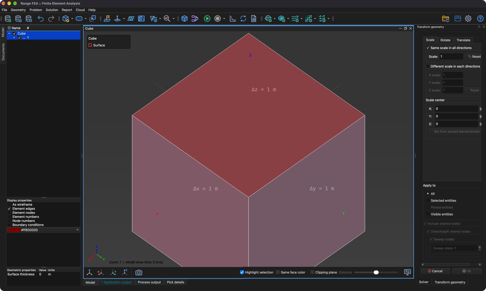
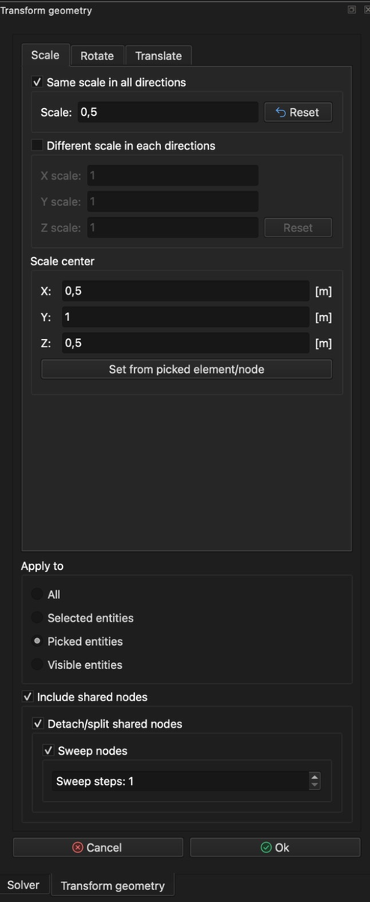

# Trasformare la geometria

Questo tutorial è il seguito del tutorial **Disegnare un cubo** e mostra come scalare, ruotare e traslare l'intera geometria o solo alcune sue parti.

## 1. Caricare il modello

Se il modello **Cube** non è ancora caricato, è possibile caricarlo con l'azione **_Apri modello_**.

**Menu:** _File -> Apri modello_

Viene mostrata la finestra di dialogo **Apri modello**. Selezionare il file **Cube.rbm** e fare clic su **Open** (Apri).

Una volta pronto il modello, la sua geometria (intera o in parte) può essere modificata (trasformata).

## 2. Preparazione

**Menu:** _Geometria -> Scala, trasla, ruota_

Una volta attivata la voce di menu, sul lato destro della finestra principale viene mostrato il pannello **Trasforma geometria** con tre schede: **Scala**, **Ruota** e **Trasla**. Il gruppo **Applica a** sotto le schede determina quale parte del modello viene trasformata.

In questo tutorial tutte le trasformazioni vengono applicate in successione a una faccia del cubo. Per ora chiudere il pannello facendo clic su **Annulla**.

Al momento tutte le facce del modello **Cube** sono raggruppate nella stessa **entità superficie**. Occorre quindi **marcare** una faccia come **entità superficie** separata, in modo che le trasformazioni vengano applicate solo a quella faccia e non alle altre. A questo serve l'azione **_Marca superficie_**. Prima però occorre selezionare la faccia del cubo.

## 3. Selezionare una faccia

Tenere premuto il tasto **_Ctrl_** (**_⌘ Cmd_** su macOS) e fare clic con il **_tasto sinistro del mouse_** sulla faccia del cubo rivolta verso l'asse **Y**. L'elemento selezionato viene evidenziato ed elencato sotto **Picked entities** nel riquadro in alto a sinistra dell'area 3D. Poiché il modello **Cube** è composto da 6 elementi rettangolari (quadrilateri), un elemento corrisponde a una faccia del **Cube**.

## 4. Marcare una superficie

**Menu:** _Geometria -> Superficie -> Marca superficie_

Questa azione mostra la finestra di dialogo **Mark entity (surface)**. Poiché nel passo precedente è stato **selezionato** un elemento, è preselezionata l'opzione **_Marca solo gli elementi selezionati e correlati_**. Facendo clic sul pulsante **Ok**, una faccia del modello **Cube** viene marcata come **entità superficie** separata con il nome **Surface 2**.

_**Nota:** qualsiasi entità può essere rinominata facendo **doppio clic** con il **tasto sinistro del mouse** sul suo nome nell'**albero del modello**, sul lato sinistro della finestra principale._

## 5. Scalare l'entità selezionata (faccia del cubo)

Selezionare la superficie marcata (**_Ctrl_** / **_⌘ Cmd_** + **_tasto sinistro del mouse_**) e aprire il pannello **Trasforma geometria**.

**Menu:** _Geometria -> Scala, trasla, ruota_

1. Nella scheda **Scala** lasciare selezionato **Stessa scala in tutte le direzioni**.
2. Impostare il valore **Scala** a 0,5 (usare il separatore decimale del proprio sistema, ad es. 0,5 o 0.5).
3. Fare clic sul pulsante **Imposta dall'elemento/nodo selezionato**. Il **Centro di scala** viene posto al centro della faccia selezionata (0,5; 1; 0,5).
4. Nel gruppo **Applica a** selezionare **Entità selezionate**.
5. Verificare che **Includi nodi condivisi** sia selezionato insieme a tutte le sue caselle secondarie.

L'impostazione corretta è visibile nella seguente schermata.

Fare clic su **Ok**. La faccia selezionata viene ridotta della metà e lo spazio tra la faccia ridotta e il resto del cubo viene riempito da una nuova entità superficie (**Surface 3**). Il risultato è visibile nella seguente schermata.

## 6. Ruotare l'entità selezionata (faccia scalata del cubo)

Ruotando la superficie selezionata si può creare una superficie estrusa. Aprire il pannello **Trasforma geometria**.

**Menu:** _Geometria -> Scala, trasla, ruota_

Passare alla scheda **Ruota** e inserire i valori come nella seguente schermata:

1. Impostare **Angoli di rotazione** **X** a -90.
2. Fare clic sul pulsante **Imposta dall'elemento/nodo selezionato** e poi cambiare **Centro di rotazione** **Z** a 0.
3. Nel gruppo **Applica a** selezionare **Entità selezionate**.
4. Verificare che **Includi nodi condivisi**, **Stacca/separa nodi condivisi** ed **Estrudi nodi** siano selezionati e impostare **Passi di estrusione** a 6.

_Nota: **Passi di estrusione: 6** genera sei nuovi segmenti._

Fare clic su **Ok**. I segmenti estrusi vengono aggiunti come nuova entità superficie (**Surface 4**). Il risultato è visibile nella seguente schermata.

