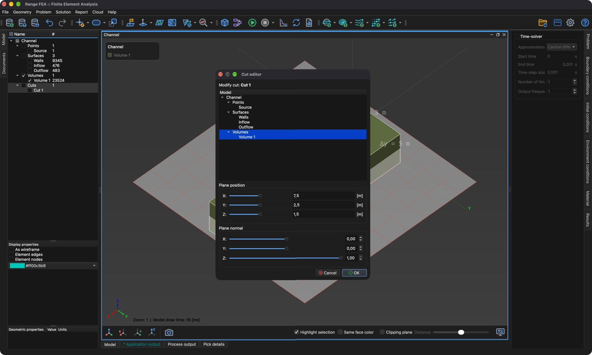
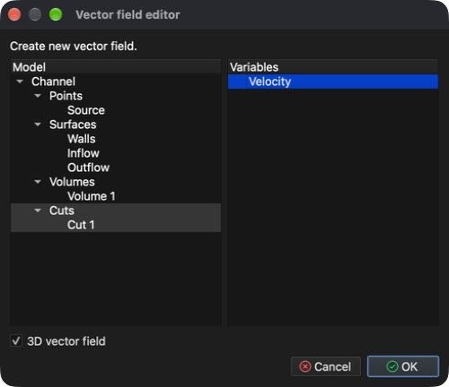
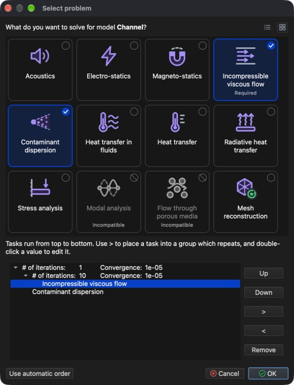
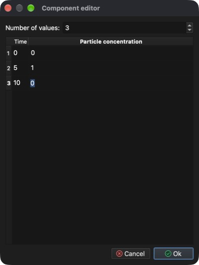

# Dyspersja zanieczyszczeń w płynach

Ten samouczek pokazuje, jak skonfigurować i rozwiązać symulację multifizyczną, która łączy nieliniowy, iteracyjny problem – **CFD (Computational Fluid Dynamics, obliczeniowa mechanika płynów)** – z transportem zanieczyszczenia unoszonego przez przepływ.

Potrzebne są dwa typy problemów:

1. **Incompressible viscous flow** (nieściśliwy przepływ lepki) – oblicza prędkość i ciśnienie płynu (ustalony lub przejściowy przepływ płynów newtonowskich).
2. **Contaminant dispersion** (dyspersja zanieczyszczeń) – oblicza, jak zanieczyszczenie rozprzestrzenia się w tym polu przepływu.

Ponieważ problem przepływu jest nieliniowy, rozwiązuje się go iteracyjnie. Symulacja przebiega więc w dwóch etapach:

1. **Przepływ ustalony** – najpierw, bez zanieczyszczenia, obliczane jest zbieżne „początkowe” pole przepływu i rozkład ciśnienia.
2. **Symulacja przejściowa** – następnie, zaczynając od tego pola przepływu, za pomocą **kroków czasowych** śledzi się, jak impuls zanieczyszczenia wpływającego do kanału jest przez niego przenoszony.

## 1. Wczytaj model

**Menu:** _Plik -> Otwórz model_

W oknie dialogowym **Otwórz model** wybierz **Channel.rbm** i kliknij **Open** (Otwórz).

Model składa się z jednej encji punktowej – **Source** – i trzech encji powierzchniowych – **Walls**, **Inflow** i **Outflow**. Ponieważ do modelu nie przypisano jeszcze typu problemu, po zakończeniu wczytywania automatycznie otworzy się okno dialogowe **Wybierz problem**.

## 2. Wybierz problem (etap 1 – przepływ ustalony)

W pierwszym etapie rozwiązywany jest tylko przepływ, z wieloma iteracjami nieliniowymi, aby mógł osiągnąć zbieżność.

1. W oknie dialogowym **Wybierz problem** kliknij kafelek **Incompressible viscous flow**.
2. Pozostaw **Maksymalna liczba iteracji** równą **2000** i **Zbieżność** równą **1e-05** – są to wartości domyślne dla przepływu ustalonego.
3. Zamknij okno przyciskiem **OK**.

Okno można w każdej chwili otworzyć ponownie przyciskiem **Wybierz problem** na pasku narzędzi.

## 3. Wygeneruj siatkę objętościową

Model jest zdefiniowany tylko przez swoje powierzchnie. Aby rozwiązać przepływ w jego wnętrzu, trzeba najpierw wygenerować siatkę objętościową (czworościenną).

**Menu:** _Geometria -> Objętość -> Generuj siatkę czworościenną_

Wartości domyślne w oknie **Generuj siatkę 3D** wystarczą. Kliknij **OK**. Po zakończeniu generowania w **drzewie modelu** w grupie **Objętości** pojawi się nowa encja **Volume 1**.

## 4. Przypisz materiał

Wszystkie encje modelu muszą mieć przypisany materiał.

1. W **drzewie modelu** rozwiń **Objętości**, kliknij **Source**, a następnie z wciśniętym klawiszem _Shift_ kliknij **Volume 1**, aby zaznaczyć wszystkie encje.
2. Otwórz zakładkę **Materiał** po prawej stronie okna głównego.
3. Zaznacz **Water** (woda; znajduje się na końcu listy).

## 5. Warunki brzegowe (etap 1)

Warunki brzegowe przypisuje się na zakładce **Warunki brzegowe** do encji zaznaczonej w **drzewie modelu**. Przypisz encjom **powierzchniowym** następujące warunki:

1. **Walls**
    - _Wall_ (ściana; wartość nie jest potrzebna)
2. **Inflow**
    - _Volumetric flow rate (inflow)_ (objętościowe natężenie przepływu, wlot)
        - Volumetric flow rate = 50 `[m^3/s]`
3. **Outflow**
    - _Pressure (implicit)_ (ciśnienie, niejawne)
        - Pressure = 0 `[Pa]` (wartość domyślna to 1000 `[Pa]`)

Dla każdej encji: zaznacz ją w **drzewie modelu**, zaznacz pole wyboru warunku na zakładce **Warunki brzegowe**, wybierz warunek, aby wyświetlić jego właściwości pod listą, a następnie kliknij dwukrotnie wartość, wpisz nową i naciśnij _Enter_.

## 6. Rozwiąż przepływ ustalony

**Menu:** _Rozwiązanie -> Uruchom solver_

Model **Channel** został otwarty z pliku, więc jest w nim zapisywany automatycznie. W oknie **Uruchom solver** kliknij **OK**. Jeśli okno wyświetla błąd, np. **Entity Source has no material assigned.**, przycisk **OK** jest nieaktywny; najpierw przypisz materiał do tej encji.

Solver działa w tle, a jego wyjście jest wyświetlane na zakładce **Wyjście procesu**. Obliczenie wszystkich 2000 iteracji trwa kilka minut; obliczenia są zakończone, gdy wyjście kończy się wierszem **SOLVER - END**. Zbieżność rozwiązania można w każdej chwili sprawdzić za pomocą:

**Menu:** _Raport -> Zbieżność solvera_

## 7. Utwórz przekrój

Dobrym sposobem na zbadanie przepływu jest wyświetlenie prędkości jako **pola wektorowego**, w którym każda strzałka pokazuje kierunek i wartość przepływu w jednym punkcie. Pole wektorowe narysowane w całej objętości szybko staje się jednak gęstą chmurą nakładających się strzałek, którą trudno odczytać. Zwykle czytelniej jest najpierw przeciąć model **przekrojem** – płaszczyzną przechodzącą przez objętość – i wyświetlić pole wektorowe tylko na tej płaszczyźnie.

_Wskazówka: przed rozpoczęciem zaznacz **Objętości** w **drzewie modelu**, aby objętość była widoczna podczas ustawiania przekroju._

**Menu:** _Geometria -> Przekrój -> Utwórz przekrój_

W oknie **Edytor przekrojów**:

1. Wybierz **Volume 1** na liście **Model**. Przekrój zostanie utworzony przez tę objętość.
2. **Położenie płaszczyzny** określa punkt, przez który przechodzi płaszczyzna przekroju. Wartości domyślne umieszczają ją w środku modelu (**X** = 7,5, **Y** = 2,5, **Z** = 1,5 `[m]`); pozostaw je.
3. **Normalna płaszczyzny** określa orientację płaszczyzny. Domyślna normalna (**X** = 1) daje płaszczyznę pionową; zmień ją na **X** = 0, **Y** = 0, **Z** = 1, aby uzyskać płaszczyznę poziomą przecinającą kanał w połowie wysokości. Między polami przechodź klawiszem _Tab_: naciśnięcie _Enter_ zatwierdza całe okno.

Płaszczyzna przekroju jest pokazywana w podglądzie w **obszarze 3D modelu** podczas zmiany wartości. Kliknij **OK**, aby utworzyć przekrój. W **drzewie modelu** w grupie **Przekroje** pojawi się nowa encja **Cut 1**.

## 8. Utwórz pole wektorowe

Teraz wyświetl obliczoną prędkość w postaci strzałek na płaszczyźnie przekroju.

**Menu:** _Geometria -> Pole wektorowe -> Utwórz pole wektorowe_

W oknie **Edytor pól wektorowych**:

1. Wybierz **Cut 1** na liście **Model**. Strzałki zostaną narysowane na płaszczyźnie przekroju utworzonej w poprzednim kroku.
2. Wybierz **Velocity** (prędkość) na liście **Zmienne**.
3. Pozostaw zaznaczone **Pole wektorowe 3D**. Strzałki pokazują wtedy pełny wektor prędkości. Po odznaczeniu każda strzałka jest rzutowana na płaszczyznę przekroju i pokazywana jest tylko składowa przepływu w tej płaszczyźnie.

Kliknij **OK**, aby utworzyć pole wektorowe. Pojawi się ono w **drzewie modelu** w grupie **Pola wektorowe** pod nazwą **Velocity**. Odznacz **Objętości**, aby bryła nie zasłaniała strzałek, i zaznacz **Pola wektorowe**.

Strzałki mogą być zbyt krótkie, aby były dobrze widoczne, ponieważ ich długość jest proporcjonalna do prędkości przepływu. Aby je wydłużyć, zaznacz pole wektorowe w **drzewie modelu**, otwórz zakładkę **Wyniki** i zwiększ wartość w sekcji **Skala odkształcenia i strzałek**, na przykład do **100**. Wpisz wartość lub przesuń suwak obok niej.

## 9. Wybierz problem (etap 2 – symulacja przejściowa)

Mając zbieżne pole przepływu, można skonfigurować **przejściową** symulację z **Contaminant dispersion**.

W symulacji przejściowej problemy są rozwiązywane raz na krok czasowy. **Incompressible viscous flow** jest nadal nieliniowy, więc w każdym kroku czasowym potrzebuje własnych iteracji nieliniowych, natomiast **Contaminant dispersion** jest rozwiązywany raz na krok czasowy po przepływie. Ponownie otwórz okno **Wybierz problem** (przycisk **Wybierz problem** na pasku narzędzi) i skonfiguruj je następująco:

1. Kliknij kafelek **Contaminant dispersion** (**Incompressible viscous flow** pozostaje wybrany i jest oznaczony jako **Wymagany**), a następnie kliknij **Dostosuj…**, aby wyświetlić kolejność zadań.
2. Zaznacz **Incompressible viscous flow** i kliknij przycisk **>**. Przeniesie to zadanie do nowej, zagnieżdżonej grupy iteracji.
3. Kliknij dwukrotnie wartość zewnętrznego **# of iterations:** i zmień ją z **2000** na **1**. Następnie zmień wewnętrzne (zagnieżdżone) **# of iterations:** z **1** na **10**.

Zatwierdź przyciskiem **OK**.

## 10. Ustawienia solvera czasowego

Otwórz zakładkę **Problem** po prawej stronie okna głównego i ustaw (między polami przechodź klawiszem _Tab_):

1. Zaznacz **Solver czasowy**.
2. **Przybliżenie**: **Backward difference (stable)** (różnica wsteczna, stabilna).
3. **Rozmiar kroku czasowego**: **0,01** `[s]`.
4. **Liczba kroków czasowych**: **2000**.
5. **Częstotliwość zapisu**: **10** – rekord wyników jest zapisywany co 10. krok czasowy.

**Czas końcowy** jest obliczany automatycznie (2000 × 0,01 s = 20 s).

W sekcji **Ustawienia dyspersji zanieczyszczeń** ustaw **Maximum saturation** na **2,4** `[kg/m^3]` i **Diffusion coefficient** na **0,01** `[m^2/s]`. Więcej informacji znajdziesz w podręczniku teorii.

## 11. Warunki brzegowe (etap 2)

Zanieczyszczenie wpływa do kanału przez wlot. Zaznacz **Inflow** w **drzewie modelu** i na zakładce **Warunki brzegowe** zaznacz **Particle concentration** (stężenie cząstek; pozostaw zaznaczone **Volumetric flow rate (inflow)**).

Zamiast stałej wartości zostanie użyta wartość zależna od czasu. Rozwiń właściwość **Particle concentration** (strzałka przed nazwą) i kliknij **Edytuj wartości zależne od czasu**.

W oknie **Edytor składowych** ustaw **Liczba wartości** na **3** i wprowadź poniższe wartości (kliknij dwukrotnie komórkę, aby ją edytować), a następnie kliknij **Ok**.

| Czas `[s]` | Particle concentration `[kg/m^3]` |
| ---------- | --------------------------------- |
| 0          | 0                                 |
| 5          | 1                                 |
| 10         | 0                                 |

Między dwoma zadanymi chwilami czasu wartość jest interpolowana liniowo, a po ostatniej zadanej chwili zachowywana jest ostatnia wartość. Przy tych wartościach stężenie na wlocie rośnie od 0 do 1 `[kg/m^3]` w ciągu pierwszych 5 sekund i spada z powrotem do 0 między 5. a 10. sekundą.

## 12. Rozwiąż problem przejściowy (restart)

**Menu:** _Rozwiązanie -> Uruchom solver_

W oknie **Uruchom solver** zaznacz **Uruchom solver ponownie / kontynuuj** i kliknij **OK**. Solver użyje wtedy obliczonego już przepływu ustalonego jako punktu wyjścia i będzie kontynuował symulację z krokami czasowymi.

Ostrzeżenie **Contaminant dispersion: No implicit boundary condition assigned.** jest oczekiwane i można je zignorować.

## 13. Wyświetl wyniki podczas pracy solvera

Solver przejściowy działa w tle, więc wyniki można przeglądać jeszcze w trakcie obliczeń. Gdy tylko zostaną zapisane pierwsze rekordy, po lewej stronie okna głównego pojawi się zakładka **Rekordy**. Wyniki obliczeń przejściowych są wyświetlane dopiero po wczytaniu rekordu: otwórz zakładkę **Rekordy**, kliknij dwukrotnie najnowszy rekord i wróć na zakładkę **Model** (więcej o rekordach w kroku 14). Kolejne encje wyświetlania, takie jak przekroje, izopowierzchnie, linie prądu, pola wektorowe lub skalarne, można tworzyć w dowolnym momencie i wyświetlać na nich obliczone wyniki. Tutaj ponownie użyto przekroju i pola wektorowego z kroków 7 i 8.

### 13.1 Stężenie zanieczyszczenia na przekroju

1. W **drzewie modelu** rozwiń **Przekroje**, zaznacz pole wyboru **Cut 1**, aby był widoczny, i zaznacz go.
2. Otwórz zakładkę **Wyniki** i z menu rozwijanego u góry wybierz **Particle concentration - Scalar**. Jeśli lista zawiera tylko **Velocity** i **Pressure**, nie wczytano jeszcze żadnego rekordu obliczeń przejściowych.
3. W sekcji **Pokaż na wybranych encjach** zaznacz **Mapa kolorów**. Przekrój jest teraz pokolorowany według stężenia zanieczyszczenia.
4. W sekcji **Zakres kolorów** ustaw **Maks.** na **1** i **Min.** na **0** (wpisz wartość i naciśnij _Enter_). Odpowiada to zakresowi stężenia na wlocie, więc te same kolory oznaczają to samo stężenie w każdym kroku czasowym.
5. Zaznacz **Pokaż legendę**, aby wyświetlić skalę kolorów w **obszarze 3D modelu**.

### 13.2 Strzałki pola wektorowego

Aby kierunek przepływu był lepiej widoczny na pokolorowanym przekroju, narysuj strzałki z grotami w kolorze białym:

1. Zaznacz **Pola wektorowe** i zaznacz pole wektorowe (**Velocity** w grupie **Pola wektorowe**) w **drzewie modelu**.
2. We **Właściwościach wyświetlania** pod drzewem zaznacz **Groty strzałek**.
3. Kliknij selektor kolorów pod polami wyboru i wybierz biały (**#ffffffff**).

Pozostałe właściwości wyświetlania określają, czy wszystkie strzałki mają tę samą długość (**Strzałki o jednakowej długości**) i czy strzałki zaczynają się w punkcie, w którym obliczana jest prędkość (**Strzałki wychodzące z**).

## 14. Rekordy modelu (wyniki w czasie)

Co 10. krok czasowy (**Częstotliwość zapisu**) solver zapisuje rekord modelu z rozwiązaniem dla danej chwili. Rekordy są wymienione na zakładce **Rekordy** po lewej stronie okna głównego; kolumna **Rekord** pokazuje numer kroku czasowego (rekord **500** zawiera rozwiązanie w chwili 500 × 0,01 s = 5 s). Kliknij dwukrotnie rekord, aby wczytać wyniki jego kroku czasowego; wczytany rekord jest oznaczony strzałką, a wyniki wyświetlone na zakładce **Wyniki** są zachowywane i rysowane ponownie dla niego. Legenda w **obszarze 3D modelu** pokazuje krok czasowy i czas wczytanego rekordu (np. **Time-step 520 · 5,19 s**). Przyciski u dołu zakładki odtwarzają rekordy jeden po drugim.

Obliczenie wszystkich 2000 kroków czasowych trwa dłuższą chwilę (około 20 minut na współczesnym komputerze). Solver można w każdej chwili zatrzymać, a zapisane dotąd rekordy zostaną zachowane:

**Menu:** _Rozwiązanie -> Zatrzymaj solver_ (potwierdź przyciskiem **Yes** (Tak))

Po zatrzymaniu solvera wczytywany jest ostatni zapisany rekord.

## 15. Nagraj wideo

Wideo powstaje z tego, co jest aktualnie wyświetlane w **obszarze 3D modelu**, więc najpierw ustaw widok i wyświetlane wyniki (zob. krok 13). Ustawienia wyświetlania nie są zapisywane z modelem, więc po jego ponownym otwarciu trzeba je ustawić ponownie. Następnie otwórz zakładkę **Rekordy**, za pomocą pól **Od** i **Do** u dołu wybierz zakres rekordów i kliknij czerwony przycisk nagrywania.

Pojawi się okno **Ustawienia wideo**, w którym można ustawić kodek wideo, format pliku, liczbę klatek na sekundę i liczbę klatek na rekord; poniżej pokazywana jest szacowana długość wideo i liczba rekordów. Przy 98 rekordach (solver zatrzymano po około 9,8 s), 24 klatkach na sekundę i 1 klatce na rekord wideo trwa około 4,1 sekundy; wszystkie 200 rekordów pełnych obliczeń daje około 8,3 sekundy. Kliknij **OK**, aby rozpocząć nagrywanie.

Nagrywanie może chwilę potrwać, ponieważ każdy rekord modelu jest kolejno wczytywany, a zrzut ekranu **obszaru 3D modelu** jest używany jako klatka wideo.

Wideo i wszystkie klatki (jeden obraz PNG na rekord) znajdują się na zakładce **Dokumenty** w grupie **Channel**: wideo **Channel.mp4** w grupie **Wideo**, a klatki w grupie **Obrazy**. Kliknij dwukrotnie wideo, aby je odtworzyć.

