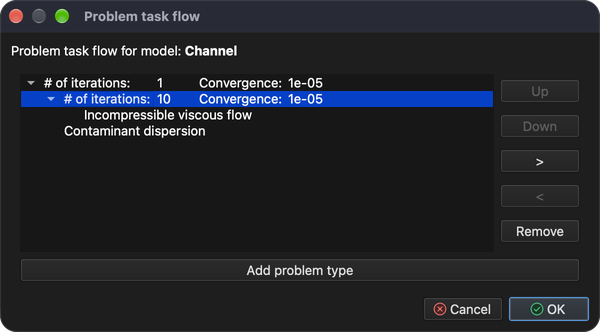
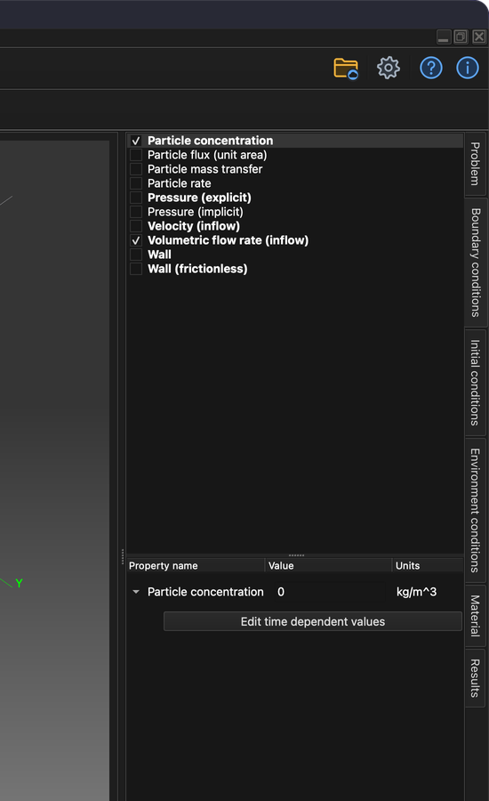
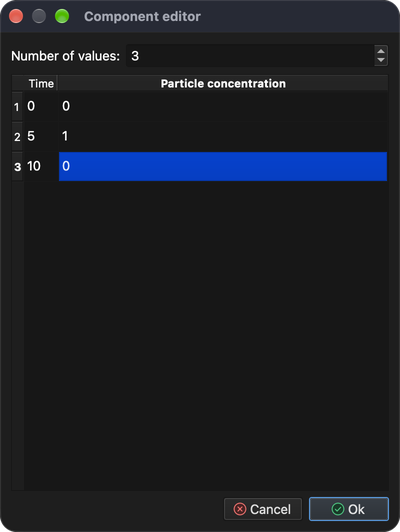
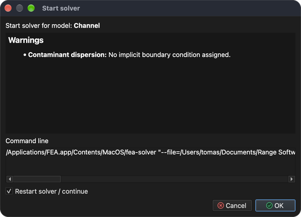
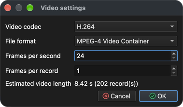

# Dyspersja zanieczyszczeń w płynach

Ten samouczek pokazuje, jak skonfigurować i rozwiązać symulację wielofizyczną, która łączy nieliniowy, iteracyjny problem – **CFD (obliczeniową mechanikę płynów)** – z transportem zanieczyszczenia unoszonego przez przepływ.

Potrzebne są dwa typy problemów:

1. **Incompressible viscous flow** (przepływ lepki nieściśliwy) – oblicza prędkość i ciśnienie płynu (ustalony lub przejściowy przepływ płynów newtonowskich).
2. **Contaminant dispersion** (dyspersja zanieczyszczeń) – oblicza, jak zanieczyszczenie rozprzestrzenia się w tym polu przepływu.

Ponieważ problem przepływu jest nieliniowy, rozwiązuje się go iteracyjnie. Symulacja jest więc prowadzona w dwóch etapach:

1. **Przepływ ustalony** – najpierw, bez zanieczyszczenia, obliczane jest zbieżne „początkowe” pole przepływu i rozkład ciśnienia.
2. **Symulacja przejściowa** – następnie, zaczynając od tego pola przepływu, stosuje się **całkowanie w czasie**, aby śledzić, jak impuls zanieczyszczenia wpływający do kanału jest przez niego przenoszony.

## 1. Wczytaj model

**Menu:** _Plik -> Otwórz model_

W oknie **Otwórz model** wybierz **Channel.tmsh** i kliknij **Otwórz**.

Model składa się z trzech encji powierzchni – **Walls**, **Inflow** i **Outflow**. Ponieważ do modelu nie przypisano jeszcze żadnego typu problemu, po zakończeniu wczytywania automatycznie otworzy się okno **Przebieg zadań problemu**.

## 2. Przebieg zadań problemu (etap 1 – przepływ ustalony)

W pierwszym etapie rozwiązywany jest tylko przepływ, z dużą liczbą iteracji nieliniowych, aby mógł osiągnąć zbieżność.

1. W oknie **Przebieg zadań problemu** kliknij **Dodaj typ problemu**.
2. W oknie **Wybór typu problemu** zaznacz **Incompressible viscous flow** i kliknij **OK**.
3. Kliknij dwukrotnie wartość **1** obok **Liczba iteracji:**, wpisz **2000** i naciśnij _Enter_.
4. Kliknij **OK**, aby zamknąć okno.

Okno można w każdej chwili otworzyć ponownie przyciskiem **Przebieg zadań problemów** na pasku narzędzi. Powinno ono teraz wyglądać tak:

## 3. Wygeneruj siatkę objętościową

Model jest zdefiniowany tylko przez swoje powierzchnie. Aby rozwiązać przepływ wewnątrz niego, należy najpierw wygenerować siatkę objętościową (czworościenną).

**Menu:** _Geometria -> Objętość -> Generuj siatkę czworościenną_

Wartości domyślne w oknie **Generuj siatkę 3D** są wystarczające. Kliknij **OK**. Po zakończeniu generowania siatki w drzewie **Model** pod **Objętości** pojawi się nowa encja **Volume 1**.

## 4. Przypisz materiał

Wszystkie encje modelu muszą mieć przypisany materiał.

1. W drzewie **Model** kliknij **Walls**, a następnie kliknij **Volume 1** z wciśniętym klawiszem _Shift_, aby wybrać wszystkie encje.
2. Otwórz kartę **Materiał** po prawej stronie okna głównego.
3. Zaznacz **Water** (woda).

## 5. Warunki brzegowe (etap 1)

Warunki brzegowe przypisuje się na karcie **Warunki brzegowe** do encji wybranej w drzewie **Model**. Przypisz następujące warunki do encji **powierzchni**:

1. **Walls**
    - _Wall_ (ściana; nie wymaga wartości)
2. **Inflow**
    - _Volumetric flow rate (inflow)_ (objętościowe natężenie przepływu na wlocie)
        - Volumetric flow rate = 50 `[m^3/s]`
3. **Outflow**
    - _Pressure (implicit)_ (ciśnienie niejawne)
        - Pressure = 0 `[Pa]` (wartość domyślna to 1000 `[Pa]`)

Dla każdej encji: wybierz ją w drzewie **Model**, zaznacz warunek na karcie **Warunki brzegowe**, wybierz warunek, aby wyświetlić jego właściwości pod listą, a następnie kliknij dwukrotnie wartość, wpisz nową i naciśnij _Enter_.

## 6. Rozwiąż przepływ ustalony

**Menu:** _Rozwiązanie -> Uruchom solver_

Jeśli model nie był jeszcze zapisany, najpierw wyświetli się okno **Zapisz model**. Kliknij **Zapisz**, aby zaakceptować proponowaną nazwę pliku (**Channel.rbm**), a następnie kliknij **OK** w oknie **Uruchom solver dla modelu**.

Solver działa w tle, a jego wyjście jest wyświetlane na karcie **Wyjście procesu**. Obliczenie wszystkich 2000 iteracji trwa kilka minut; obliczenia są zakończone, gdy wyjście kończy się napisem **SOLVER - END**. Zbieżność rozwiązania można w każdej chwili sprawdzić za pomocą:

**Menu:** _Raport -> Zbieżność solvera_

## 7. Utwórz przekrój

Dobrym sposobem badania przepływu jest wyświetlenie prędkości jako **pola wektorowego**, w którym każda strzałka pokazuje kierunek i wartość przepływu w danym punkcie. Pole wektorowe narysowane w całej objętości szybko staje się jednak gęstą chmurą nakładających się strzałek, trudną do odczytania. Zwykle czytelniej jest najpierw przeciąć model **przekrojem** – płaszczyzną przechodzącą przez objętość – a następnie wyświetlić pole wektorowe tylko na tej płaszczyźnie.

_Wskazówka: przed rozpoczęciem zaznacz **Objętości** w drzewie **Model**, aby objętość była widoczna podczas ustawiania przekroju._

**Menu:** _Geometria -> Przekrój -> Utwórz przekrój_

W oknie **Edytor przekrojów**:

1. Wybierz **Volume 1** na liście **Model**. Przekrój zostanie utworzony przez tę objętość.
2. **Położenie płaszczyzny** określa punkt, przez który przechodzi płaszczyzna przekroju. Wartości domyślne umieszczają ją w środku modelu (**X** = 7.5, **Y** = 2.5, **Z** = 1.5 `[m]`); pozostaw je.
3. **Normalna płaszczyzny** określa orientację płaszczyzny. Domyślna normalna (**X** = 1) daje płaszczyznę pionową; zmień ją na **X** = 0, **Y** = 0, **Z** = 1, aby uzyskać płaszczyznę poziomą przecinającą kanał w połowie wysokości.

Podczas zmiany wartości płaszczyzna przekroju jest wyświetlana w podglądzie w **obszarze 3D modelu**. Kliknij **OK**, aby utworzyć przekrój. W drzewie **Model** pod **Przekroje** pojawi się nowa encja **Cut 1**.

## 8. Utwórz pole wektorowe

Teraz wyświetl obliczoną prędkość jako strzałki na płaszczyźnie przekroju.

**Menu:** _Geometria -> Pole wektorowe -> Utwórz pole wektorowe_

W oknie **Edytor pól wektorowych**:

1. Wybierz **Cut 1** na liście **Model**. Strzałki zostaną narysowane na płaszczyźnie przekroju utworzonej w poprzednim kroku.
2. Wybierz **Velocity** (prędkość) na liście **Zmienne**.
3. Pozostaw zaznaczone **Pole wektorowe 3D**. Strzałki pokazują wtedy pełny wektor prędkości. Po odznaczeniu każda strzałka jest rzutowana na płaszczyznę przekroju i pokazywana jest tylko część przepływu leżąca w tej płaszczyźnie.

Kliknij **OK**, aby utworzyć pole wektorowe. Pojawi się ono w drzewie **Model** pod **Pola wektorowe**. Odznacz **Objętości**, aby pełna objętość nie zasłaniała strzałek.

Strzałki mogą być zbyt krótkie, aby były dobrze widoczne, ponieważ ich długość jest proporcjonalna do prędkości przepływu. Aby je wydłużyć, wybierz pole wektorowe w drzewie **Model**, otwórz kartę **Wyniki** i zwiększ wartość w sekcji **Skala**. Skala jest iloczynem wartości **Skala** i potęgi dziesięciu ustawionej w polu **Współczynnik**; w poniższym przykładzie **Skala** 1 i **Współczynnik** 2 dają skalę `1 × 10^2 = 100`.

## 9. Przebieg zadań problemu (etap 2 – przejściowy)

Gdy dostępne jest zbieżne pole przepływu, można skonfigurować symulację **przejściową** z **Contaminant dispersion**.

W symulacji przejściowej problemy są rozwiązywane raz w każdym kroku czasowym. **Incompressible viscous flow** jest nadal nieliniowy, więc w każdym kroku czasowym wymaga własnych iteracji nieliniowych, natomiast **Contaminant dispersion** jest rozwiązywany raz w każdym kroku czasowym, po przepływie. Otwórz ponownie okno **Przebieg zadań problemu** (przycisk **Przebieg zadań problemów** na pasku narzędzi) i skonfiguruj je następująco:

1. Wybierz **Incompressible viscous flow** i kliknij przycisk **>**. Spowoduje to przeniesienie go do nowej, zagnieżdżonej grupy iteracji.
2. Kliknij dwukrotnie wartość zewnętrznego pola **Liczba iteracji:** i zmień ją z **2000** na **1**. Następnie zmień wewnętrzne (zagnieżdżone) pole **Liczba iteracji:** z **1** na **10**.
3. Kliknij **Dodaj typ problemu**, zaznacz **Contaminant dispersion** i kliknij **OK**. **Incompressible viscous flow** zostanie również zaznaczony automatycznie, ponieważ dyspersja zanieczyszczeń wymaga pola przepływu. Jeśli na poziomie zewnętrznym zostanie dodany drugi wpis **Incompressible viscous flow**, wybierz go i kliknij **Usuń**.

Przebieg zadań powinien wyglądać jak na poniższym zrzucie ekranu. Kliknij **OK**, aby zatwierdzić.

## 10. Ustawienia solvera czasowego

Otwórz kartę **Problem** po prawej stronie okna głównego i ustaw:

1. Zaznacz **Solver czasowy**.
2. **Przybliżenie**: **Backward difference (stable)** (różnice wsteczne, stabilne).
3. **Rozmiar kroku czasowego**: **0.01** `[s]`.
4. **Liczba kroków czasowych**: **2000**.
5. **Częstotliwość zapisu**: **10** – rekord wyników jest zapisywany co 10 kroków czasowych.

**Czas końcowy** jest obliczany automatycznie (2000 × 0.01 s = 20 s).

W sekcji **Ustawienia dyspersji zanieczyszczeń** ustaw **Maksymalne nasycenie** na **2.4** `[kg/m^3]` i **Współczynnik dyfuzji** na **0.01** `[m^2/s]`. Więcej informacji zawiera podręcznik teorii.

## 11. Warunki brzegowe (etap 2)

Zanieczyszczenie dostaje się do kanału przez wlot. Wybierz **Inflow** w drzewie **Model** i na karcie **Warunki brzegowe** zaznacz **Particle concentration** (stężenie cząstek); pozostaw zaznaczone **Volumetric flow rate (inflow)**.

Zamiast wartości stałej zostanie użyta wartość zależna od czasu. Rozwiń właściwość **Particle concentration** (strzałka przed jej nazwą) i kliknij **Edytuj wartości zależne od czasu**.

W oknie **Edytor składowych** ustaw **Liczba wartości** na **3** i wprowadź poniższe wartości (kliknij dwukrotnie komórkę, aby ją edytować), a następnie kliknij **OK**.

| Czas `[s]` | Particle concentration `[kg/m^3]` |
| ---------- | --------------------------------- |
| 0          | 0                                 |
| 5          | 1                                 |
| 10         | 0                                 |

Między dwiema podanymi chwilami wartość jest interpolowana liniowo, a po ostatniej podanej chwili zachowywana jest ostatnia wartość. Przy tych wartościach stężenie na wlocie rośnie od 0 do 1 `[kg/m^3]` w ciągu pierwszych 5 sekund i spada z powrotem do 0 między 5 a 10 sekundą.

## 12. Rozwiąż problem przejściowy (ponowne uruchomienie)

**Menu:** _Rozwiązanie -> Uruchom solver_

W oknie **Uruchom solver dla modelu** zaznacz **Uruchom solver ponownie / kontynuuj** i kliknij **OK**. Solver użyje wówczas już obliczonego przepływu ustalonego jako punktu wyjścia i będzie kontynuował symulację z całkowaniem w czasie.

Ostrzeżenie **Contaminant dispersion: No implicit boundary condition assigned.** jest oczekiwane i można je zignorować.

## 13. Wyświetlaj wyniki podczas pracy solvera

Solver przejściowy działa w tle, więc wyniki można oglądać, gdy obliczenia nadal trwają. W każdej chwili można tworzyć kolejne encje wyświetlania, takie jak przekroje, izopowierzchnie, linie prądu, pola wektorowe czy pola skalarne, i wyświetlać na nich obliczone wyniki. Tutaj ponownie wykorzystano przekrój i pole wektorowe z kroków 7 i 8.

### 13.1 Stężenie zanieczyszczenia na przekroju

1. W drzewie **Model** rozwiń **Przekroje**, zaznacz **Cut 1**, aby był widoczny, i wybierz go.
2. Otwórz kartę **Wyniki** i wybierz **Particle concentration - Scalar** z listy rozwijanej u góry.
3. W sekcji **Zastosuj jako ...** zaznacz **Scalar**. Przekrój jest teraz pokolorowany według stężenia zanieczyszczenia.
4. W sekcji **Zakres wartości i skala kolorów** ustaw **Maksimum** na **1** i **Minimum** na **0** (wpisz wartość i naciśnij _Enter_). Odpowiada to zakresowi stężenia na wlocie, więc te same kolory oznaczają to samo stężenie w każdym kroku czasowym.
5. Zaznacz **Wyświetl zakres wartości**, aby pokazać skalę kolorów w **obszarze 3D modelu**.

### 13.2 Strzałki pola wektorowego

Aby kierunek przepływu był czytelniejszy na tle pokolorowanego przekroju, narysuj strzałki z grotami i w kolorze białym:

1. Wybierz pole wektorowe (**Velocity** pod **Pola wektorowe**) w drzewie **Model**.
2. We **Właściwościach wyświetlania** pod drzewem zaznacz **Rysuj groty strzałek**.
3. Kliknij selektor koloru pod polami wyboru i wybierz biały (**#ffffffff**).

Pozostałe właściwości wyświetlania określają, czy wszystkie strzałki mają tę samą długość (**Rysuj strzałki o jednakowej długości**) i czy strzałki zaczynają się w punkcie, w którym obliczana jest prędkość (**Rysuj strzałki wychodzące z**).

## 14. Rekordy modelu (wyniki w czasie)

Co 10 kroków czasowych (**Częstotliwość zapisu**) solver zapisuje rekord modelu zawierający rozwiązanie dla danej chwili. Rekordy są wyświetlane na karcie **Rekordy** po lewej stronie okna głównego; kolumna **Rekord** pokazuje numer kroku czasowego (rekord **500** zawiera rozwiązanie w chwili 500 × 0.01 s = 5 s). Kliknij dwukrotnie rekord, aby wczytać wyniki dla jego kroku czasowego; wyniki zastosowane na karcie **Wyniki** są zachowywane i rysowane ponownie dla wczytanego rekordu.

Obliczenie wszystkich 2000 kroków czasowych zajmuje trochę czasu (około 20 minut na współczesnym komputerze). Solver można w każdej chwili zatrzymać, a zapisane do tej pory rekordy zostaną zachowane:

**Menu:** _Rozwiązanie -> Zatrzymaj solver_ (potwierdź przyciskiem **Yes**)

## 15. Nagraj wideo

Wideo powstaje z tego, co jest aktualnie wyświetlane w **obszarze 3D modelu**, więc najpierw skonfiguruj widok i wyświetlane wyniki (zobacz krok 13). Ustawienia wyświetlania nie są zapisywane razem z modelem, więc po jego ponownym otwarciu trzeba je ustawić od nowa. Następnie otwórz kartę **Rekordy**, za pomocą pól **Od** i **Do** na dole wybierz zakres rekordów i kliknij czerwony przycisk nagrywania.

Pojawi się okno **Ustawienia wideo**, w którym można ustawić kodek wideo, format pliku, liczbę klatek na sekundę i klatek na rekord; poniżej wyświetlana jest szacowana długość wideo. Przy 202 rekordach, 24 klatkach na sekundę i 1 klatce na rekord wideo trwa około 8.4 sekundy. Kliknij **OK**, aby rozpocząć nagrywanie.

Nagrywanie może potrwać, ponieważ każdy rekord modelu jest kolejno wczytywany, a zrzut **obszaru 3D modelu** jest zapisywany jako klatka wideo.

Wideo i wszystkie klatki (jeden obraz PNG na rekord) znajdują się na karcie **Dokumenty** pod **Channel**; wideo **Channel.mp4** jest na końcu listy. Kliknij je dwukrotnie, aby je odtworzyć.

