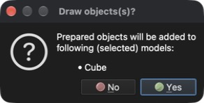

# Rysowanie sześcianu

Ten samouczek pokazuje, jak narysować (wygenerować) prostą geometrię, na przykład sześcian.

## 1. Utwórz nowy model

**Menu:** _Plik -> Nowy model_

Wpisz **Cube** jako nazwę modelu (opis jest opcjonalny) i kliknij **OK**. Zostanie utworzony nowy, pusty model o nazwie **Cube**. Ponieważ nowo utworzony model nie ma przypisanego problemu, wyświetlone zostanie okno dialogowe **Wybierz problem**.

### 1.1 Przypisz typ problemu

Aby przypisać typ problemu, kliknij kafelek **Heat transfer**, a następnie przycisk **OK**.

## 2. Narysuj sześcian

**Menu:** _Geometria -> Rysuj -> Rysuj sześciościan_

Po wybraniu tej pozycji menu po prawej stronie okna głównego pojawi się panel **Rysuj obiekt**, w którym można zmienić położenie i rozmiar obiektu oraz liczbę podziałów w kierunkach X, Y i Z. Domyślnym obiektem jest sześcian o boku 1 `[m]` umieszczony w początku układu współrzędnych.

Wyświetlany obiekt zmienia się jednocześnie ze zmianą wartości w panelu **Rysuj obiekt**. Pozostaw zaznaczone **Scal bliskie węzły** i kliknij przycisk **OK**, aby dodać obiekt do modelu. Pojawi się okno potwierdzenia **Draw objects(s)?** z listą wybranych modeli, do których obiekt zostanie dodany.

Kliknij **Yes** (Tak), aby potwierdzić, a sześcian zostanie dodany do modelu **Cube** jako jedna encja **Powierzchnia**.

## 3. Zapisz model

Aby zapisać model, wykonaj następującą akcję.

**Menu:** _Plik -> Zapisz model_

Jeśli model nie był wcześniej zapisany, program wyświetli okno dialogowe **Zapisz model** z proponowaną nazwą pliku (**Cube.rbm**) i folderem, w którym zostanie zapisany. Kliknij **Save** (Zapisz), aby zatwierdzić.
