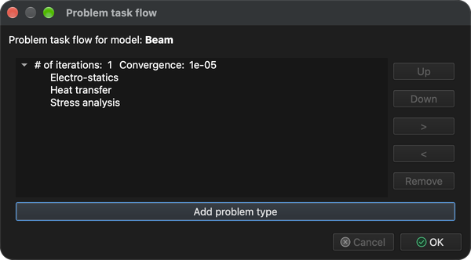
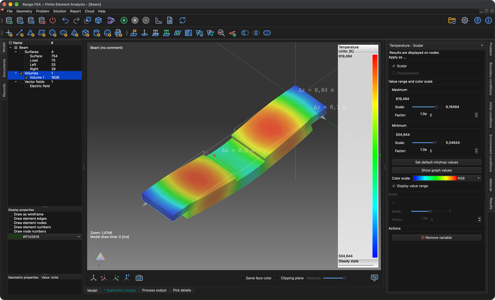

# Multifizyka

Ten samouczek pokazuje, jak rozwiązać kilka sprzężonych problemów na jednym modelu. Ponownie użyto modelu **Beam** z samouczka **Analiza naprężeń i odkształceń**. Tym razem przez belkę płynie prąd elektryczny, prąd nagrzewa belkę (ciepło Joule'a), a ciepło powoduje rozszerzanie się i odkształcanie belki.

Potrzebne są trzy typy problemów, rozwiązywane w tej kolejności:

1. **Electro-statics** (elektrostatyka) – oblicza potencjał elektryczny, pole elektryczne, gęstość prądu i ciepło Joule'a wytwarzane przez prąd.
2. **Heat transfer** (wymiana ciepła) – oblicza rozkład temperatury wywołany ciepłem Joule'a.
3. **Stress analysis** (analiza naprężeń) – oblicza rozszerzalność cieplną (przemieszczenia) i wynikające z niej naprężenia.

Każdy problem korzysta z wyników poprzedniego, więc kolejność problemów ma znaczenie.

## 1. Wczytaj model

**Menu:** _Plik -> Otwórz model_

W oknie **Otwórz model** wybierz **Beam.tmsh** i kliknij **Otwórz**.

Ponieważ do modelu nie przypisano jeszcze żadnego typu problemu, po zakończeniu wczytywania automatycznie otworzy się okno **Przebieg zadań problemu**.

## 2. Przebieg zadań problemu

1. W oknie **Przebieg zadań problemu** kliknij **Dodaj typ problemu**.
2. W oknie **Wybór typu problemu** zaznacz **Electro-statics**, **Heat transfer** i **Stress analysis**, a następnie kliknij **OK**.

**Przebieg zadań problemu** powinien teraz zawierać trzy problemy w jednej grupie iteracji, w kolejności pokazanej poniżej. Jeśli kolejność jest inna lub występują dodatkowe wpisy, wybierz wpis i popraw go przyciskami **W górę**, **W dół** i **Usuń**. Kliknij **OK**, aby zatwierdzić.

Okno można w każdej chwili otworzyć ponownie przyciskiem **Przebieg zadań problemów** na pasku narzędzi.

## 3. Wygeneruj siatkę 3D

Wszystkie trzy problemy są rozwiązywane na siatce objętościowej.

**Menu:** _Geometria -> Objętość -> Generuj siatkę czworościenną_

Wartości domyślne w oknie **Generuj siatkę 3D** są wystarczające. Kliknij **OK**. Po zakończeniu generowania siatki w drzewie **Model** pod **Objętości** pojawi się nowa encja **Volume 1**.

## 4. Przypisz materiał

Wszystkie encje modelu muszą mieć przypisany materiał. Materiał musi zapewniać właściwości potrzebne wszystkim trzem problemom; **Iron** (żelazo) je zapewnia.

1. W drzewie **Model** kliknij **Surface**, a następnie kliknij **Volume 1** z wciśniętym klawiszem _Shift_, aby wybrać wszystkie encje.
2. Otwórz kartę **Materiał** po prawej stronie okna głównego.
3. Zaznacz **Iron**.

## 5. Przypisz warunki brzegowe

Ponieważ wybrano kilka typów problemów, karta **Warunki brzegowe** oferuje teraz warunki ich wszystkich, a jedna encja może mieć przypisanych kilka warunków – po jednym dla każdego problemu. Przypisz następujące warunki do encji **powierzchni**:

1. **Surface** (zewnętrzna powierzchnia belki)
    - _Simple convection_ (konwekcja prosta)
        - Convection coefficient = 100 `[W/(m^2*K)]`
        - Fluid temperature = 293.15 `[K]`
2. **Load** (ściana pośrodku belki)
    - _Electric potential_ (potencjał elektryczny)
        - Electric potential = 0.4 `[V]`
    - _Simple convection_ (wartości jak dla **Surface**)
3. **Left** i **Right** (ściany na obu końcach belki)
    - _Displacement_ (przemieszczenie)
        - Displacement in X, Y and Z direction = 0 `[m]`
    - _Electric potential_
        - Electric potential = -0.4 `[V]`
    - _Simple convection_ (wartości jak dla **Surface**)

Prąd płynie więc od środka belki do obu jej końców, a wszystkie ściany oddają ciepło do otaczającego powietrza przez konwekcję.

Dla każdej encji: wybierz ją w drzewie **Model** (przytrzymaj _Ctrl_ / _⌘ Cmd_, aby wybrać jednocześnie **Left** i **Right**), zaznacz warunek na karcie **Warunki brzegowe**, wybierz warunek, aby wyświetlić jego właściwości pod listą, a następnie kliknij dwukrotnie wartość, wpisz nową i naciśnij _Enter_. Wartości domyślne **Simple convection** (100 `[W/(m^2*K)]` i 293.15 `[K]`) oraz **Displacement** (0 `[m]`) już się zgadzają, więc zmienić trzeba tylko **Electric potential**.

## 6. Sprawdź warunki otoczenia

Warunki otoczenia dotyczą całego modelu i nie zaznacza się ich tak jak warunków brzegowych. Otwórz kartę **Warunki otoczenia** i wybierz każdy warunek, aby sprawdzić jego wartości:

- _Gravitational acceleration_ (przyspieszenie ziemskie)
    - 0, 0 i -9.80665 `[m/s^2]` w kierunkach X, Y i Z
- _Temperature_ (temperatura)
    - Temperature = 293.15 `[K]`

## 7. Rozwiąż problem

**Menu:** _Rozwiązanie -> Uruchom solver_

Przed uruchomieniem solvera model musi zostać zapisany. Jeśli nie był jeszcze zapisany, najpierw wyświetli się okno **Zapisz model**; kliknij **Zapisz**, aby zatwierdzić (jeśli plik o tej samej nazwie już istnieje, potwierdź jego zastąpienie). Następnie wyświetli się okno **Uruchom solver dla modelu**.

Okno zawiera kilka ostrzeżeń, takich jak **Heat transfer: No explicit boundary condition assigned.** Są one oczekiwane w tej konfiguracji i można je zignorować. Kliknij **OK**, aby uruchomić solver.

Solver działa w tle, a jego wyjście jest wyświetlane na karcie **Wyjście procesu**. Problemy są rozwiązywane jeden po drugim w kolejności przebiegu zadań; obliczenia są zakończone, gdy wyjście kończy się napisem **SOLVER - END**.

## 8. Utwórz pole wektorowe

**Pole wektorowe** to encja wyświetlania, która rysuje zmienną wektorową w postaci strzałek. Tutaj służy do pokazania pola elektrycznego wewnątrz belki.

**Menu:** _Geometria -> Pole wektorowe -> Utwórz pole wektorowe_

W oknie **Edytor pól wektorowych** wybierz **Volume 1** na liście **Model** i **Electric field** (pole elektryczne) na liście **Zmienne**, a pole **Pole wektorowe 3D** pozostaw zaznaczone.

Kliknij **OK**, aby utworzyć pole wektorowe. Zostanie ono dodane do drzewa **Model** pod **Pola wektorowe**, a obliczone wyniki można do niego stosować jak do każdej innej encji modelu.

## 9. Zastosuj wyniki

Wyniki stosuje się na karcie **Wyniki** do encji wybranej w drzewie **Model**, tak samo jak w samouczku **Analiza naprężeń i odkształceń**.

### 9.1. Temperatura i odkształcenie objętości

1. W drzewie **Model** zaznacz **Objętości** (pozostawiając powierzchnie odznaczone), a następnie wybierz **Volume 1**.
2. Na karcie **Wyniki** wybierz **Temperature - Scalar** z listy rozwijanej, zaznacz **Scalar** i **Wyświetl zakres wartości**. Jeśli pokazany zakres nie odpowiada wynikom, kliknij **Ustaw domyślne wartości min./maks.**.
3. Wybierz **Displacement - Vector [3]** z listy rozwijanej, zaznacz **Displacement** i ustaw **Skala** na **20**, aby odkształcenie było widoczne (obliczone przemieszczenia wynoszą tylko około 1.3 mm).

Temperatura wynosi od około 505 K do 620 K; belka jest najgorętsza w środku swoich dwóch zewnętrznych odcinków i wygina się do góry, ponieważ utwierdzone końce nie pozwalają jej swobodnie się rozszerzać.

### 9.2. Temperatura na polu wektorowym

1. W drzewie **Model** odznacz **Objętości**, zaznacz **Pola wektorowe** i wybierz **Electric field**.
2. Na karcie **Wyniki** wybierz **Temperature - Scalar**, zaznacz **Scalar** i **Wyświetl zakres wartości**. Strzałki są teraz pokolorowane według temperatury w miejscu, w którym się znajdują.
3. We **Właściwościach wyświetlania** pod drzewem zaznacz **Rysuj groty strzałek**, aby pokazać kierunek pola elektrycznego.

