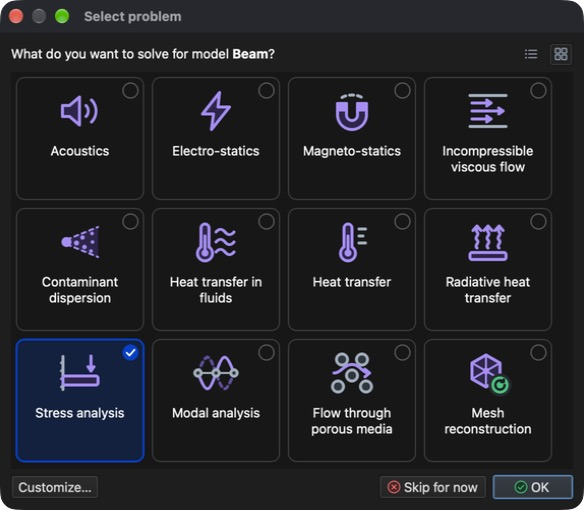
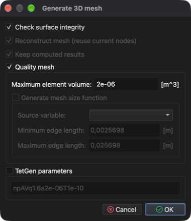
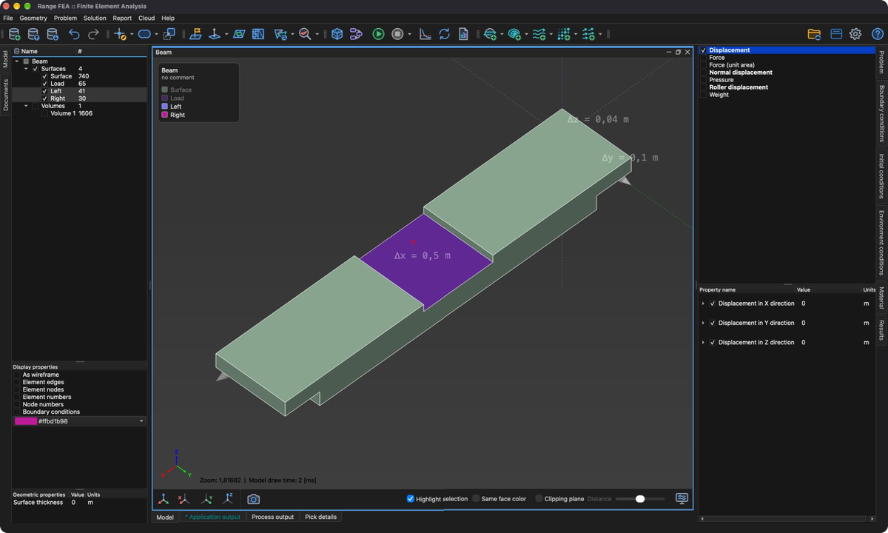
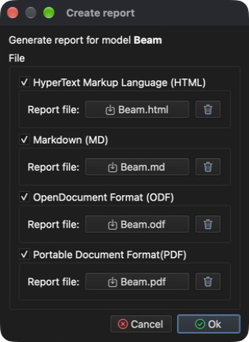

# Analiza naprężeń i odkształceń

Ten samouczek pokazuje, jak skonfigurować i rozwiązać problem **Stress analysis** (analiza naprężeń). Prosta belka zostanie podparta na obu końcach i obciążona w środku.

## 1. Wczytaj model

**Menu:** _Plik -> Otwórz model_

Pojawi się okno dialogowe **Otwórz model**. Wybierz plik **Beam.rbm** i kliknij **Open** (Otwórz), aby wczytać model.

Ponieważ do tego modelu nie przypisano żadnego problemu fizycznego, wkrótce po zakończeniu wczytywania pojawi się okno dialogowe **Wybierz problem**.

Kliknij kafelek **Stress analysis** i zatwierdź przyciskiem **OK**.

## 2. Wygeneruj siatkę 3D

Aby rozwiązać ten problem, trzeba wygenerować siatkę objętościową.

**Menu:** _Geometria -> Objętość -> Generuj siatkę czworościenną_

Ta akcja wyświetla okno dialogowe **Generuj siatkę 3D**.

Na razie wystarczą wartości domyślne. Zatwierdź przyciskiem **OK**.

Po wygenerowaniu siatki w **drzewie modelu** pojawi się nowa encja **Objętość**. Aby zobaczyć wygenerowaną siatkę, ukryj encje powierzchniowe, pokaż tylko **Objętości** i we **Właściwościach wyświetlania** zaznacz **Jako siatka krawędziowa**.

## 3. Przypisz materiał

Materiał można przypisać tylko do zaznaczonej encji modelu. Encje zaznacza się w **drzewie modelu**. Aby zaznaczyć wiele encji, przytrzymaj klawisz _Ctrl_ (_⌘ Cmd_ w macOS) podczas zaznaczania albo klawisz _Shift_, aby zaznaczyć zakres. Po zaznaczeniu wszystkich encji materiał można przypisać na zakładce **Materiał** po prawej stronie okna głównego.

**Drzewo modelu** i **lista materiałów** są widoczne na poniższym zrzucie ekranu.

Materiał jest przypisany, gdy pole wyboru przed jego nazwą jest zaznaczone. W tym samouczku używany jest **Iron** (żelazo).

_Uwaga: Wszystkie encje modelu muszą mieć przypisany materiał._

## 4. Przypisz warunki brzegowe

Warunki brzegowe to zadane wartości zmiennych pola (lub wielkości pokrewnych, np. pochodnych) na brzegach pola. Warunki brzegowe dzielą się na **jawne** i **niejawne**. Warunki **jawne** są wyróżnione **pogrubioną** czcionką.

W tym samouczku warunki brzegowe zostaną przypisane do encji **powierzchniowych** w następujący sposób:

1. **Load**
    - _Weight_ (ciężar)
        - Weight = 1000 `[kg]`
2. **Left** i **Right**
    - _Displacement_ (przemieszczenie)
        - Displacement in X direction = 0 `[m]`
        - Displacement in Y direction = 0 `[m]`
        - Displacement in Z direction = 0 `[m]`

Aby przypisać warunek brzegowy **Weight**:

1. Zaznacz encję **Load** w **drzewie modelu**.
2. Otwórz zakładkę **Warunki brzegowe**, a następnie wybierz warunek **Weight** i zaznacz jego pole wyboru.
3. We właściwości **Weight** zastąp wartość **1** wartością **1000** `[kg]`.

Aby przypisać warunek brzegowy **Displacement**:

1. Zaznacz encje **Left** i **Right** w **drzewie modelu** (przytrzymaj _Ctrl_ / _⌘ Cmd_, aby zaznaczyć obie).
2. Na zakładce **Warunki brzegowe** zaznacz warunek **Displacement** i jego pole wyboru.
3. Sprawdź, czy wszystkie wartości właściwości są ustawione na **0** `[m]`.

## 5. Przypisz warunki otoczenia

Aby warunek brzegowy **Weight** działał prawidłowo, musi być przypisany poprawny warunek otoczenia **Gravitational acceleration** (przyspieszenie grawitacyjne).

Warunków otoczenia nie zaznacza się jak warunków brzegowych. Otwórz zakładkę **Warunki otoczenia** i zaznacz **Gravitational acceleration**, aby sprawdzić jego wartości: 0, 0 i -9,80665 `[m/s^2]` w kierunkach X, Y i Z.

## 6. Rozwiąż problem

Gdy problem jest poprawnie skonfigurowany, można go rozwiązać.

**Menu:** _Rozwiązanie -> Uruchom solver_

Przed uruchomieniem solvera model musi zostać zapisany. Model **Beam** został otwarty z pliku, więc jest w nim zapisywany automatycznie; model, który nigdy nie był zapisany, najpierw wyświetla okno dialogowe **Zapisz model** (kliknij **Save** (Zapisz), a jeśli plik o tej nazwie już istnieje, potwierdź jego zastąpienie). Następnie wyświetlone zostanie okno dialogowe **Uruchom solver**.

Kliknij przycisk **OK**, aby uruchomić proces solvera.

Proces solvera działa w tle, a całe jego wyjście jest wyświetlane na zakładce **Wyjście procesu** poniżej obszaru 3D, jak widać na poniższym zrzucie ekranu. Obliczenia są zakończone, gdy wyjście kończy się wierszem **SOLVER - END**.

## 7. Wyświetl obliczone wyniki

Po pomyślnym zakończeniu procesu solvera obliczone wyniki powinny zostać wczytane automatycznie. Aby je wyświetlić, trzeba je zastosować do encji modelu. Robi się to na zakładce **Wyniki**. Wyniki są wyświetlane na zaznaczonych encjach modelu. W tym celu wróć na zakładkę **Model** poniżej obszaru 3D, ukryj wszystkie encje powierzchniowe, pokaż tylko **Objętości** i zaznacz **Volume 1** w **drzewie modelu**.

### 7.1. Przemieszczenie

Z menu rozwijanego wybierz **Displacement** (jeśli nie jest już wybrane). **Displacement** jest zmienną wektorową; można ją wyświetlić jako **Mapę kolorów** (encja zostanie pokolorowana według wartości przemieszczenia) i/lub jako **Kształt odkształcony** (encja się ugnie). Tym razem zaznacz pole wyboru **Kształt odkształcony** i ustaw **Skalę odkształcenia i strzałek** na **500**, aby odkształcenie było widoczne.

### 7.2. Naprężenie według Misesa

Podobnie jak **Displacement** wyświetl **Von Mises stress** na zaznaczonej encji **Objętość**: wybierz **Von Mises stress - Scalar** z menu rozwijanego i zaznacz **Mapa kolorów**. Kształt odkształcony ustawiony dla **Displacement** pozostanie widoczny. Dodatkowo zaznacz pole wyboru **Pokaż legendę**, aby wyświetlić zakres wartości w obszarze 3D.

**Von Mises stress** jest obliczane na elementach, dlatego każdy element jest rysowany jednym kolorem. Zaznacz **Wygładzone wyświetlanie**, aby uśrednić wartości elementów w węzłach i uzyskać ciągły obraz; zmienia to tylko wyświetlanie, a nie wyniki.

## 8. Utwórz raport

Czasem trzeba utworzyć raport, aby opublikować obliczone wyniki.

**Menu:** _Raport -> Utwórz raport_

Program może tworzyć raporty w wielu formatach (HTML, Markdown, ODF i PDF); wszystkie są domyślnie zaznaczone. Tym razem wystarczy utworzyć tylko dokument **PDF**, więc odznacz wszystkie formaty oprócz **Portable Document Format(PDF)** i kliknij przycisk **Ok**.

Po utworzeniu raportu zostanie wyświetlony komunikat **Documents have been generated.** (Dokumenty zostały utworzone). Zamknij go, klikając **OK**.

Utworzone dokumenty nie są wyświetlane automatycznie. Aby je zobaczyć, otwórz zakładkę **Dokumenty** po lewej stronie okna głównego, gdzie są wymienione pod nazwą modelu (**Beam**): raport w grupie **Dokumenty**, a obraz obszaru 3D użyty w raporcie w grupie **Obrazy**. Kliknij dwukrotnie dokument, który chcesz wyświetlić.

