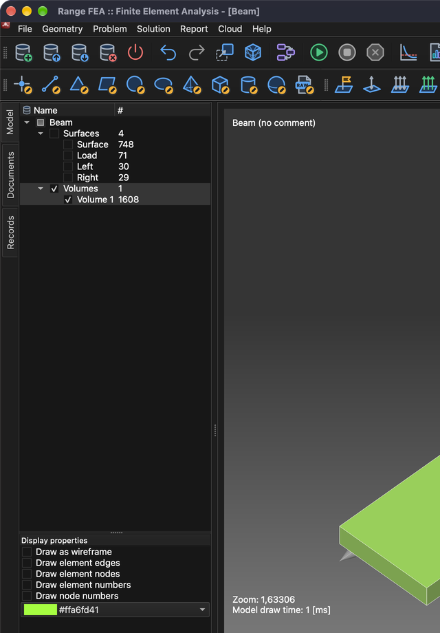
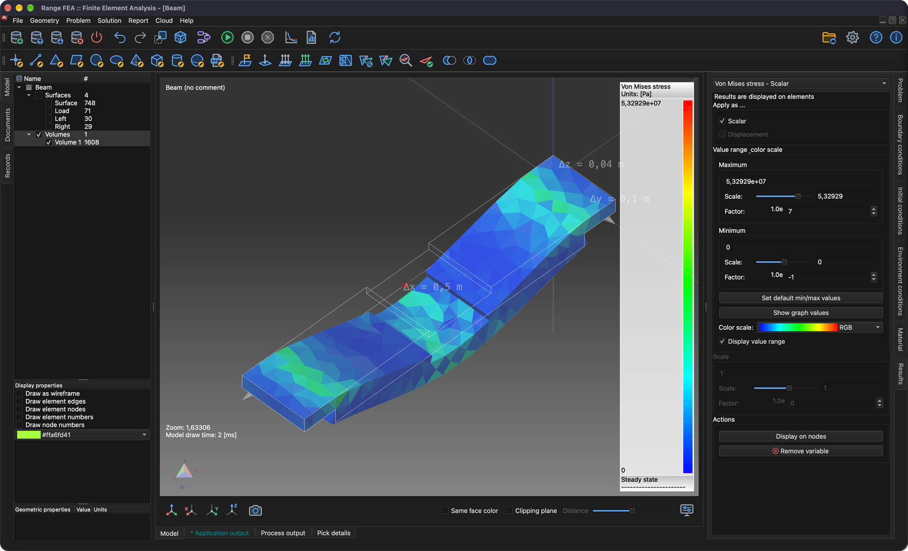

# Analiza naprężeń i odkształceń

Ten samouczek pokazuje, jak skonfigurować i rozwiązać problem typu **Stress analysis** (analiza naprężeń). W tym celu prosta belka zostanie podparta na obu końcach i obciążona pośrodku.

## 1. Wczytaj model

**Menu:** _Plik -> Otwórz model_

Pojawi się okno **Otwórz model**. Wybierz plik **Beam.tmsh** i kliknij **Otwórz**, aby wczytać model.

Ponieważ do tego modelu nie przypisano żadnego problemu fizycznego, wkrótce po zakończeniu wczytywania modelu pojawi się okno **Przebieg zadań problemu**.

Kliknij przycisk **Dodaj typ problemu**, a wyświetli się okno **Wybór typu problemu**. Znajdź i zaznacz **Stress analysis**, a następnie kliknij **OK**, aby zatwierdzić.

**Przebieg zadań problemu** powinien teraz wyświetlać 1 iterację **Stress analysis**. Kliknij **OK**, aby zatwierdzić.

## 2. Wygeneruj siatkę 3D

Aby rozwiązać ten problem, należy wygenerować siatkę objętościową.

**Menu:** _Geometria -> Objętość -> Generuj siatkę czworościenną_

Ta akcja otworzy okno **Generuj siatkę 3D**.

Na razie wartości domyślne są wystarczające. Kliknij **OK**, aby zatwierdzić.

Po wygenerowaniu siatki w **drzewie modelu** pojawi się nowa encja **Volume**. Aby zobaczyć wygenerowaną siatkę, ukryj encje powierzchni, pokaż tylko **Objętości** i zaznacz **Rysuj jako siatkę krawędziową** we **Właściwościach wyświetlania**.

## 3. Przypisz materiał

Materiał można przypisać tylko do wybranej encji modelu. Encje wybiera się w **drzewie modelu**. Aby wybrać kilka encji, przytrzymaj klawisz _Ctrl_ (_⌘ Cmd_ w systemie macOS) podczas wybierania lub przytrzymaj klawisz _Shift_, aby wybrać zakres. Po wybraniu wszystkich encji materiał można przypisać na karcie **Materiał** po prawej stronie okna głównego.

**Drzewo modelu** i **listę materiałów** widać na poniższym zrzucie ekranu.

Materiał jest przypisany, gdy pole wyboru przed jego nazwą jest zaznaczone. W tym samouczku używane jest **Iron** (żelazo).

_Uwaga: wszystkie encje modelu muszą mieć przypisany materiał._

## 4. Przypisz warunki brzegowe

Warunki brzegowe to zadane wartości zmiennych pola (lub zmiennych pokrewnych, takich jak pochodne) na brzegach pola. Warunki brzegowe dzielą się na **jawne** i **niejawne**. Warunki **jawne** są wyróżnione **pogrubioną** czcionką.

W tym samouczku warunki brzegowe zostaną przypisane do encji **powierzchni** w sposób opisany poniżej:

1. **Load**
    - _Weight_ (ciężar)
        - Weight = 1000 `[kg]`
2. **Left** i **Right**
    - _Displacement_ (przemieszczenie)
        - Displacement in X direction = 0 `[m]`
        - Displacement in Y direction = 0 `[m]`
        - Displacement in Z direction = 0 `[m]`

Aby przypisać warunek brzegowy **Weight**, wykonaj następujące kroki:

1. Wybierz encję **Load** w **drzewie modelu**.
2. Otwórz kartę **Warunki brzegowe**, a następnie wybierz i zaznacz warunek brzegowy **Weight**.
3. W polu wartości właściwości **Weight** zastąp **1** wartością **1000** `[kg]`.

Aby przypisać warunek brzegowy **Displacement**, wykonaj następujące kroki:

1. Wybierz encje **Left** i **Right** w **drzewie modelu** (przytrzymaj _Ctrl_ / _⌘ Cmd_, aby wybrać obie).
2. Wybierz i zaznacz warunek brzegowy **Displacement** na karcie **Warunki brzegowe**.
3. Sprawdź, czy wszystkie wartości właściwości są ustawione na **0** `[m]`.

## 5. Przypisz warunki otoczenia

Aby warunek brzegowy **Weight** działał prawidłowo, musi być poprawnie przypisany warunek otoczenia **Gravitational acceleration** (przyspieszenie ziemskie).

Warunków otoczenia nie zaznacza się tak jak warunków brzegowych. Otwórz kartę **Warunki otoczenia** i wybierz **Gravitational acceleration**, aby sprawdzić jego wartości: 0, 0 i -9.80665 `[m/s^2]` w kierunkach X, Y i Z.

## 6. Rozwiąż problem

Gdy problem jest poprawnie skonfigurowany, można go rozwiązać.

**Menu:** _Rozwiązanie -> Uruchom solver_

Przed uruchomieniem solvera model musi zostać zapisany. Jeśli nie był jeszcze zapisany, najpierw wyświetli się okno **Zapisz model**; kliknij **Zapisz**, aby zatwierdzić (jeśli plik o tej samej nazwie już istnieje, potwierdź jego zastąpienie). Następnie wyświetli się okno **Uruchom solver dla modelu**.

Kliknij **OK**, aby uruchomić proces solvera.

Proces solvera działa w tle, a całe jego wyjście jest wyświetlane na karcie **Wyjście procesu**, co widać na poniższym zrzucie ekranu.

## 7. Zastosuj obliczone wyniki

Po pomyślnym zakończeniu procesu solvera obliczone wyniki powinny zostać wczytane automatycznie. Aby je wyświetlić, należy zastosować je do encji modelu. Służy do tego karta **Wyniki**. Wyniki są stosowane do wybranych encji modelu. W tym celu ukryj wszystkie encje powierzchni i pokaż tylko **Objętości**.

### 7.1. Przemieszczenie

Z menu rozwijanego wybierz **Displacement** (jeśli nie jest już wybrane). **Displacement** to zmienna wektorowa; można ją zastosować jako **Scalar** (encja zostanie pokolorowana według modułu) i/lub jako **Displacement** (encja ulegnie odkształceniu). Tym razem zaznacz pole wyboru **Displacement** i ustaw **Skala** na **500**, aby zobaczyć odkształcenie.

### 7.2. Naprężenie zredukowane według von Misesa

Podobnie jak **Displacement** zastosuj **Von Mises Stress** (naprężenie zredukowane według von Misesa) do wybranej encji modelu **Volume**. Dodatkowo zaznacz pole wyboru **Wyświetl zakres wartości**, aby wyświetlić zakres wartości w obszarze 3D.

## 8. Utwórz raport

Czasami konieczne jest utworzenie raportu w celu opublikowania obliczonych wyników.

**Menu:** _Raport -> Utwórz raport_

Oprogramowanie może tworzyć raporty w wielu formatach (HTML, Markdown, ODF i PDF), które domyślnie są wszystkie zaznaczone. Tym razem wystarczy utworzyć tylko dokument **PDF**, więc odznacz wszystkie formaty oprócz **Portable Document Format(PDF)** i kliknij **OK**.

Po wygenerowaniu raportu wyświetli się komunikat **Documents have been generated.** (dokumenty zostały wygenerowane). Kliknij **OK**, aby go zamknąć.

Wygenerowane dokumenty nie są wyświetlane automatycznie. Aby je wyświetlić, przejdź do drzewa **Dokumenty** i kliknij dwukrotnie dokument, który chcesz zobaczyć.

