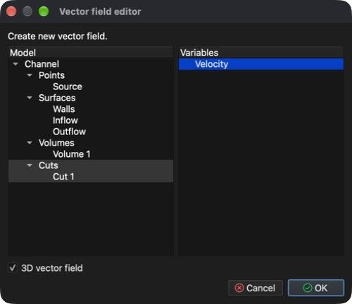
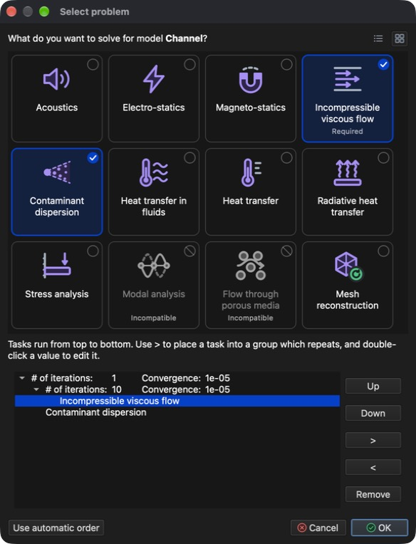
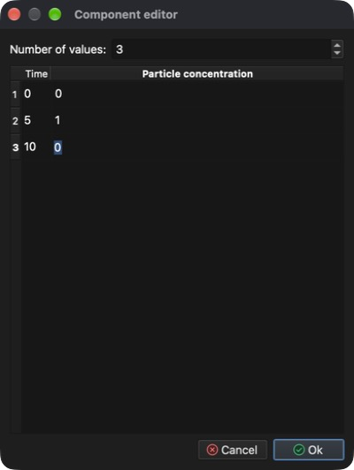

# Rozptyl kontaminantu v tekutinách

Tento tutoriál ukáže, ako nastaviť a vyriešiť multifyzikálnu simuláciu, ktorá kombinuje nelineárnu, iteračnú úlohu – **CFD (Computational Fluid Dynamics, výpočtová dynamika tekutín)** – s transportom kontaminantu unášaného prúdením.

Potrebné sú dva typy úloh:

1. **Incompressible viscous flow** (nestlačiteľné viskózne prúdenie) – počíta rýchlosť a tlak tekutiny (ustálené alebo prechodové prúdenie newtonovských tekutín).
2. **Contaminant dispersion** (rozptyl kontaminantu) – počíta, ako sa kontaminant v tomto prúdovom poli šíri.

Keďže je úloha prúdenia nelineárna, rieši sa iteračne. Simulácia preto prebieha v dvoch etapách:

1. **Ustálené prúdenie** – najprv sa bez kontaminantu vypočíta skonvergované „počiatočné“ prúdové pole a rozloženie tlaku.
2. **Prechodová simulácia** – potom sa z tohto prúdového poľa pomocou **časového kroku** sleduje, ako je pulz kontaminantu vstupujúci do kanála unášaný cezeň.

## 1. Načítať model

**Menu:** _Súbor -> Otvoriť model_

V dialógu **Otvoriť model** vyberte **Channel.rbm** a kliknite na **Open** (Otvoriť).

Model sa skladá z jedného bodového celku – **Source** – a troch povrchových celkov – **Walls**, **Inflow** a **Outflow**. Keďže modelu zatiaľ nie je priradený žiadny typ úlohy, po dokončení načítania sa automaticky otvorí dialóg **Vybrať úlohu**.

## 2. Vybrať úlohu (etapa 1 – ustálené prúdenie)

V prvej etape sa rieši iba prúdenie, a to s mnohými nelineárnymi iteráciami, aby mohlo skonvergovať.

1. V dialógu **Vybrať úlohu** kliknite na dlaždicu **Incompressible viscous flow**.
2. Ponechajte **Maximum iterácií** na **2000** a **Konvergencia** na **1e-05**, čo sú predvolené hodnoty pre ustálené prúdenie.
3. Dialóg zatvorte kliknutím na **OK**.

Dialóg možno kedykoľvek znova otvoriť tlačidlom **Vybrať úlohu** na paneli nástrojov.

## 3. Vygenerovať objemovú sieť

Model je definovaný iba svojimi povrchmi. Aby bolo možné vyriešiť prúdenie vo vnútri, treba najprv vygenerovať objemovú (tetrahedrónovú) sieť.

**Menu:** _Geometria -> Objem -> Generovať tetrahedrónovú sieť_

Predvyplnené hodnoty v dialógu **Generovať 3D sieť** postačia. Kliknite na **OK**. Po dokončení generovania sa v **strome modelu** pod **Objemy** objaví nový celok **Volume 1**.

## 4. Priradiť materiál

Všetky celky modelu musia mať priradený materiál.

1. V **strome modelu** rozbaľte **Objemy**, kliknite na **Source** a potom so stlačeným klávesom _Shift_ kliknite na **Volume 1**, čím vyberiete všetky celky.
2. Otvorte záložku **Materiál** na pravej strane hlavného okna.
3. Zaškrtnite **Water** (voda; je na konci zoznamu).

## 5. Okrajové podmienky (etapa 1)

Okrajové podmienky sa priraďujú v záložke **Okrajové podmienky** celku vybranému v **strome modelu**. **Povrchovým** celkom priraďte tieto podmienky:

1. **Walls**
    - _Wall_ (stena; hodnota nie je potrebná)
2. **Inflow**
    - _Volumetric flow rate (inflow)_ (objemový prietok, vtok)
        - Volumetric flow rate = 50 `[m^3/s]`
3. **Outflow**
    - _Pressure (implicit)_ (tlak, implicitný)
        - Pressure = 0 `[Pa]` (predvolená hodnota je 1000 `[Pa]`)

Pre každý celok: vyberte ho v **strome modelu**, v záložke **Okrajové podmienky** zaškrtnite podmienku, vyberte ju, aby sa pod zoznamom zobrazili jej vlastnosti, potom dvakrát kliknite na hodnotu, zadajte novú a stlačte _Enter_.

## 6. Vyriešiť ustálené prúdenie

**Menu:** _Riešenie -> Spustiť riešič_

Model **Channel** bol otvorený zo súboru, takže sa doň uloží automaticky. V dialógu **Spustiť riešič** kliknite na **OK**. Ak dialóg vypíše chybu, napríklad **Entity Source has no material assigned.**, je tlačidlo **OK** neaktívne; najprv priraďte tomuto celku materiál.

Riešič beží na pozadí a jeho výstup sa zobrazuje v záložke **Výstup procesu**. Výpočet všetkých 2000 iterácií trvá niekoľko minút; je dokončený, keď výstup končí riadkom **SOLVER - END**. Konvergenciu riešenia možno kedykoľvek skontrolovať pomocou:

**Menu:** _Výkaz -> Konvergencia riešiča_

## 7. Vytvoriť rez

Dobrým spôsobom, ako preskúmať prúdenie, je zobraziť rýchlosť ako **vektorové pole**, kde každá šípka ukazuje smer a veľkosť prúdenia v jednom bode. Vektorové pole vykreslené v celom objeme sa však rýchlo zmení na hustý mrak prekrývajúcich sa šípok, ktorý sa zle číta. Zvyčajne je prehľadnejšie model najprv rozrezať **rezom** – rovinou prechádzajúcou objemom – a vektorové pole zobraziť len na tejto rovine.

_Tip: Pred začiatkom zaškrtnite v **strome modelu** **Objemy**, aby bol objem pri umiestňovaní rezu viditeľný._

**Menu:** _Geometria -> Rez -> Vytvoriť rez_

V dialógu **Editor rezu**:

1. V zozname **Model** vyberte **Volume 1**. Rez sa vytvorí cez tento objem.
2. **Poloha roviny** určuje bod, ktorým rovina rezu prechádza. Predvolené hodnoty ju umiestňujú do stredu modelu (**X** = 7,5, **Y** = 2,5, **Z** = 1,5 `[m]`); ponechajte ich.
3. **Normála roviny** určuje orientáciu roviny. Predvolená normála (**X** = 1) dáva zvislú rovinu; zmeňte ju na **X** = 0, **Y** = 0, **Z** = 1, aby ste získali vodorovnú rovinu prechádzajúcu polovicou výšky kanála. Medzi poľami sa presúvajte klávesom _Tab_: stlačením _Enter_ sa potvrdí celý dialóg.

Rovina rezu sa počas zmeny hodnôt zobrazuje v náhľade v **3D oblasti modelu**. Kliknutím na **OK** rez vytvoríte. V **strome modelu** sa pod **Rezy** objaví nový celok **Cut 1**.

## 8. Vytvoriť vektorové pole

Teraz zobrazte vypočítanú rýchlosť ako šípky na rovine rezu.

**Menu:** _Geometria -> Vektorové pole -> Vytvoriť vektorové pole_

V dialógu **Editor vektorového poľa**:

1. V zozname **Model** vyberte **Cut 1**. Šípky sa vykreslia na rovine rezu vytvorenej v predchádzajúcom kroku.
2. V zozname **Premenné** vyberte **Velocity** (rýchlosť).
3. Ponechajte zaškrtnuté **3D vektorové pole**. Šípky potom ukazujú celý vektor rýchlosti. Bez zaškrtnutia sa každá šípka premietne do roviny rezu a zobrazí sa len zložka prúdenia v rovine.

Kliknutím na **OK** vektorové pole vytvoríte. Objaví sa v **strome modelu** pod **Vektorové polia** s názvom **Velocity**. Zrušte zaškrtnutie **Objemy**, aby plný objem nezakrýval šípky, a zaškrtnite **Vektorové polia**.

Šípky môžu byť príliš krátke, aby boli dobre viditeľné, pretože ich dĺžka je úmerná rýchlosti prúdenia. Ak ich chcete predĺžiť, vyberte vektorové pole v **strome modelu**, otvorte záložku **Výsledky** a zväčšite hodnotu v sekcii **Mierka deformácie a šípok**, napríklad na **100**. Hodnotu zadajte alebo posuňte posuvník vedľa nej.

## 9. Vybrať úlohu (etapa 2 – prechodová simulácia)

So skonvergovaným prúdovým poľom možno nastaviť **prechodovú** simuláciu vrátane **Contaminant dispersion**.

V prechodovej simulácii sa úlohy riešia raz v každom časovom kroku. **Incompressible viscous flow** je stále nelineárna, a preto potrebuje v každom časovom kroku vlastné nelineárne iterácie, zatiaľ čo **Contaminant dispersion** sa rieši raz v každom časovom kroku po prúdení. Znova otvorte dialóg **Vybrať úlohu** (tlačidlo **Vybrať úlohu** na paneli nástrojov) a nastavte ho takto:

1. Kliknite na dlaždicu **Contaminant dispersion** (**Incompressible viscous flow** zostane vybraná a je označená ako **Vyžadovaná**) a potom kliknutím na **Prispôsobiť…** zobrazte poradie krokov úlohy.
2. Vyberte **Incompressible viscous flow** a kliknite na tlačidlo **>**. Tým ju presuniete do novej, vnorenej skupiny iterácií.
3. Dvakrát kliknite na hodnotu vonkajšieho **# of iterations:** a zmeňte ju z **2000** na **1**. Potom zmeňte vnútorné (vnorené) **# of iterations:** z **1** na **10**.

Potvrďte kliknutím na **OK**.

## 10. Nastavenie riešiča v čase

Otvorte záložku **Úloha** na pravej strane hlavného okna a nastavte (medzi poľami sa presúvajte klávesom _Tab_):

1. Zaškrtnite **Riešič v čase**.
2. **Aproximácia**: **Backward difference (stable)** (spätná diferencia, stabilná).
3. **Veľkosť časového kroku**: **0,01** `[s]`.
4. **Počet časových krokov**: **2000**.
5. **Frekvencia výstupu**: **10** – záznam výsledkov sa zapíše každý 10. časový krok.

**Konečný čas** sa vypočíta automaticky (2000 × 0,01 s = 20 s).

V sekcii **Nastavenia rozptylu kontaminantu** nastavte **Maximum saturation** na **2,4** `[kg/m^3]` a **Diffusion coefficient** na **0,01** `[m^2/s]`. Viac informácií nájdete v teoretickej príručke.

## 11. Okrajové podmienky (etapa 2)

Kontaminant vstupuje do kanála vtokom. V **strome modelu** vyberte **Inflow** a v záložke **Okrajové podmienky** zaškrtnite **Particle concentration** (koncentrácia častíc; **Volumetric flow rate (inflow)** ponechajte zaškrtnuté).

Namiesto konštantnej hodnoty sa použije časovo závislá hodnota. Rozbaľte vlastnosť **Particle concentration** (šípka pred názvom) a kliknite na **Upraviť časovo závislé hodnoty**.

V dialógu **Editor zložiek** nastavte **Počet hodnôt** na **3** a zadajte nižšie uvedené hodnoty (bunku upravíte dvojklikom), potom kliknite na **Ok**.

| Čas `[s]` | Particle concentration `[kg/m^3]` |
| --------- | --------------------------------- |
| 0         | 0                                 |
| 5         | 1                                 |
| 10        | 0                                 |

Medzi dvoma zadanými časmi sa hodnota lineárne interpoluje a po poslednom zadanom čase zostáva posledná hodnota. S týmito hodnotami koncentrácia na vtoku počas prvých 5 sekúnd stúpa z 0 na 1 `[kg/m^3]` a medzi 5 a 10 sekundami klesá späť na 0.

## 12. Vyriešiť prechodovú úlohu (reštart)

**Menu:** _Riešenie -> Spustiť riešič_

V dialógu **Spustiť riešič** zaškrtnite **Reštartovať riešič / pokračovať** a kliknite na **OK**. Riešič potom použije už vypočítané ustálené prúdenie ako východiskový bod a pokračuje simuláciou s časovým krokom.

Upozornenie **Contaminant dispersion: No implicit boundary condition assigned.** je očakávané a možno ho ignorovať.

## 13. Zobraziť výsledky počas behu riešiča

Prechodový riešič beží na pozadí, takže výsledky možno prezerať, aj keď ešte počíta. Hneď ako sa zapíšu prvé záznamy, objaví sa na ľavej strane hlavného okna záložka **Záznamy**. Výsledky prechodového výpočtu sa zobrazia až po načítaní záznamu: otvorte záložku **Záznamy**, dvakrát kliknite na najnovší záznam a vráťte sa na záložku **Model** (viac o záznamoch pozri krok 14). Ďalšie zobrazovacie celky, ako sú rezy, izoplochy, prúdnicové čiary, vektorové alebo skalárové polia, možno vytvoriť kedykoľvek a zobraziť na nich vypočítané výsledky. Tu sa znova použije rez a vektorové pole z krokov 7 a 8.

### 13.1 Koncentrácia kontaminantu na reze

1. V **strome modelu** rozbaľte **Rezy**, zaškrtnite **Cut 1**, aby bol viditeľný, a vyberte ho.
2. Otvorte záložku **Výsledky** a v rozbaľovacej ponuke hore vyberte **Particle concentration - Scalar**. Ak ponuka obsahuje len **Velocity** a **Pressure**, ešte nebol načítaný žiadny záznam prechodového výpočtu.
3. V sekcii **Zobraziť na vybraných entitách** zaškrtnite **Farebná mapa**. Rez je teraz zafarbený podľa koncentrácie kontaminantu.
4. V sekcii **Farebný rozsah** nastavte **Max** na **1** a **Min** na **0** (zadajte hodnotu a stlačte _Enter_). To zodpovedá rozsahu koncentrácie na vtoku, takže rovnaké farby znamenajú rovnakú koncentráciu v každom časovom kroku.
5. Zaškrtnite **Zobraziť legendu**, aby sa v **3D oblasti modelu** zobrazila farebná stupnica.

### 13.2 Šípky vektorového poľa

Aby bol smer prúdenia nad zafarbeným rezom lepšie čitateľný, vykreslite šípky s hrotmi a bielou farbou:

1. Zaškrtnite **Vektorové polia** a v **strome modelu** vyberte vektorové pole (**Velocity** pod **Vektorové polia**).
2. V **Možnostiach zobrazenia** pod stromom zaškrtnite **Hroty šípiek**.
3. Kliknite na výber farby pod zaškrtávacími políčkami a zvoľte bielu (**#ffffffff**).

Ostatné možnosti zobrazenia určujú, či majú všetky šípky rovnakú dĺžku (**Šípky rovnako dlhé**) a či šípky začínajú v bode, v ktorom sa rýchlosť vyhodnocuje (**Šípky smerujúce von**).

## 14. Záznamy modelu (výsledky v čase)

Každý 10. časový krok (**Frekvencia výstupu**) riešič zapíše záznam modelu s riešením pre daný čas. Záznamy sú uvedené v záložke **Záznamy** na ľavej strane hlavného okna; stĺpec **Záznam** ukazuje číslo časového kroku (záznam **500** obsahuje riešenie v čase 500 × 0,01 s = 5 s). Dvojklikom na záznam načítate výsledky jeho časového kroku; načítaný záznam je označený šípkou a výsledky zobrazené v záložke **Výsledky** zostanú zachované a prekreslia sa preň. Legenda v **3D oblasti modelu** zobrazuje časový krok a čas načítaného záznamu (napr. **Time-step 520 · 5,19 s**). Tlačidlá v spodnej časti záložky prehrávajú záznamy jeden po druhom.

Výpočet všetkých 2000 časových krokov chvíľu trvá (asi 20 minút na súčasnom počítači). Riešič možno kedykoľvek zastaviť a doteraz zapísané záznamy zostanú zachované:

**Menu:** _Riešenie -> Zastaviť riešič_ (potvrďte tlačidlom **Yes** (Áno))

Po zastavení riešiča sa načíta posledný zapísaný záznam.

## 15. Nahrať video

Video sa vytvára z toho, čo je práve zobrazené v **3D oblasti modelu**, preto najprv nastavte pohľad a zobrazené výsledky (pozri krok 13). Nastavenia zobrazenia sa s modelom neukladajú, takže po jeho opätovnom otvorení ich treba nastaviť znova. Potom otvorte záložku **Záznamy**, pomocou polí **Od** a **Do** v spodnej časti zvoľte rozsah záznamov a kliknite na červené tlačidlo nahrávania.

Zobrazí sa dialóg **Nastavenia videa**, v ktorom možno nastaviť kodek videa, formát súboru, počet snímok za sekundu a počet snímok za záznam; pod nimi sa zobrazí odhadovaná dĺžka videa a počet záznamov. S 98 záznamami (riešič bol zastavený približne v čase 9,8 s), 24 snímkami za sekundu a 1 snímkou za záznam je video dlhé asi 4,1 sekundy; všetkých 200 záznamov úplného výpočtu dá asi 8,3 sekundy. Kliknutím na **OK** spustíte nahrávanie.

Nahrávanie môže chvíľu trvať, pretože sa postupne načíta každý záznam modelu a snímka obrazovky **3D oblasti modelu** sa použije ako snímka videa.

Video a všetky snímky (jeden obrázok PNG na záznam) nájdete v záložke **Dokumenty** pod **Channel**: video **Channel.mp4** pod **Videá** a snímky pod **Obrázky**. Dvojklikom video prehráte.

