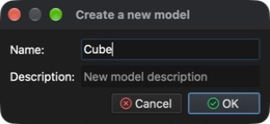
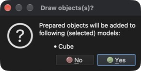

# Kresliť kocku

Tento tutoriál ukáže, ako nakresliť (vygenerovať) jednoduchú geometriu, napríklad kocku.

## 1. Vytvoriť nový model

**Menu:** _Súbor -> Nový model_

Zadajte **Cube** ako názov modelu (popis je nepovinný) a kliknite na **OK**. Vytvorí sa nový prázdny model s názvom **Cube**. Keďže novovytvorený model nemá priradenú žiadnu úlohu, zobrazí sa dialóg **Vybrať úlohu**.

### 1.1 Priradiť typ úlohy

Na priradenie typu úlohy kliknite na dlaždicu **Heat transfer** a potom na tlačidlo **OK**.

## 2. Nakresliť kocku

**Menu:** _Geometria -> Kresliť -> Nakresliť kváder_

Po spustení akcie sa na pravej strane hlavného okna zobrazí panel **Kresliť objekt**, v ktorom možno zmeniť polohu a veľkosť objektu a počet delení v smere X, Y a Z. Predvoleným objektom je kocka s hranou 1 `[m]` umiestnená v počiatku.

Zobrazený objekt sa mení súčasne so zmenou hodnôt v paneli **Kresliť objekt**. Ponechajte zaškrtnuté **Zlúčiť blízke uzly** a kliknutím na tlačidlo **OK** objekt pridajte do modelu. Zobrazí sa potvrdzovací dialóg **Draw objects(s)?** so zoznamom vybraných modelov, do ktorých sa objekt pridá.

Potvrďte kliknutím na **Yes** (Áno) a kocka sa pridá do modelu **Cube** ako jeden celok **Povrch**.

## 3. Uložiť model

Model uložíte touto akciou.

**Menu:** _Súbor -> Uložiť model_

Ak model ešte nebol uložený, program zobrazí dialóg **Uložiť model** s navrhnutým názvom súboru (**Cube.rbm**) a priečinkom, kam sa uloží. Potvrďte kliknutím na **Save** (Uložiť).
