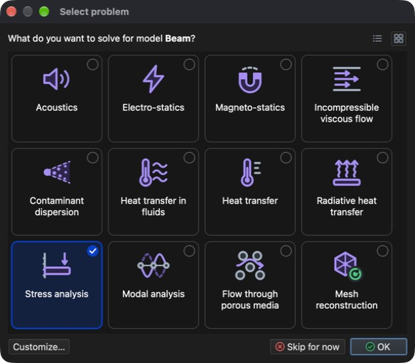
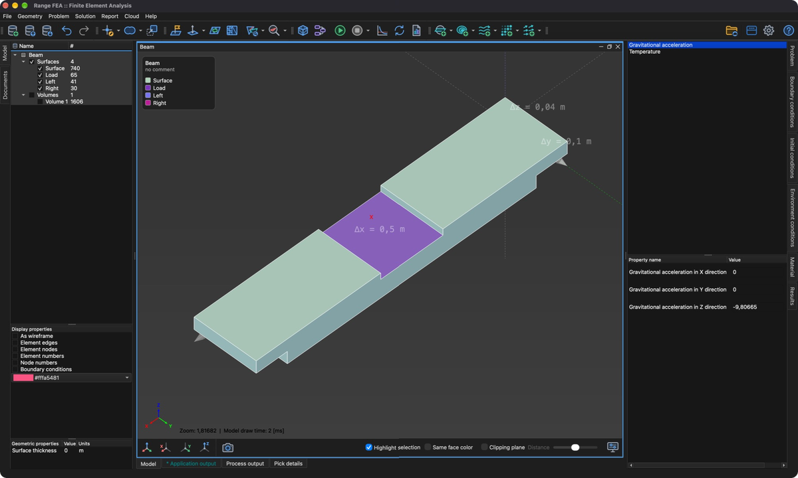
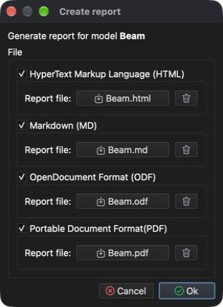

# Analýza napätia a deformácie

Tento tutoriál ukáže, ako nastaviť a vyriešiť úlohu **Stress analysis** (analýza napätia). Použije sa jednoduchý nosník podopretý na oboch koncoch so zaťažením v strede.

## 1. Načítať model

**Menu:** _Súbor -> Otvoriť model_

Zobrazí sa dialóg **Otvoriť model**. Vyberte súbor **Beam.rbm** a kliknutím na **Open** (Otvoriť) model načítajte.

Keďže tomuto modelu nie je priradená žiadna fyzikálna úloha, krátko po dokončení načítania sa zobrazí dialóg **Vybrať úlohu**.

Kliknite na dlaždicu **Stress analysis** a potvrďte kliknutím na **OK**.

## 2. Vygenerovať 3D sieť

Na vyriešenie tejto úlohy treba vygenerovať objemovú sieť.

**Menu:** _Geometria -> Objem -> Generovať tetrahedrónovú sieť_

Táto akcia zobrazí dialóg **Generovať 3D sieť**.

Zatiaľ postačia predvyplnené hodnoty. Potvrďte kliknutím na tlačidlo **OK**.

Po vygenerovaní siete sa v **strome modelu** objaví nový celok **Objem**. Ak chcete vygenerovanú sieť zobraziť, skryte povrchové celky, zobrazte iba **Objemy** a v **Možnostiach zobrazenia** zaškrtnite **Ako drôtený model**.

## 3. Priradiť materiál

Materiál možno priradiť iba vybraným celkom modelu. Celky sa vyberajú v **strome modelu**. Ak chcete vybrať viac celkov, podržte počas výberu kláves _Ctrl_ (na macOS _⌘ Cmd_), prípadne kláves _Shift_ na výber rozsahu. Po výbere všetkých celkov možno materiál priradiť v záložke **Materiál** na pravej strane hlavného okna.

**Strom modelu** a **zoznam materiálov** sú zobrazené na nasledujúcej snímke obrazovky.

Materiál je priradený, keď je zaškrtnuté políčko pred jeho názvom. V tomto tutoriáli sa použije **Iron** (železo).

_Poznámka: Všetky celky modelu musia mať priradený materiál._

## 4. Priradiť okrajové podmienky

Okrajové podmienky sú zadané hodnoty premenných poľa (alebo súvisiacich veličín, napríklad derivácií) na hraniciach poľa. Okrajové podmienky sa delia na **explicitné** a **implicitné**. **Explicitné** podmienky sú zvýraznené **tučným** písmom.

V tomto tutoriáli sa okrajové podmienky priradia **povrchovým** celkom takto:

1. **Load**
    - _Weight_ (hmotnosť)
        - Weight = 1000 `[kg]`
2. **Left** a **Right**
    - _Displacement_ (posunutie)
        - Displacement in X direction = 0 `[m]`
        - Displacement in Y direction = 0 `[m]`
        - Displacement in Z direction = 0 `[m]`

Okrajovú podmienku **Weight** priradíte takto:

1. Vyberte celok **Load** v **strome modelu**.
2. Otvorte záložku **Okrajové podmienky**, vyberte a zaškrtnite okrajovú podmienku **Weight**.
3. Vo vlastnosti **Weight** nahraďte hodnotu **1** hodnotou **1000** `[kg]`.

Okrajovú podmienku **Displacement** priradíte takto:

1. Vyberte celky **Left** a **Right** v **strome modelu** (na výber oboch podržte _Ctrl_ / _⌘ Cmd_).
2. V záložke **Okrajové podmienky** vyberte a zaškrtnite okrajovú podmienku **Displacement**.
3. Overte, že všetky hodnoty vlastností sú nastavené na **0** `[m]`.

## 5. Priradiť podmienky prostredia

Aby okrajová podmienka **Weight** fungovala správne, musí byť priradená správna podmienka prostredia **Gravitational acceleration** (gravitačné zrýchlenie).

Podmienky prostredia sa nezaškrtávajú ako okrajové podmienky. Otvorte záložku **Environmentálne podmienky** a vyberte **Gravitational acceleration**, aby ste overili jej hodnoty: 0, 0 a -9,80665 `[m/s^2]` v smere X, Y a Z.

## 6. Vyriešiť úlohu

Keď je úloha správne nastavená, možno ju vyriešiť.

**Menu:** _Riešenie -> Spustiť riešič_

Pred spustením riešiča musí byť model uložený. Model **Beam** bol otvorený zo súboru, takže sa doň uloží automaticky; model, ktorý ešte nikdy nebol uložený, najprv zobrazí dialóg **Uložiť model** (potvrďte kliknutím na **Save** (Uložiť), a ak už súbor s rovnakým názvom existuje, potvrďte jeho nahradenie). Potom sa zobrazí dialóg **Spustiť riešič**.

Kliknutím na tlačidlo **OK** spustíte proces riešiča.

Proces riešiča beží na pozadí a celý jeho výstup sa zobrazuje v záložke **Výstup procesu** pod 3D oblasťou, ako je vidieť na snímke obrazovky nižšie. Výpočet je dokončený, keď výstup končí riadkom **SOLVER - END**.

## 7. Zobraziť vypočítané výsledky

Po úspešnom dokončení procesu riešiča by sa vypočítané výsledky mali načítať automaticky. Aby sa zobrazili, treba ich použiť na celky modelu. To sa robí v záložke **Výsledky**. Výsledky sa zobrazujú na vybraných celkoch modelu. Na tento účel sa vráťte na záložku **Model** pod 3D oblasťou, skryte všetky povrchové celky, zobrazte iba **Objemy** a v **strome modelu** vyberte **Volume 1**.

### 7.1. Posunutie

V rozbaľovacej ponuke vyberte **Displacement** (ak ešte nie je vybrané). **Displacement** je vektorová premenná; možno ju zobraziť ako **Farebnú mapu** (celok sa zafarbí podľa veľkosti posunutia) a/alebo ako **Deformovaný tvar** (celok sa ohne). Tentoraz zaškrtnite políčko **Deformovaný tvar** a nastavte **Mierka deformácie a šípok** na **500**, aby bola deformácia viditeľná.

### 7.2. Napätie podľa von Misesa

Podobne ako **Displacement** zobrazte **Von Mises stress** na vybranom celku **Objem**: v rozbaľovacej ponuke vyberte **Von Mises stress - Scalar** a zaškrtnite **Farebná mapa**. Deformovaný tvar nastavený pre **Displacement** zostane zobrazený. Navyše zaškrtnite políčko **Zobraziť legendu**, aby sa v 3D oblasti zobrazil rozsah hodnôt.

**Von Mises stress** sa počíta na prvkoch, preto je každý prvok vykreslený jednou farbou. Zaškrtnutím **Vyhladené zobrazenie** sa hodnoty prvkov spriemerujú v uzloch a obraz bude spojitý; mení sa tým iba zobrazenie, nie výsledky.

## 8. Vytvoriť správu

Niekedy je potrebné vytvoriť správu, v ktorej sa vypočítané výsledky publikujú.

**Menu:** _Výkaz -> Vytvoriť správu_

Softvér vie vytvárať správy vo viacerých formátoch (HTML, Markdown, ODT a PDF), všetky sú predvolene zaškrtnuté. Tentoraz stačí vytvoriť iba dokument **PDF**, preto zrušte zaškrtnutie všetkých formátov okrem **Portable Document Format(PDF)** a kliknite na tlačidlo **Ok**.

Po vytvorení správy sa zobrazí hlásenie **Documents have been generated.** (Dokumenty boli vytvorené). Zatvorte ho kliknutím na **OK**.

Vytvorené dokumenty sa automaticky nezobrazia. Ak ich chcete zobraziť, otvorte záložku **Dokumenty** na ľavej strane hlavného okna, kde sú uvedené pod názvom modelu (**Beam**): správa pod **Dokumenty** a obrázok 3D oblasti použitý v správe pod **Obrázky**. Dvojklikom otvoríte dokument, ktorý chcete zobraziť.

