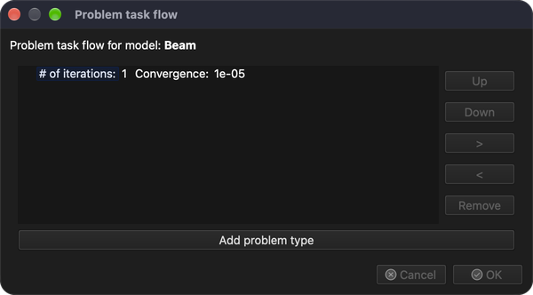
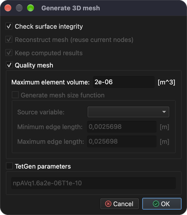
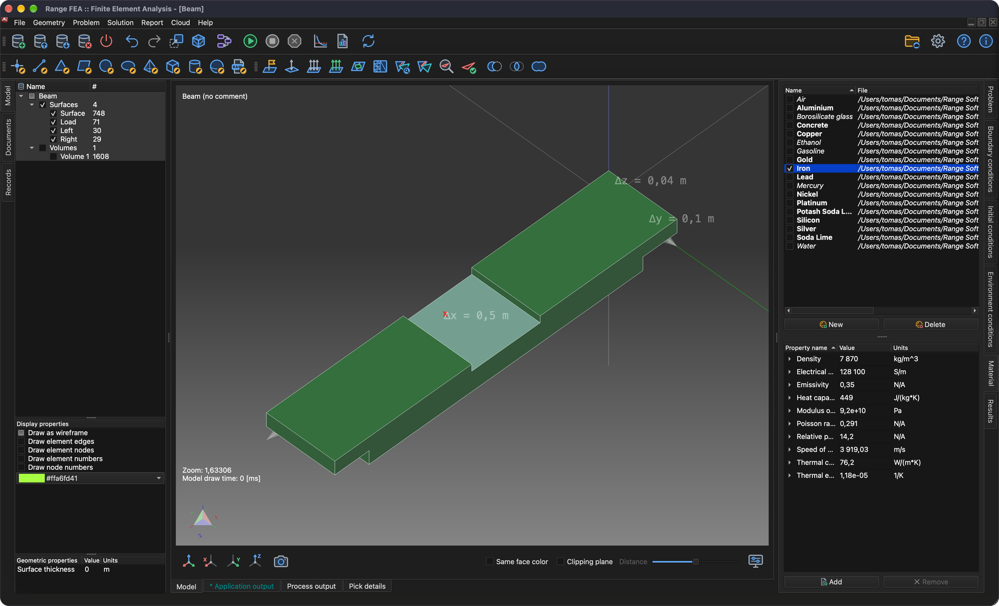

# Analýza napätia a deformácie

Tento návod ukáže, ako nastaviť a vyriešiť úlohu **Stress analysis** (analýza napätia). Použije sa jednoduchý nosník podopretý na oboch koncoch so zaťažením v strede.

## 1. Načítať model

**Menu:** _Súbor -> Otvoriť model_

Zobrazí sa dialóg **Otvoriť model**. Vyberte súbor **Beam.tmsh** a kliknutím na **Otvoriť** model načítajte.

Keďže tomuto modelu nie je priradená žiadna fyzikálna úloha, krátko po dokončení načítania sa zobrazí dialóg **Poradie krokov úlohy**.

Kliknite na tlačidlo **Pridať typ úlohy** a zobrazí sa dialóg **Výber typu úlohy**. Nájdite a zaškrtnite **Stress analysis** a potvrďte kliknutím na **OK**.

Dialóg **Poradie krokov úlohy** by teraz mal zobrazovať 1 iteráciu úlohy **Stress analysis**. Potvrďte kliknutím na **OK**.

## 2. Vygenerovať 3D sieť

Na vyriešenie tejto úlohy treba vygenerovať objemovú sieť.

**Menu:** _Geometria -> Objem -> Generovať tetrahedrónovú sieť_

Táto akcia zobrazí dialóg **Vygenerovať 3D sieť**.

Predvyplnené hodnoty sú zatiaľ postačujúce. Potvrďte kliknutím na **OK**.

Po vygenerovaní siete sa v strome **Model** objaví nový celok v skupine **Objemy**. Ak chcete vygenerovanú sieť vidieť, skryte celky povrchov, zobrazte iba **Objemy** a v **Možnosti zobrazenia** zaškrtnite **Vykresliť ako drôtený model**.

## 3. Priradiť materiál

Materiál možno priradiť iba vybraným celkom modelu. Celky sa vyberajú v strome **Model**. Ak chcete vybrať viac celkov, podržte počas výberu kláves _Ctrl_ (na macOS _⌘ Cmd_), prípadne kláves _Shift_ na výber rozsahu. Po výbere všetkých celkov možno materiál priradiť v záložke **Materiál** na pravej strane hlavného okna.

Strom **Model** a zoznam materiálov sú zobrazené na nasledujúcej snímke obrazovky.

Materiál je priradený, keď je zaškrtnuté políčko pred jeho názvom. V tomto návode sa použije **Iron** (železo).

_Poznámka: Všetky celky modelu musia mať priradený materiál._

## 4. Priradiť okrajové podmienky

Okrajové podmienky sú zadané hodnoty premenných poľa (alebo súvisiacich veličín, napríklad derivácií) na hraniciach poľa. Okrajové podmienky sa delia na **explicitné** a **implicitné**. **Explicitné** podmienky sú zvýraznené **tučným** písmom.

V tomto návode sa okrajové podmienky priradia **celkom povrchu** takto:

1. **Load**
    - _Weight_ (hmotnosť)
        - Weight = 1000 `[kg]`
2. **Left** a **Right**
    - _Displacement_ (posunutie)
        - posunutie v smere X = 0 `[m]`
        - posunutie v smere Y = 0 `[m]`
        - posunutie v smere Z = 0 `[m]`

Okrajovú podmienku **Weight** priradíte takto:

1. V strome **Model** vyberte celok **Load**.
2. Otvorte záložku **Okrajové podmienky**, vyberte a zaškrtnite okrajovú podmienku **Weight**.
3. V poli hodnoty vlastnosti **Weight** nahraďte **1** hodnotou **1000** `[kg]`.

Okrajovú podmienku **Displacement** priradíte takto:

1. V strome **Model** vyberte celky **Left** a **Right** (na výber oboch podržte _Ctrl_ / _⌘ Cmd_).
2. V záložke **Okrajové podmienky** vyberte a zaškrtnite okrajovú podmienku **Displacement**.
3. Skontrolujte, že všetky hodnoty vlastností sú nastavené na **0** `[m]`.

## 5. Priradiť environmentálne podmienky

Aby okrajová podmienka **Weight** fungovala správne, musí byť nastavená správna environmentálna podmienka **Gravitational acceleration** (gravitačné zrýchlenie).

Environmentálne podmienky sa nezaškrtávajú ako okrajové podmienky. Otvorte záložku **Environmentálne podmienky** a vyberte **Gravitational acceleration**, aby ste skontrolovali jej hodnoty: 0, 0 a -9.80665 `[m/s^2]` v smere X, Y a Z.

## 6. Vyriešiť úlohu

Keď je úloha správne nastavená, možno ju vyriešiť.

**Menu:** _Riešenie -> Spustiť riešič_

Pred spustením riešiča musí byť model uložený. Ak ešte nebol uložený, najprv sa zobrazí dialóg **Uložiť model**; potvrďte ho kliknutím na **Uložiť** (ak súbor s rovnakým názvom už existuje, potvrďte jeho nahradenie). Potom sa zobrazí dialóg **Spustiť riešič pre model**.

Kliknutím na **OK** spustíte proces riešiča.

Proces riešiča beží na pozadí a celý jeho výstup sa zobrazuje v záložke **Výstup procesu**, ako vidno na nasledujúcej snímke obrazovky.

## 7. Použiť vypočítané výsledky

Po úspešnom dokončení procesu riešiča by sa vypočítané výsledky mali načítať automaticky. Aby sa výsledky zobrazili, treba ich použiť na celky modelu. Robí sa to v záložke **Výsledky**. Výsledky sa použijú na vybrané celky modelu. Na tento účel skryte všetky celky povrchov a zobrazte iba **Objemy**.

### 7.1. Posunutie

V rozbaľovacom zozname vyberte **Displacement** (ak ešte nie je vybrané). **Displacement** je vektorová premenná; možno ju použiť ako **Scalar** (celok sa zafarbí podľa veľkosti posunutia) a/alebo ako **Displacement** (celok sa prehne). Tentokrát zaškrtnite políčko **Displacement** a **Mierka** nastavte na **500**, aby bola deformácia viditeľná.

### 7.2. Von Misesovo napätie

Podobne ako **Displacement** použite na vybraný celok v skupine **Objemy** aj **Von Mises Stress** (Von Misesovo napätie). Navyše zaškrtnite políčko **Zobraziť rozsah hodnôt**, aby sa rozsah hodnôt zobrazil v 3D oblasti.

## 8. Vytvoriť správu

Niekedy treba vytvoriť správu, v ktorej sa publikujú vypočítané výsledky.

**Menu:** _Výkaz -> Vytvoriť správu_

Program dokáže vytvárať správy vo viacerých formátoch (HTML, Markdown, ODF a PDF), pričom všetky sú predvolene zaškrtnuté. Tentokrát stačí vytvoriť iba dokument **PDF**, preto zrušte zaškrtnutie všetkých formátov okrem **Portable Document Format(PDF)** a kliknite na **Ok**.

Po vytvorení správy sa zobrazí správa **Documents have been generated.** (dokumenty boli vytvorené). Zatvorte ju kliknutím na **OK**.

Vytvorené dokumenty sa nezobrazujú automaticky. Ak ich chcete zobraziť, prejdite do stromu **Dokumenty** a dvakrát kliknite na dokument, ktorý chcete otvoriť.

