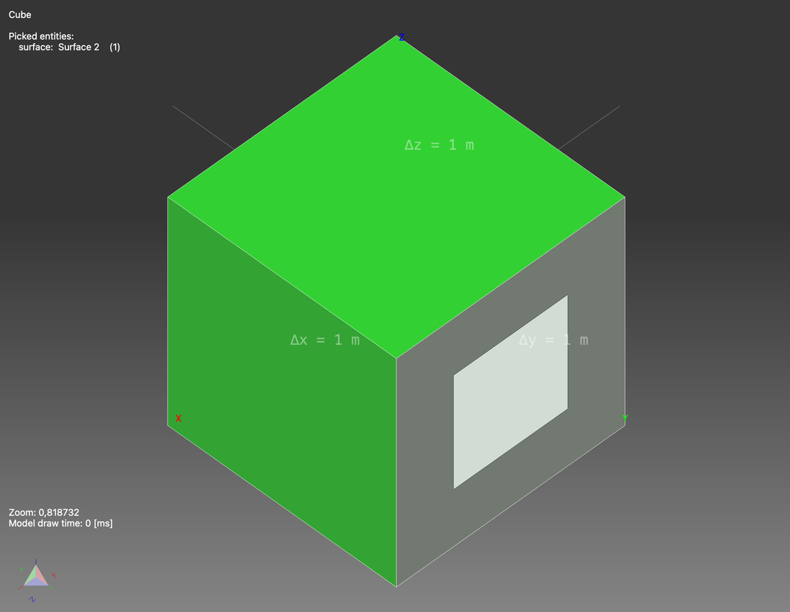
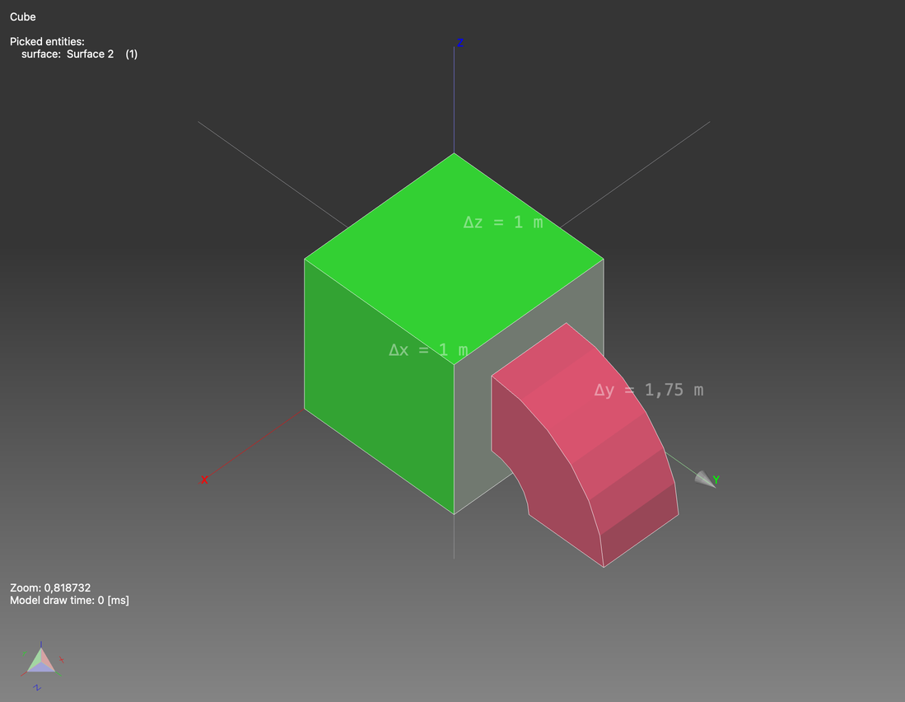

# Transformovať geometriu

Tento návod nadväzuje na návod **Kresliť kocku** a ukáže, ako škálovať, otáčať a posúvať celú geometriu alebo len jej časti.

## 1. Načítať model

Ak model **Cube** ešte nie je načítaný, otvorte ho akciou menu **_Otvoriť model_**.

**Menu:** _Súbor -> Otvoriť model_

Zobrazí sa dialóg **Otvoriť model**. Vyberte súbor **Cube.rbm** a kliknite na **Otvoriť**.

Keď je model načítaný, jeho geometriu (celú alebo jej časť) možno upravovať (transformovať).

## 2. Príprava

**Menu:** _Geometria -> Škálovať, presunúť, otočiť_

Po aktivovaní položky menu sa na pravej strane hlavného okna zobrazí panel **Transformovať geometriu** s troma záložkami: **Mierka**, **Otočiť** a **Presunúť**.

V tomto návode sa všetky transformácie postupne použijú na jednu stranu kocky.

Momentálne sú všetky strany modelu **Cube** zoskupené v jednom **celku povrchu**. Preto treba jednu stranu **označiť** ako samostatný **celok povrchu**, aby sa transformácie použili iba na túto stranu a nie na ostatné. Slúži na to akcia menu **_Označiť povrch_**. Najprv však treba stranu kocky vyznačiť.

## 3. Vyznačiť stranu

Stlačte a podržte kláves **_Ctrl_** (na macOS **_⌘ Cmd_**) a kliknite **_ľavým tlačidlom myši_** na jednu stranu kocky. Vyznačený prvok sa zvýrazní. Keďže model **Cube** pozostáva zo 6 obdĺžnikových (štvoruholníkových) prvkov, jeden prvok zodpovedá jednej strane kocky.

## 4. Označiť povrch

**Menu:** _Geometria -> Povrch -> Označiť povrch_

Táto akcia zobrazí dialóg **Označiť celok**. Keďže v predchádzajúcom kroku bol vyznačený jeden prvok, je predvolene vybraná možnosť **_Označiť iba vybrané a súvisiace prvky_**. Kliknutím na tlačidlo **Ok** sa jedna strana modelu **Cube** označí ako samostatný **celok povrchu**.

_**Poznámka:** Akýkoľvek celok možno premenovať **dvojitým kliknutím** **ľavým tlačidlom myši** na jeho názov v strome **Model** na ľavej strane hlavného okna._

## 5. Škálovať vyznačený celok (stranu kocky)

Vyznačte označený povrch (**_Ctrl_** / **_⌘ Cmd_** + **_ľavé tlačidlo myši_**) a otvorte panel **Transformovať geometriu**.

**Menu:** _Geometria -> Škálovať, presunúť, otočiť_

1. Zaškrtnite **Rovnaká mierka vo všetkých smeroch**.
2. Hodnotu **Mierka** nastavte na 0,5 (použite desatinný oddeľovač vášho systému, napr. 0,5 alebo 0.5).
3. Kliknite na tlačidlo **Nastaviť z vyznačeného prvku/uzlu**.
4. V skupine **Použiť na** vyberte **Označené celky**.
5. Skontrolujte, že je zaškrtnutá možnosť **Zahrnúť zdieľané uzly** a **všetky** jej podriadené zaškrtávacie políčka.

Správne nastavenie je zobrazené na nasledujúcej snímke obrazovky.

Kliknite na **Ok**. Výsledok je zobrazený na nasledujúcej snímke obrazovky.

## 6. Otočiť vyznačený celok (škálovanú stranu kocky)

Otočením vyznačeného povrchu možno vytvoriť vytiahnutý povrch. Otvorte panel **Transformovať geometriu**.

**Menu:** _Geometria -> Škálovať, presunúť, otočiť_

Prepnite sa na záložku **Otočiť** a zadajte hodnoty podľa nasledujúcej snímky obrazovky:

1. V **Uhly rotácie** nastavte **X** na -90.
2. Kliknite na tlačidlo **Nastaviť z vyznačeného prvku/uzlu** a potom v **Stred rotácie** zmeňte **Z** na 0.
3. V skupine **Použiť na** vyberte **Označené celky**.
4. Skontrolujte, že sú zaškrtnuté možnosti **Zahrnúť zdieľané uzly**, **Rozpojiť/rozdeliť zdieľané uzly** a **Natiahnuť uzly**, a **Počet krokov natiahnutia** nastavte na 6.

_Poznámka: **Počet krokov natiahnutia: 6** vytvorí šesť nových segmentov._

Kliknite na **Ok**. Výsledok je zobrazený na nasledujúcej snímke obrazovky.

