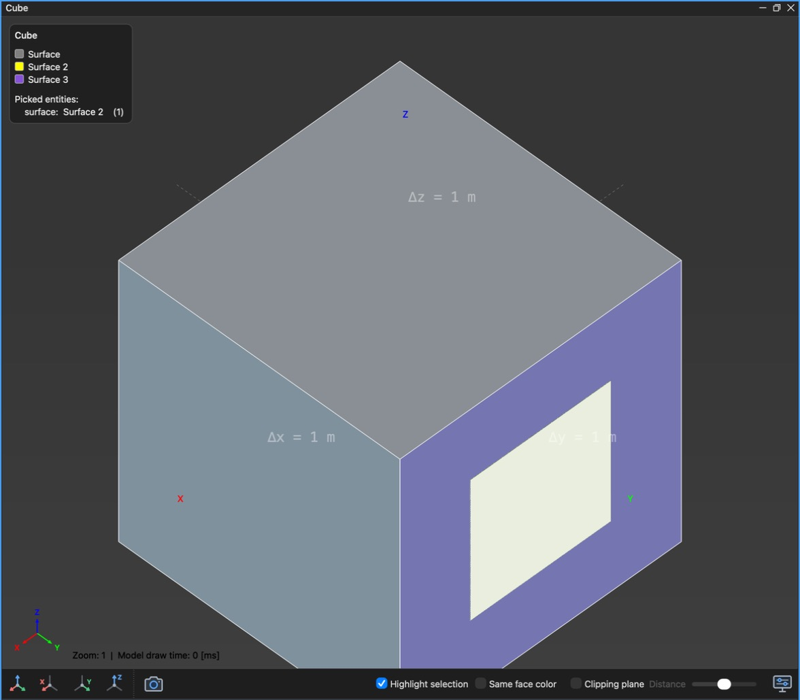

# Transformovať geometriu

Tento tutoriál nadväzuje na tutoriál **Kresliť kocku** a ukáže, ako škálovať, otáčať a presúvať celú geometriu alebo len jej časti.

## 1. Načítať model

Ak model **Cube** ešte nie je načítaný, možno to urobiť akciou **_Otvoriť model_**.

**Menu:** _Súbor -> Otvoriť model_

Zobrazí sa dialóg **Otvoriť model**. Vyberte súbor **Cube.rbm** a kliknite na **Open** (Otvoriť).

Keď je model pripravený, jeho geometriu (celú alebo časť) možno upraviť (transformovať).

## 2. Príprava

**Menu:** _Geometria -> Škálovať, presunúť, otočiť_

Po spustení akcie sa na pravej strane hlavného okna zobrazí panel **Transformovať geometriu** s tromi záložkami: **Mierka**, **Otočiť** a **Presunúť**. Skupina **Použiť na** pod záložkami určuje, ktorá časť modelu sa transformuje.

V tomto tutoriáli sa všetky transformácie postupne použijú na jednu stenu kocky. Panel zatiaľ zatvorte kliknutím na **Zrušiť**.

V tejto chvíli sú všetky steny modelu **Cube** zoskupené v jednom **celku povrchu**. Preto treba jednu stenu **označiť** ako samostatný **celok povrchu**, aby sa transformácie použili iba na túto stenu a nie na ostatné. Na to slúži akcia **_Označiť povrch_**. Najprv však treba stenu kocky vybrať.

## 3. Vybrať stenu

Stlačte a podržte kláves **_Ctrl_** (na macOS **_⌘ Cmd_**) a kliknite **_ľavým tlačidlom myši_** na stenu kocky, ktorá smeruje k osi **Y**. Vybraný prvok sa zvýrazní a zobrazí sa v sekcii **Picked entities** v prehľade v ľavom hornom rohu 3D oblasti. Keďže sa model **Cube** skladá zo 6 obdĺžnikových (štvoruholníkových) prvkov, jeden prvok zodpovedá jednej stene kocky.

## 4. Označiť povrch

**Menu:** _Geometria -> Povrch -> Označiť povrch_

Táto akcia zobrazí dialóg **Mark entity (surface)**. Keďže bol v predchádzajúcom kroku jeden prvok **vybraný**, je predvolená možnosť **_Označiť iba vybrané a súvisiace prvky_**. Kliknutím na tlačidlo **Ok** sa jedna stena modelu **Cube** označí ako samostatný **celok povrchu** s názvom **Surface 2**.

_**Poznámka:** Každý celok možno premenovať **dvojklikom** **ľavým tlačidlom myši** na názov celku v **strome modelu** na ľavej strane hlavného okna._

## 5. Škálovať vybraný celok (stenu kocky)

Vyberte označený povrch (**_Ctrl_** / **_⌘ Cmd_** + **_ľavé tlačidlo myši_**) a otvorte panel **Transformovať geometriu**.

**Menu:** _Geometria -> Škálovať, presunúť, otočiť_

1. Na záložke **Mierka** ponechajte zaškrtnuté **Rovnaká mierka vo všetkých smeroch**.
2. Nastavte hodnotu **Mierka** na 0,5 (použite desatinný oddeľovač vášho systému, napr. 0,5 alebo 0.5).
3. Kliknite na tlačidlo **Nastaviť z vyznačeného prvku/uzlu**. **Stred škálovania** sa nastaví do stredu vybranej steny (0,5; 1; 0,5).
4. V skupine **Použiť na** vyberte **Označené celky**.
5. Uistite sa, že je zaškrtnuté **Zahrnúť zdieľané uzly** aj všetky jeho podriadené zaškrtávacie políčka.

Správne nastavenie je vidieť na nasledujúcej snímke obrazovky.

Kliknite na **Ok**. Vybraná stena sa zmenší na polovicu a medzera medzi zmenšenou stenou a zvyškom kocky sa vyplní novým celkom povrchu (**Surface 3**). Výsledok je vidieť na nasledujúcej snímke obrazovky.

## 6. Otočiť vybraný celok (zmenšenú stenu kocky)

Otočením vybraného povrchu možno vytvoriť natiahnutý povrch. Otvorte panel **Transformovať geometriu**.

**Menu:** _Geometria -> Škálovať, presunúť, otočiť_

Prepnite na záložku **Otočiť** a zadajte hodnoty podľa nasledujúcej snímky obrazovky:

1. Nastavte **Uhly rotácie** **X** na -90.
2. Kliknite na tlačidlo **Nastaviť z vyznačeného prvku/uzlu** a potom zmeňte **Stred rotácie** **Z** na 0.
3. V skupine **Použiť na** vyberte **Označené celky**.
4. Uistite sa, že sú zaškrtnuté **Zahrnúť zdieľané uzly**, **Rozpojiť/rozdeliť zdieľané uzly** a **Natiahnuť uzly**, a nastavte **Počet krokov natiahnutia** na 6.

_Poznámka: **Počet krokov natiahnutia: 6** vytvorí šesť nových segmentov._

Kliknite na **Ok**. Natiahnuté segmenty sa pridajú ako nový celok povrchu (**Surface 4**). Výsledok je vidieť na nasledujúcej snímke obrazovky.

