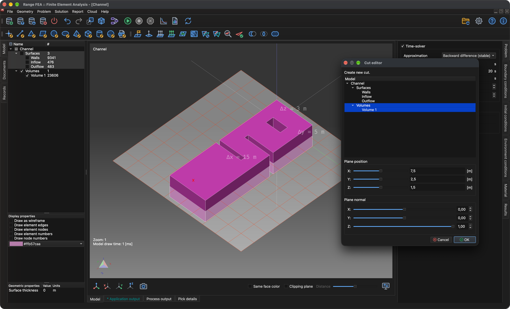

# Дисперсія забруднення в рідинах

У цьому підручнику показано, як налаштувати та розв’язати багатофізичне моделювання, яке поєднує нелінійну ітераційну задачу – **CFD (обчислювальна гідродинаміка)** – із транспортуванням забруднювача, що переноситься потоком.

Необхідні два типи задач:

1. **Нестислива в'язка течія** - обчислює швидкість і тиск рідини (стаціонарний або перехідний потік ньютонівських рідин).
2. **Розсіювання забруднення** - обчислює, як забруднення поширюється в цьому полі потоку.

Оскільки задача потоку є нелінійною, її розв’язують ітераційно. Таким чином, моделювання виконується в два етапи:

1. **Потік у стаціонарному стані** - спочатку обчислюється конвергентне «початкове» поле потоку та розподіл тиску без будь-яких забруднень.
2. **Перехідна симуляція** - тоді, починаючи з цього поля потоку, **часовий марш** використовується для відстеження того, як імпульс забруднення, що надходить у канал, переноситься через нього.

## 1. Завантажте модель

**Меню:** _Файл -> Відкрити модель_

У діалоговому вікні **Відкрити модель** виберіть **Channel.tmsh** і натисніть **Відкрити**.

Модель складається з трьох поверхневих сутностей - **Стінки**, **Приплив** і **Відтік**. Оскільки моделі ще не призначено тип задачі, після завершення завантаження автоматично відкриється діалогове вікно **Потік завдання задачі**.

## 2. Послідовність розв’язування задач (стадія 1 - потік стаціонарного стану)

Для першого етапу розв’язується лише потік, використовуючи багато нелінійних ітерацій, щоб він міг сходитися.

1. У діалоговому вікні **Послідовність розв’язування задач** натисніть **Додати тип задачі**.
2. У **Вибір типу задачі** позначте **Нестисливий в’язкий потік** і натисніть **ОК**.
3. Двічі клацніть значення **1** поруч із **# ітерацій:**, введіть **2000** і натисніть _Enter_.
4. Натисніть **Гаразд**, щоб закрити діалогове вікно.

Діалогове вікно можна відкрити знову в будь-який час за допомогою кнопки **Задача(и) потоку завдань** на панелі інструментів. Тепер це має виглядати так:

## 3. Створіть об'ємну сітку

Модель визначається лише своїми поверхнями. Щоб розв’язати потік всередині нього, спочатку потрібно створити об’ємну (тетраедральну) сітку.

**Меню:** _Геометрія -> Об'єм -> Створити тетраедральну сітку_

Попередньо заповнених значень у діалоговому вікні **Створити 3D-сітку** достатньо. Натисніть **ОК**. Після завершення створення сітки нова сутність **Том 1** з’являється в розділі **Об’єми** в дереві **Модель**.

## 4. Роздайте матеріал

Усі сутності моделі повинні мати призначений матеріал.

1. У дереві **Модель** клацніть **Стіни**, а потім, утримуючи _Shift_, клацніть **Том 1**, щоб вибрати всі сутності.
2. Відкрийте вкладку **Матеріал** у правій частині головного вікна.
3. Перевірте **Вода**.

## 5. Граничні умови (етап 1)

Граничні умови призначаються на вкладці **Граничні умови** об’єкту, вибраному в дереві **Модель**. Призначте наступні умови для сутностей **поверхня**:

1. **Стіни**
    - _Стінка_ (значення не потрібне)
2. **Приплив**
    - _Об'ємна швидкість потоку (приплив)_
        - Об'ємна швидкість потоку = 50 `[m^3/s]`
3. **Відтік**
    - _Тиск (неявний)_
        - Тиск = 0 `[Pa]` (значення за замовчуванням 1000 `[Pa]`)

Для кожної сутності: виберіть її в дереві **Модель**, перевірте умову на вкладці **Граничні умови**, виберіть умову, щоб відобразити її властивості під списком, потім двічі клацніть значення, введіть нове та натисніть _Enter_.

## 6. Розв’яжіть стаціонарний потік

**Меню:** _Рішення -> Запустити розв'язувач_

Якщо модель ще не збережено, спочатку буде показано діалогове вікно **Зберегти модель**. Натисніть **Зберегти**, щоб прийняти запропоноване ім’я файлу (**Channel.rbm**), а потім натисніть **ОК** у діалоговому вікні **Почати розв’язувач**.

Розв’язувач працює у фоновому режимі, а його результати відображаються на вкладці **Вихід процесу**. Обчислення всіх 2000 ітерацій займає кілька хвилин; виконання завершується, коли вихід закінчується **SOLVER - END**. Збіжність розв'язку можна перевірити в будь-який час за допомогою:

**Меню:** _Звіт -> Збіжність розв'язувача_

## 7. Створіть розріз

Хороший спосіб перевірити потік — це відобразити швидкість як **векторне поле**, де кожна стрілка показує напрямок і величину потоку в одній точці. Проте векторне поле, проведене через весь об’єм, швидко перетворюється на щільну хмару стрілок, що накладаються одна на одну, яку важко прочитати. Зазвичай зрозуміліше спочатку розрізати модель **розрізом** - площиною через об'єм - а потім відобразити векторне поле лише на цій площині.

_Порада: перед початком перевірте **Об’єми** в дереві **Модель**, щоб об’єм було видно під час позиціонування розрізу._

**Меню:** _Геометрія -> Вирізати -> Створити переріз_

У діалоговому вікні **Редактор перерізу**:

1. Виберіть **Том 1** у списку **Модель**. Через цей обсяг буде створено розріз.
2. **Положення площини** встановлює точку, через яку проходить площина розрізу. Стандартні значення розміщують його в центрі моделі (**X** = 7,5, **Y** = 2,5, **Z** = 1,5 `[m]`); тримати їх.
3. **Нормаль площини** встановлює орієнтацію площини. Стандартна нормаль (**X** = 1) дає вертикальну площину; змініть його на **X** = 0, **Y** = 0, **Z** = 1, щоб отримати горизонтальну площину, що прорізає середину висоти каналу.

Розрізна площина попередньо переглядається в **області 3D-моделі** під час зміни значень. Натисніть **ОК**, щоб створити розріз. Нова сутність **Cut 1** з’являється в дереві **Модель** у розділі **Перерізи**.

## 8. Створіть векторне поле

Тепер відобразіть обчислену швидкість у вигляді стрілок на площині розрізу.

**Меню:** _Геометрія -> Векторне поле -> Створити векторне поле_

У діалоговому вікні **Редактор векторних полів**:

1. Виберіть **Cut 1** у списку **Модель**. Стрілки будуть намальовані на площині розрізу, створеній на попередньому кроці.
2. Виберіть **Швидкість** у списку **Змінні**.
3. Залиште позначеним **3D векторне поле**. Тоді стрілки показують повний вектор швидкості. Якщо не позначено, кожна стрілка проектується на площину розрізу, і відображається лише частина потоку в площині.

Натисніть **Гаразд**, щоб створити векторне поле. Він відображається в дереві **Модель** у розділі **Векторні поля**. Зніміть прапорець **Обсяги**, щоб суцільний обсяг не приховував стрілки.

Стрілки можуть бути занадто короткими, щоб їх було чітко видно, оскільки їх довжина пропорційна швидкості потоку. Щоб зробити їх довшими, виберіть векторне поле в дереві **Модель**, відкрийте вкладку **Результати** і збільште значення в розділі **Масштаб**. Масштаб – це добуток значення **Шкала** на ступінь десяти, встановлений у **Коефіцієнті**; у наведеному нижче прикладі **Шкала** 1 і **Коефіцієнт** 2 дають шкалу `1 × 10^2 = 100`.

## 9. Хід розв’язування задач (етап 2 - перехідний)

Завдяки конвергентному полю потоку можна налаштувати моделювання **перехідних процесів**, включаючи **Розсіювання забруднень**.

У моделюванні перехідних процесів задачі вирішуються один раз за часовий крок. **Потік нестисливої ​​в’язкої рідини** все ще є нелінійним, тому йому потрібні власні нелінійні ітерації в кожному часовому кроці, тоді як **Дисперсія забруднень** розв’язується один раз за часовий крок після потоку. Знову відкрийте діалогове вікно **Потік завдань задачі** (кнопка панелі інструментів **Потік завдань задачі**) і налаштуйте його таким чином:

1. Виберіть **Нестисливий в’язкий потік** і натисніть кнопку **>**. Це переміщує його до нової вкладеної групи ітерацій.
2. Двічі клацніть значення зовнішнього **# ітерацій:** і змініть його з **2000** на **1**. Потім змініть внутрішній (вкладений) **# ітерацій:** з **1** на **10**.
3. Клацніть **Додати тип задачі**, позначте **Розсіювання забруднень** і натисніть **ОК**. **Нестислива в’язка течія** також перевіряється автоматично, оскільки дисперсія забруднюючих речовин потребує поля течії. Якщо на зовнішньому рівні додано другий запис **Нестислива в’язка течія**, виберіть його та натисніть **Видалити**.

Потік завдань має виглядати, як на знімку екрана нижче. Натисніть **ОК**, щоб прийняти.

## 10. Налаштування розв’язування в часі

Відкрийте вкладку **Задача** у правій частині головного вікна та встановіть:

1. Перевірте **Розв’язування в часі**.
2. **Наближення**: **Зворотна різниця (стабільна)**.
3. **Розмір кроку в часі**: **0,01** `[s]`.
4. **Кількість часових кроків**: **2000**.
5. **Частота виведення**: **10** - запис результату записується на кожному 10-му часовому кроку.

**Час завершення** обчислюється автоматично (2000 × 0,01 с = 20 с).

У розділі **Налаштування дисперсії забруднення** встановіть **Максимальне насичення** на **2,4** `[kg/m^3]` і **Коефіцієнт дифузії** на **0,01** `[m^2/s]`. Для отримання додаткової інформації зверніться до теоретичного посібника.

## 11. Граничні умови (етап 2)

Забруднювач потрапляє в канал через приплив. Виберіть **Приплив** у дереві **Модель** і на вкладці **Граничні умови** позначте **Концентрація частинок** (залиште прапорцем **Об’ємна швидкість потоку (приплив)**).

Замість постійного значення буде використано значення, що залежить від часу. Розгорніть властивість **Концентрація частинок** (стрілка перед назвою) і натисніть **Редагувати значення, що залежать від часу**.

У діалоговому вікні **Редактор компонентів** встановіть **Кількість значень** на **3** і введіть значення нижче (двічі клацніть клітинку, щоб відредагувати її), а потім натисніть **Гаразд**.

| Час `[s]` | Концентрація частинок `[kg/m^3]` |
| ---------- | --------------------------------- |
| 0          | 0                                 |
| 5          | 1                                 |
| 10         | 0                                 |

Між двома вказаними моментами часу значення лінійно інтерполюється, а після останнього вказаного часу зберігається останнє значення. З цими значеннями концентрація припливу зростає від 0 до 1 `[kg/m^3]` протягом перших 5 секунд і падає до 0 між 5 і 10 секундами.

## 12. Вирішіть тимчасову задачу (перезапустіть)

**Меню:** _Рішення -> Запустити розв'язувач_

У діалоговому вікні **Запустити розв’язувач** позначте **Перезапустити розв’язувач / продовжити** та натисніть **ОК**. Потім розв’язувач використовує вже обчислений стаціонарний потік як початкову точку та продовжує моделювання маршування в часі.

Очікується попередження **Дисперсія забруднюючих речовин: неявних граничних умов не призначено.**, і його можна ігнорувати.

## 13. Показувати результати під час роботи розв’язувача

Перехідний розв’язувач працює у фоновому режимі, тому результати можна перевірити, поки він ще обчислюється. Інші об’єкти відображення, такі як розрізи, ізо, лінії потоку, векторні поля або скалярні поля, можна створити в будь-який час, і на них можна відобразити обчислені результати. Тут повторно використовуються розріз і векторне поле з кроків 7 і 8.

### 13.1 Концентрація забруднення на зрізі

1. У дереві **Модель** розгорніть **Вирізи**, позначте **Виріз 1**, щоб він був видимим, і виберіть його.
2. Відкрийте вкладку **Результати** та оберіть **Концентрація частинок - Скаляр** у розкривному списку вгорі.
3. Під **Застосувати як ...** позначте **Скалярний**. Зріз тепер забарвлюється концентрацією забруднення.
4. У розділі **Діапазон значень і колірна шкала** встановіть **Максимум** на **1** і **Мінімум** на **0** (введіть значення та натисніть _Enter_). Це відповідає діапазону концентрації потоку, тому однакові кольори означають однакову концентрацію на кожному кроці часу.
5. Перевірте **Діапазон відображення значень**, щоб відобразити колірну шкалу в **області 3D-моделі**.

### 13.2 Стрілки векторного поля

Щоб полегшити читання напрямку потоку поверх кольорового розрізу, намалюйте стрілки з голівками та білим кольором:

1. Виберіть векторне поле (**Швидкість** у розділі **Векторні поля**) у дереві **Модель**.
2. У **Властивості відображення** під деревом позначте **Намалювати стрілки**.
3. Клацніть селектор кольорів під прапорцями та виберіть білий (**#ffffffff**).

Інші властивості відображення визначають, чи всі стрілки мають однакову довжину (**Малювати стрілки однакової довжини**) і чи починаються стрілки в точці, де оцінюється швидкість (**Малювати стрілки, що вказують від**).

## 14. Записи моделі (результати в часі)

Кожен 10-й часовий крок (**Вихідна частота**) розв’язувач записує модельний запис, що містить рішення для цього часу. Записи перераховані на вкладці **Записи** в лівій частині головного вікна; стовпець **Запис** показує номер кроку за часом (запис **500** містить розв’язок 500 × 0,01 с = 5 с). Двічі клацніть запис, щоб завантажити результати для його кроку часу; результати, застосовані на вкладці **Результати**, зберігаються та перемальовуються для завантаженого запису.

Обчислення всіх 2000 часових кроків займає деякий час (близько 20 хвилин на поточному комп’ютері). Розв’язувач може бути зупинений у будь-який час, а записи, записані до цього моменту, зберігаються:

**Меню:** _Рішення -> Зупинити розв’язувач_ (підтвердіть **Так**)

## 15. Запишіть відео

Відео створюється з того, що зараз показано в **області 3D-моделі**, тому спочатку налаштуйте перегляд і відображувані результати (див. крок 13). Параметри дисплея не зберігаються разом із моделлю, тому після повторного відкриття їх потрібно налаштувати знову. Потім відкрийте вкладку **Записи**, за допомогою полів **Від** і **Кому** внизу виберіть діапазон записів і натисніть червону кнопку **Записати**.

З’явиться діалогове вікно **Налаштування відео**, де можна встановити відеокодек, формат файлу, кількість кадрів за секунду та кількість кадрів на запис; приблизна тривалість відео показана нижче. З 202 записами, 24 кадрами в секунду та 1 кадром на запис відео триває приблизно 8,4 секунди. Натисніть **ОК**, щоб почати запис.

Записування може тривати деякий час, оскільки кожен запис моделі завантажується по черзі, а знімок екрана **3D-області моделі** береться як відеокадр.

Відео та всі кадри (одне зображення PNG на запис) можна знайти на вкладці **Документи** у розділі **Канал**; відео **Channel.mp4** знаходиться в кінці списку. Двічі клацніть його, щоб відтворити відео.

