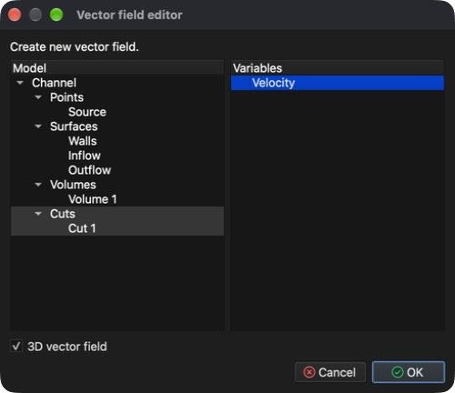
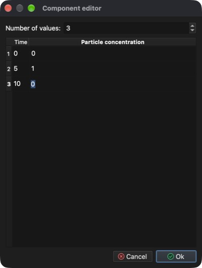
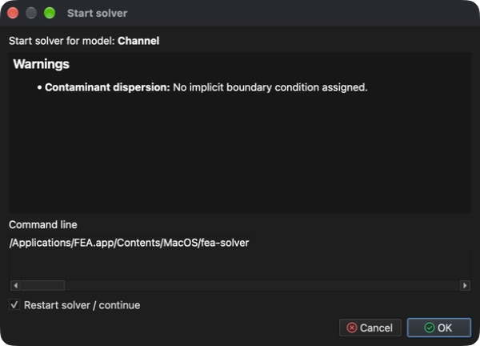

# Дисперсія забруднень у рідинах

Цей підручник показує, як налаштувати й розв’язати мультифізичну симуляцію, яка поєднує нелінійну ітераційну задачу – **CFD (Computational Fluid Dynamics, обчислювальна гідродинаміка)** – з перенесенням забруднювача, що його несе потік.

Потрібні два типи задач:

1. **Incompressible viscous flow** (нестислива в’язка течія) – обчислює швидкість і тиск рідини (стаціонарна або нестаціонарна течія ньютонівських рідин).
2. **Contaminant dispersion** (дисперсія забруднення) – обчислює, як забруднювач поширюється в цьому полі течії.

Оскільки задача течії нелінійна, її розв’язують ітераційно. Тому симуляція виконується у два етапи:

1. **Стаціонарна течія** – спочатку без забруднювача обчислюється збіжне «початкове» поле течії та розподіл тиску.
2. **Нестаціонарна симуляція** – потім, починаючи з цього поля течії, за допомогою **кроків за часом** відстежується, як імпульс забруднювача, що входить у канал, переноситься крізь нього.

## 1. Завантажити модель

**Меню:** _Файл -> Відкрити модель_

У діалоговому вікні **Відкрити модель** виберіть **Channel.rbm** і натисніть **Open** (Відкрити).

Модель складається з однієї точкової сутності – **Source** – і трьох поверхневих сутностей – **Walls**, **Inflow** і **Outflow**. Оскільки моделі ще не призначено жодного типу задачі, після завершення завантаження автоматично відкриється діалогове вікно **Вибрати задачу**.

## 2. Вибрати задачу (етап 1 – стаціонарна течія)

На першому етапі розв’язується лише течія з великою кількістю нелінійних ітерацій, щоб вона могла збігтися.

1. У діалоговому вікні **Вибрати задачу** клацніть плитку **Incompressible viscous flow**.
2. Залиште **Максимум ітерацій** рівним **2000** і **Збіжність** рівною **1e-05** – це типові значення для стаціонарної течії.
3. Закрийте вікно кнопкою **Гаразд**.

Вікно можна будь-коли відкрити знову кнопкою **Вибрати задачу** на панелі інструментів.

## 3. Згенерувати об’ємну сітку

Модель визначена лише своїми поверхнями. Щоб розв’язати течію всередині, спочатку потрібно згенерувати об’ємну (тетраедральну) сітку.

**Меню:** _Геометрія -> Об’єм -> Згенеруйте тетраедральну сітку_

Заповнених значень у вікні **Створіть 3D-сітку** достатньо. Натисніть **Гаразд**. Після завершення генерування в **дереві моделі** в групі **Об’єми** з’явиться нова сутність **Volume 1**.

## 4. Призначити матеріал

Усім сутностям моделі має бути призначено матеріал.

1. У **дереві моделі** розгорніть **Об’єми**, клацніть **Source**, а потім з натиснутою клавішею _Shift_ клацніть **Volume 1**, щоб вибрати всі сутності.
2. Відкрийте вкладку **Матеріал** праворуч у головному вікні.
3. Позначте **Water** (вода; вона в кінці списку).

## 5. Граничні умови (етап 1)

Граничні умови призначаються на вкладці **Граничні умови** сутності, вибраній у **дереві моделі**. Призначте **поверхневим** сутностям такі умови:

1. **Walls**
    - _Wall_ (стінка; значення не потрібне)
2. **Inflow**
    - _Volumetric flow rate (inflow)_ (об’ємна витрата, вхід)
        - Volumetric flow rate = 50 `[m^3/s]`
3. **Outflow**
    - _Pressure (implicit)_ (тиск, неявний)
        - Pressure = 0 `[Pa]` (типове значення 1000 `[Pa]`)

Для кожної сутності: виберіть її в **дереві моделі**, позначте умову на вкладці **Граничні умови**, виберіть умову, щоб під списком з’явилися її властивості, потім двічі клацніть значення, введіть нове й натисніть _Enter_.

## 6. Розв’язати стаціонарну течію

**Меню:** _Рішення -> Запустити розв’язувач_

Модель **Channel** відкрито з файлу, тому вона зберігається в ньому автоматично. У вікні **Запустити розв’язувач** натисніть **Гаразд**. Якщо вікно показує помилку, наприклад **Entity Source has no material assigned.**, кнопка **Гаразд** неактивна; спочатку призначте матеріал цій сутності.

Розв’язувач працює у фоновому режимі, а його вивід показується на вкладці **Вивід процесу**. Обчислення всіх 2000 ітерацій триває кілька хвилин; воно завершено, коли вивід закінчується рядком **SOLVER - END**. Збіжність розв’язку можна будь-коли перевірити за допомогою:

**Меню:** _Звіт -> Збіжність розв'язувача_

## 7. Створити переріз

Добрий спосіб дослідити течію – показати швидкість як **векторне поле**, де кожна стрілка показує напрямок і величину течії в одній точці. Однак векторне поле, намальоване в усьому об’ємі, швидко перетворюється на густу хмару стрілок, що перекриваються, і його важко читати. Зазвичай зрозуміліше спочатку розрізати модель **перерізом** – площиною, що проходить крізь об’єм, – і показати векторне поле лише на цій площині.

_Порада: перед початком позначте **Об’єми** в **дереві моделі**, щоб об’єм було видно під час розміщення перерізу._

**Меню:** _Геометрія -> Переріз -> Створити переріз_

У діалоговому вікні **Редактор перерізу**:

1. Виберіть **Volume 1** у списку **Модель**. Переріз буде створено крізь цей об’єм.
2. **Положення площини** задає точку, через яку проходить площина перерізу. Типові значення розміщують її в центрі моделі (**X** = 7,5, **Y** = 2,5, **Z** = 1,5 `[m]`); залиште їх.
3. **Нормаль площини** задає орієнтацію площини. Типова нормаль (**X** = 1) дає вертикальну площину; змініть її на **X** = 0, **Y** = 0, **Z** = 1, щоб отримати горизонтальну площину, яка перетинає канал на половині висоти. Переходьте між полями клавішею _Tab_: натискання _Enter_ підтверджує все вікно.

Площина перерізу показується в попередньому перегляді в **3D області моделі** під час зміни значень. Натисніть **Гаразд**, щоб створити переріз. У **дереві моделі** в групі **Перерізи** з’явиться нова сутність **Cut 1**.

## 8. Створити векторне поле

Тепер покажіть обчислену швидкість у вигляді стрілок на площині перерізу.

**Меню:** _Геометрія -> Векторне поле -> Створити векторне поле_

У діалоговому вікні **Редактор векторних полів**:

1. Виберіть **Cut 1** у списку **Модель**. Стрілки буде намальовано на площині перерізу, створеній на попередньому кроці.
2. Виберіть **Velocity** (швидкість) у списку **Змінні**.
3. Залиште позначеним **3D векторне поле**. Тоді стрілки показують повний вектор швидкості. Якщо позначку зняти, кожна стрілка проєктується на площину перерізу, і показується лише складова течії в площині.

Натисніть **Гаразд**, щоб створити векторне поле. Воно з’явиться в **дереві моделі** в групі **Векторні поля** з назвою **Velocity**. Зніміть позначку з **Об’єми**, щоб суцільний об’єм не закривав стрілки, і позначте **Векторні поля**.

Стрілки можуть бути закороткими, щоб їх було добре видно, бо їхня довжина пропорційна швидкості течії. Щоб подовжити їх, виберіть векторне поле в **дереві моделі**, відкрийте вкладку **Результати** і збільште значення в розділі **Масштаб деформації та стрілок**, наприклад до **100**. Введіть значення або перетягніть повзунок поруч.

## 9. Вибрати задачу (етап 2 – нестаціонарна)

Маючи збіжне поле течії, можна налаштувати **нестаціонарну** симуляцію з **Contaminant dispersion**.

У нестаціонарній симуляції задачі розв’язуються один раз на кожному кроці за часом. **Incompressible viscous flow** залишається нелінійною, тому на кожному кроці за часом їй потрібні власні нелінійні ітерації, тоді як **Contaminant dispersion** розв’язується один раз на кожному кроці за часом після течії. Знову відкрийте вікно **Вибрати задачу** (кнопка **Вибрати задачу** на панелі інструментів) і налаштуйте його так:

1. Клацніть плитку **Contaminant dispersion** (**Incompressible viscous flow** залишається вибраною й позначена як **Потрібна**), а потім натисніть **Налаштувати…**, щоб показати послідовність завдань.
2. Виберіть **Incompressible viscous flow** і натисніть кнопку **>**. Так завдання буде перенесено до нової вкладеної групи ітерацій.
3. Двічі клацніть значення зовнішнього **# of iterations:** і змініть його з **2000** на **1**. Потім змініть внутрішнє (вкладене) **# of iterations:** з **1** на **10**.

Підтвердьте кнопкою **Гаразд**.

## 10. Налаштування розв’язування в часі

Відкрийте вкладку **Задача** праворуч у головному вікні та встановіть (переходьте між полями клавішею _Tab_):

1. Позначте **Розв’язування в часі**.
2. **Наближення**: **Backward difference (stable)** (різниця назад, стійка).
3. **Розмір кроку в часі**: **0,01** `[s]`.
4. **Кількість часових кроків**: **2000**.
5. **Частота запису результатів**: **10** – запис результатів зберігається кожен 10-й крок за часом.

**Час закінчення** обчислюється автоматично (2000 × 0,01 s = 20 s).

У розділі **Налаштування дисперсії забруднення** встановіть **Maximum saturation** на **2,4** `[kg/m^3]` і **Diffusion coefficient** на **0,01** `[m^2/s]`. Докладніше див. у теоретичному посібнику.

## 11. Граничні умови (етап 2)

Забруднювач потрапляє в канал через вхід. Виберіть **Inflow** у **дереві моделі** і на вкладці **Граничні умови** позначте **Particle concentration** (концентрація частинок; **Volumetric flow rate (inflow)** залиште позначеним).

Замість сталого значення буде використано значення, що залежить від часу. Розгорніть властивість **Particle concentration** (стрілка перед назвою) і натисніть **Редагувати значення, що залежать від часу**.

У діалоговому вікні **Редактор компонентів** установіть **Кількість значень** на **3** і введіть наведені нижче значення (двічі клацніть клітинку, щоб змінити її), потім натисніть **Добре**.

| Час `[s]` | Particle concentration `[kg/m^3]` |
| --------- | --------------------------------- |
| 0         | 0                                 |
| 5         | 1                                 |
| 10        | 0                                 |

Між двома заданими моментами часу значення інтерполюється лінійно, а після останнього заданого моменту зберігається останнє значення. З цими значеннями концентрація на вході зростає від 0 до 1 `[kg/m^3]` протягом перших 5 секунд і знову падає до 0 між 5 і 10 секундами.

## 12. Розв’язати нестаціонарну задачу (перезапуск)

**Меню:** _Рішення -> Запустити розв’язувач_

У вікні **Запустити розв’язувач** позначте **Перезапустити розв’язувач / продовжити** і натисніть **Гаразд**. Тоді розв’язувач використає вже обчислену стаціонарну течію як вихідну точку і продовжить симуляцію з кроками за часом.

Попередження **Contaminant dispersion: No implicit boundary condition assigned.** очікуване, і його можна ігнорувати.

## 13. Показати результати під час роботи розв’язувача

Нестаціонарний розв’язувач працює у фоновому режимі, тому результати можна переглядати ще під час обчислення. Щойно буде записано перші записи, ліворуч у головному вікні з’явиться вкладка **Записи**. Результати нестаціонарного обчислення показуються лише після завантаження запису: відкрийте вкладку **Записи**, двічі клацніть найновіший запис і поверніться на вкладку **Модель** (докладніше про записи див. крок 14). Інші сутності відображення, як-от перерізи, ISO, лінії потоку, векторні чи скалярні поля, можна створювати будь-коли й показувати на них обчислені результати. Тут повторно використовуються переріз і векторне поле з кроків 7 і 8.

### 13.1 Концентрація забруднювача на перерізі

1. У **дереві моделі** розгорніть **Перерізи**, позначте **Cut 1**, щоб його було видно, і виберіть його.
2. Відкрийте вкладку **Результати** і виберіть у розкривному меню вгорі **Particle concentration - Scalar**. Якщо список пропонує лише **Velocity** і **Pressure**, жоден запис нестаціонарного обчислення ще не завантажено.
3. У розділі **Показати на вибраних сутностях** позначте **Кольорова карта**. Переріз тепер зафарбовано за концентрацією забруднювача.
4. У розділі **Діапазон кольорів** встановіть **Макс.** на **1** і **Мін.** на **0** (введіть значення й натисніть _Enter_). Це відповідає діапазону концентрації на вході, тож однакові кольори означають однакову концентрацію на кожному кроці за часом.
5. Позначте **Показати легенду**, щоб показати шкалу кольорів у **3D області моделі**.

### 13.2 Стрілки векторного поля

Щоб напрямок течії краще читався на зафарбованому перерізі, намалюйте стрілки з наконечниками й білим кольором:

1. Позначте **Векторні поля** і виберіть векторне поле (**Velocity** у групі **Векторні поля**) у **дереві моделі**.
2. У **Властивостях відображення** під деревом позначте **Наконечники стріл**.
3. Клацніть вибір кольору під прапорцями і виберіть білий (**#ffffffff**).

Інші властивості відображення визначають, чи мають усі стрілки однакову довжину (**Стрілки однакової довжини**) і чи починаються стрілки в точці, де обчислюється швидкість (**Стрілки, що вказують з**).

## 14. Записи моделі (результати в часі)

Кожен 10-й крок за часом (**Частота запису результатів**) розв’язувач записує запис моделі з розв’язком для цього моменту. Записи наведено на вкладці **Записи** ліворуч у головному вікні; стовпець **Запис** показує номер кроку за часом (запис **500** містить розв’язок у момент 500 × 0,01 s = 5 s). Двічі клацніть запис, щоб завантажити результати його кроку за часом; завантажений запис позначено стрілкою, а результати, застосовані на вкладці **Результати**, зберігаються й перемальовуються для нього. Легенда в **3D області моделі** показує крок за часом і час завантаженого запису (наприклад, **Time-step 520 · 5,19 s**). Кнопки внизу вкладки відтворюють записи один за одним.

Обчислення всіх 2000 кроків за часом триває певний час (близько 20 хвилин на сучасному комп’ютері). Розв’язувач можна будь-коли зупинити, а вже записані записи збережуться:

**Меню:** _Рішення -> Зупинити розв’язувач_ (підтвердьте кнопкою **Yes** (Так))

Коли розв’язувач зупиняється, завантажується останній записаний запис.

## 15. Записати відео

Відео створюється з того, що зараз показано в **3D області моделі**, тому спочатку налаштуйте вигляд і показані результати (див. крок 13). Налаштування відображення не зберігаються разом із моделлю, тож після її повторного відкриття їх потрібно налаштувати знову. Потім відкрийте вкладку **Записи**, за допомогою полів **Від** і **До** внизу виберіть діапазон записів і натисніть червону кнопку запису.

З’явиться діалогове вікно **Налаштування відео**, у якому можна задати відеокодек, формат файлу, кількість кадрів за секунду та кадрів на запис; нижче показано орієнтовну тривалість відео та кількість записів. Для 98 записів (розв’язувач зупинено приблизно на 9,8 s), 24 кадрів за секунду й 1 кадру на запис відео триває близько 4,1 секунди; усі 200 записів повного обчислення дають близько 8,3 секунди. Натисніть **Гаразд**, щоб почати запис.

Запис може тривати певний час, бо кожен запис моделі завантажується по черзі, а знімок **3D області моделі** використовується як кадр відео.

Відео та всі кадри (одне зображення PNG на запис) можна знайти на вкладці **Документи** в групі **Channel**: відео **Channel.mp4** у групі **Відео**, а кадри в групі **Зображення**. Двічі клацніть відео, щоб відтворити його.

