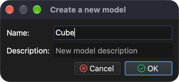
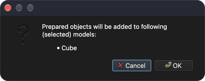

# Намалюй куб

Цей посібник покаже, як намалювати/створити просту геометрію, наприклад куб.

## 1. Створіть нову модель

**Меню:** _Файл -> Нова модель_

Введіть **Куб** як назву моделі та натисніть **Гаразд**. Буде створено нову порожню модель під назвою **Куб**. Оскільки для новоствореної моделі не призначено жодної задачі, з’явиться діалогове вікно **Потік завдання задачі**.

### 1.1 Призначте тип задачі

Щоб призначити тип задачі, натисніть кнопку **Додати тип задачі** та в діалоговому вікні **Вибір типу задачі** виберіть **Передача тепла**.

Клацніть кнопку **Гаразд**, щоб закрити діалогове вікно **Вибір типу задачі**, а потім знову натисніть кнопку **Гаразд**, щоб закрити діалогове вікно **Потік завдання задачі**.

## 2. Намалюй куб

**Меню:** _Геометрія -> Намалювати -> Намалювати шестигранник_

Після активації пункту меню праворуч від головного вікна буде показано панель **Намалювати об’єкт**, де користувач може змінити положення об’єкта, розмір і осьові поділки.

Відображуваний об’єкт змінюється одночасно зі зміною значень на панелі **Намалювати об’єкт**. Натисніть кнопку **Гаразд**, щоб додати об’єкт до моделі. З’явиться діалогове вікно підтвердження зі списком вибраних моделей, до яких буде додано об’єкт.

Натисніть **Гаразд** для підтвердження, і куб буде додано до моделі **Куб**.

## 3. Зберегти модель

Щоб зберегти модель, просто виконайте наступну дію.

**Меню:** _Файл -> Зберегти модель_

Якщо модель не була збережена раніше, програма покаже діалогове вікно **Зберегти модель** із пропозицією імені файлу та шляху для його збереження. Натисніть **Зберегти**, щоб прийняти.
