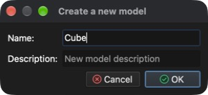
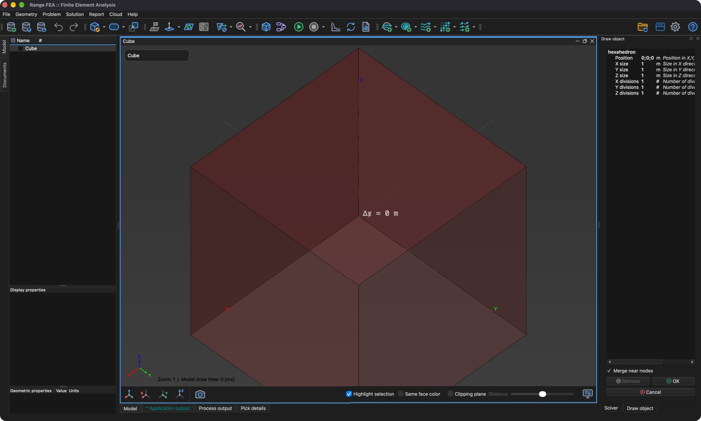
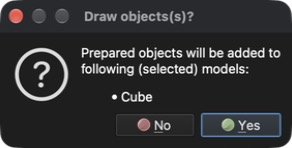

# Намалюй куб

Цей підручник показує, як намалювати (згенерувати) просту геометрію, наприклад куб.

## 1. Створити нову модель

**Меню:** _Файл -> Нова модель_

Введіть **Cube** як назву моделі (опис необов’язковий) і натисніть **Гаразд**. Буде створено нову порожню модель з назвою **Cube**. Оскільки новоствореній моделі не призначено жодної задачі, з’явиться діалогове вікно **Вибрати задачу**.

### 1.1 Призначити тип задачі

Щоб призначити тип задачі, клацніть плитку **Heat transfer**, а потім кнопку **Гаразд**.

## 2. Намалювати куб

**Меню:** _Геометрія -> Побудова -> Побудувати гексаедр_

Після вибору цього пункту меню праворуч у головному вікні з’явиться панель **Намалюйте об'єкт**, у якій можна змінити положення й розмір об’єкта та кількість поділів у напрямках X, Y і Z. Типовим об’єктом є куб зі стороною 1 `[m]`, розташований у початку координат.

Показаний об’єкт змінюється одночасно зі зміною значень на панелі **Намалюйте об'єкт**. Залиште позначеним **Об’єднати близькі вузли** і натисніть кнопку **Гаразд**, щоб додати об’єкт до моделі. З’явиться вікно підтвердження **Draw objects(s)?** зі списком вибраних моделей, до яких буде додано об’єкт.

Натисніть **Yes** (Так), щоб підтвердити, і куб буде додано до моделі **Cube** як одну сутність **Поверхня**.

## 3. Зберегти модель

Щоб зберегти модель, виконайте таку дію.

**Меню:** _Файл -> Зберегти модель_

Якщо модель ще не зберігалася, програма покаже діалогове вікно **Зберегти модель** із запропонованою назвою файлу (**Cube.rbm**) і папкою для збереження. Натисніть **Save** (Зберегти), щоб підтвердити.
