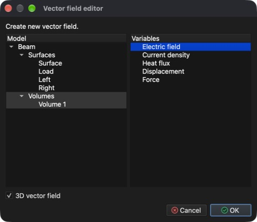

# Мультифізика

Цей підручник показує, як розв’язати кілька пов’язаних задач на одній моделі. Знову використовується модель **Beam** (балка) з підручника **Аналіз напружень і деформацій**. Цього разу балкою тече електричний струм, струм нагріває балку (джоулеве тепло), а тепло змушує балку розширюватися й деформуватися.

Потрібні три типи задач, які розв’язуються в такому порядку:

1. **Electro-statics** (електростатика) – обчислює електричний потенціал, електричне поле, густину струму та джоулеве тепло, створене струмом.
2. **Heat transfer** (теплообмін) – обчислює розподіл температури, спричинений джоулевим теплом.
3. **Stress analysis** (аналіз напружень) – обчислює теплове розширення (переміщення) та спричинені ним напруження.

Кожна задача використовує результати попередньої, тому порядок задач має значення.

## 1. Завантажити модель

**Меню:** _Файл -> Відкрити модель_

У діалоговому вікні **Відкрити модель** виберіть **Beam.rbm** і натисніть **Open** (Відкрити).

Оскільки моделі ще не призначено жодного типу задачі, після завершення завантаження автоматично відкриється діалогове вікно **Вибрати задачу**.

## 2. Вибрати задачі

У діалоговому вікні **Вибрати задачу** клацніть плитки **Electro-statics**, **Heat transfer** і **Stress analysis**. Під плитками вікно показує **Порядок розв’язання**: Electro-statics → Heat transfer → Stress analysis. **Modal analysis** позначено як **Несумісна**, бо її не можна поєднувати з іншими типами задач. Підтвердьте кнопкою **Гаразд**.

Вікно можна будь-коли відкрити знову кнопкою **Вибрати задачу** на панелі інструментів.

## 3. Згенерувати 3D-сітку

Усі три задачі розв’язуються на об’ємній сітці.

**Меню:** _Геометрія -> Об’єм -> Згенеруйте тетраедральну сітку_

Заповнених значень у вікні **Створіть 3D-сітку** достатньо. Натисніть **Гаразд**. Після завершення генерування в **дереві моделі** в групі **Об’єми** з’явиться нова сутність **Volume 1**.

## 4. Призначити матеріал

Усім сутностям моделі має бути призначено матеріал. Матеріал має містити властивості, потрібні для всіх трьох задач; **Iron** (залізо) їх містить.

1. У **дереві моделі** розгорніть **Об’єми**, клацніть **Surface**, а потім з натиснутою клавішею _Shift_ клацніть **Volume 1**, щоб вибрати всі сутності.
2. Відкрийте вкладку **Матеріал** праворуч у головному вікні.
3. Позначте **Iron**.

## 5. Призначити граничні умови

Оскільки вибрано кілька типів задач, вкладка **Граничні умови** тепер пропонує умови всіх цих задач, і одній сутності можна призначити кілька умов – по одній для кожної задачі. Призначте **поверхневим** сутностям такі умови:

1. **Surface** (зовнішня поверхня балки)
    - _Simple convection_ (проста конвекція)
        - Convection coefficient = 100 `[W/(m^2*K)]`
        - Fluid temperature = 293,15 `[K]`
2. **Load** (грань посередині балки)
    - _Electric potential_ (електричний потенціал)
        - Electric potential = 0,04 `[V]`
    - _Simple convection_ (значення як для **Surface**)
3. **Left** і **Right** (грані на обох кінцях балки)
    - _Displacement_ (переміщення)
        - Displacement in X, Y and Z direction = 0 `[m]`
    - _Electric potential_
        - Electric potential = -0,04 `[V]`
    - _Simple convection_ (значення як для **Surface**)

Отже, струм тече від середини балки до обох кінців, а всі грані віддають тепло навколишньому повітрю конвекцією.

Для кожної сутності: виберіть її в **дереві моделі** (утримуйте _Ctrl_ / _⌘ Cmd_, щоб вибрати **Left** і **Right**), позначте умову на вкладці **Граничні умови**, виберіть умову, щоб під списком з’явилися її властивості, потім двічі клацніть значення, введіть нове й натисніть _Enter_. Типові значення **Simple convection** (100 `[W/(m^2*K)]` і 293,15 `[K]`) і **Displacement** (0 `[m]`) уже відповідають, тому змінити потрібно лише **Electric potential**.

## 6. Перевірити умови середовища

Умови середовища застосовуються до всієї моделі й не позначаються прапорцем, як граничні умови. Відкрийте вкладку **Умови навколишнього середовища** і виберіть кожну умову, щоб перевірити її значення:

- _Gravitational acceleration_ (прискорення вільного падіння)
    - 0, 0 і -9,80665 `[m/s^2]` у напрямках X, Y і Z
- _Temperature_ (температура)
    - Temperature = 293,15 `[K]`

## 7. Розв’язати задачу

**Меню:** _Рішення -> Запустити розв’язувач_

Перш ніж розв’язувач зможе запуститися, модель має бути збережена. Модель **Beam** відкрито з файлу, тому вона зберігається в ньому автоматично; модель, яку ще ніколи не зберігали, спочатку показує вікно **Зберегти модель**. Потім з’являється вікно **Запустити розв’язувач**.

Вікно показує три попередження: **Electro-statics: No implicit boundary condition assigned.**, **Heat transfer: No explicit boundary condition assigned.** і **Stress analysis: No implicit boundary condition assigned.** Для цього налаштування вони очікувані, і їх можна ігнорувати. Натисніть **Гаразд**, щоб запустити розв’язувач.

Розв’язувач працює у фоновому режимі, а його вивід показується на вкладці **Вивід процесу**. Задачі розв’язуються одна за одною в порядку послідовності завдань; обчислення завершено, коли вивід закінчується рядком **SOLVER - END**.

## 8. Створити векторне поле

**Векторне поле** — це сутність відображення, яка малює векторну змінну у вигляді стрілок. Тут вона використовується, щоб показати електричне поле всередині балки.

**Меню:** _Геометрія -> Векторне поле -> Створити векторне поле_

У діалоговому вікні **Редактор векторних полів** виберіть **Volume 1** у списку **Модель** і **Electric field** у списку **Змінні** та залиште позначеним **3D векторне поле**. Список **Змінні** містить векторні змінні, обчислені для вибраної сутності (**Electric field**, **Current density**, **Heat flux**, **Displacement** і **Force**).

Натисніть **Гаразд**, щоб створити векторне поле. Його буде додано до **дерева моделі** в групі **Векторні поля** з назвою **Electric field**, і до нього можна застосовувати обчислені результати, як до будь-якої іншої сутності моделі.

## 9. Показати результати

Результати показуються на вкладці **Результати** на сутності, вибраній у **дереві моделі**, так само як у підручнику **Аналіз напружень і деформацій**.

### 9.1. Температура й деформація об’єму

1. У **дереві моделі** позначте **Об’єми** (поверхні залиште непозначеними), а потім виберіть **Volume 1**.
2. На вкладці **Результати** виберіть у розкривному меню **Temperature - Scalar**, позначте **Кольорова карта** і **Показати легенду**. Якщо показаний діапазон не відповідає результатам, натисніть **Скинути за даними**.
3. Виберіть у розкривному меню **Displacement - Vector [3]**, позначте **Деформована форма** і встановіть **Масштаб деформації та стрілок** на **20**, щоб деформацію було видно (обчислені переміщення становлять лише близько 1,2 мм).
4. Знову виберіть **Temperature - Scalar**, щоб легенда показувала температуру.

Температура становить приблизно від 468 K до 558 K; балка найтепліша посередині обох зовнішніх частин і вигинається вгору, бо закріплені кінці не дають їй вільно розширитися.

### 9.2. Температура на векторному полі

1. У **дереві моделі** зніміть позначку з **Об’єми**, позначте **Векторні поля** і виберіть **Electric field**.
2. На вкладці **Результати** виберіть **Temperature - Scalar**, позначте **Кольорова карта** і **Показати легенду** (якщо ще не позначено). Стрілки тепер зафарбовано за температурою в місці, де вони розташовані.
3. У **Властивостях відображення** під деревом позначте **Наконечники стріл**, щоб показати напрямок електричного поля. Електричне поле спрямоване від середини балки (вищий потенціал) до обох кінців.

