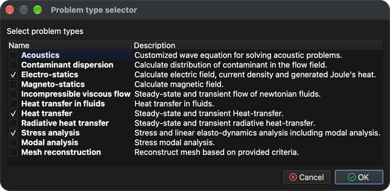

# Мультифізика

У цьому підручнику показано, як розв’язувати декілька пов’язаних задач на одній моделі. Знову використовується модель **Балка** з підручника **Аналіз напружень і деформацій**. Цього разу крізь пучок протікає електричний струм, який нагріває пучок (Джоулев нагрів), і тепло змушує пучок розширюватися та деформуватися.

Потрібні три типи задач, і вони розв’язуються в такому порядку:

1. **Електростатика** - обчислює електричний потенціал, електричне поле, густину струму та джоулеву теплоту, вироблену струмом.
2. **Передача тепла** - обчислює розподіл температури, спричинений теплом Джоуля.
3. **Аналіз напруги** - обчислює теплове розширення (переміщення) і результуючу напругу.

Кожна задача використовує результати попередньої, тому порядок задач має значення.

## 1. Завантажити модель

**Меню:** _Файл -> Відкрити модель_

У діалоговому вікні **Відкрити модель** виберіть **Beam.tmsh** і натисніть **Відкрити**.

Оскільки моделі ще не призначено жодного типу задачі, після завершення завантаження автоматично відкривається діалогове вікно **Потік завдання задачі**.

## 2. Хід розв’язування задач

1. У діалоговому вікні **Послідовність розв’язування задач** натисніть **Додати тип задачі**.
2. У **Виборі типу задачі** позначте **Електростатика**, **Теплопередача** та **Аналіз напруги** і натисніть **Гаразд**.

**Проблемний потік завдань** тепер має перелічувати три задачі в одній групі ітерацій у порядку, показаному нижче. Якщо порядок інший або є додаткові записи, виберіть запис і використовуйте кнопки **Вгору**, **Вниз** і **Видалити**, щоб виправити це. Натисніть **ОК**, щоб прийняти.

Діалогове вікно можна відкрити знову в будь-який час за допомогою кнопки **Задача(и) потоку завдань** на панелі інструментів.

## 3. Створіть 3D-сітку

Усі три задачі розв’язуються на об’ємній сітці.

**Меню:** _Геометрія -> Об'єм -> Створити тетраедральну сітку_

Попередньо заповнених значень у діалоговому вікні **Створити 3D-сітку** достатньо. Натисніть **ОК**. Після завершення створення сітки нова сутність **Том 1** з’являється в розділі **Об’єми** в дереві **Модель**.

## 4. Роздайте матеріал

Усі сутності моделі повинні мати призначений матеріал. Матеріал повинен забезпечувати властивості, необхідні для всіх трьох задач; **Залізо** робить.

1. У дереві **Модель** клацніть **Поверхня**, а потім, утримуючи _Shift_, клацніть **Том 1**, щоб вибрати всі сутності.
2. Відкрийте вкладку **Матеріал** у правій частині головного вікна.
3. Перевірте **Залізо**.

## 5. Задайте граничні умови

Оскільки вибрано кілька типів задач, вкладка **Граничні умови** тепер пропонує умови для всіх із них, і одній сутності може бути призначено кілька умов - по одній для кожної задачі. Призначте наступні умови для сутностей **поверхня**:

1. **Поверхня** (зовнішня поверхня балки)
    - _Проста конвекція_
        - Коефіцієнт конвекції = 100 `[W/(m^2*K)]`
        - Температура рідини = 293,15 `[K]`
2. **Навантаження** (обличчя в середині балки)
    - _Електричний потенціал_
        - Електричний потенціал = 0,4 `[V]`
    - _Проста конвекція_ (значення як для **Поверхні**)
3. **Ліворуч** і **Праворуч** (грані на обох кінцях променя)
    - _Переміщення_
        - Переміщення в напрямку X, Y і Z = 0 `[m]`
    - _Електричний потенціал_
        - Електричний потенціал = -0,4 `[V]`
    - _Проста конвекція_ (значення як для **Поверхні**)

Тому струм тече від середини променя до обох кінців, і всі поверхні втрачають тепло навколишньому повітрю через конвекцію.

Для кожної сутності: виберіть її в дереві **Модель** (утримуйте _Ctrl_ / _⌘ Cmd_, щоб вибрати **Ліворуч** і **Праворуч**), перевірте умову на вкладці **Граничні умови**, виберіть умову, щоб показати її властивості під списком, потім двічі клацніть значення, введіть нове та натисніть _Enter_. Значення за замовчуванням **Проста конвекція** (100 `[W/(m^2*K)]` і 293,15 `[K]`) і **Зміщення** (0 `[m]`) уже збігаються, тому потрібно змінити лише **Електричний потенціал**.

## 6. Перевірте умови середовища

Умови середовища застосовуються до всієї моделі й не перевіряються, як граничні умови. Відкрийте вкладку **Умови середовища** та виберіть кожну умову, щоб перевірити її значення:

- _Гравітаційне прискорення_
    - 0, 0 і -9,80665 `[m/s^2]` у напрямку X, Y і Z
- _Температура_
    - Температура = 293,15 `[K]`

## 7. Розв’яжи задачу

**Меню:** _Рішення -> Запустити розв'язувач_

Модель має бути збережена перед запуском розв’язувача. Якщо його ще не було збережено, спочатку буде показано діалогове вікно **Зберегти модель**; натисніть **Зберегти**, щоб прийняти (якщо файл із такою назвою вже існує, підтвердьте його заміну). Після цього відобразиться діалогове вікно **Запустити розв’язувач**.

У діалоговому вікні наведено кілька попереджень, наприклад **Теплопередача: чітко не призначено граничних умов.** Вони очікувані для цього налаштування, і їх можна ігнорувати. Натисніть **Гаразд**, щоб запустити розв’язувач.

Розв’язувач працює у фоновому режимі, а його результати відображаються на вкладці **Вихід процесу**. Задачі вирішуються одна за одною в порядку виконання завдань; виконання завершується, коли вихід закінчується **SOLVER - END**.

## 8. Створіть векторне поле

**Векторне поле** — це відображувана сутність, яка малює векторну змінну у вигляді стрілок. Тут він використовується, щоб показати електричне поле всередині променя.

**Меню:** _Геометрія -> Векторне поле -> Створити векторне поле_

У діалоговому вікні **Редактор векторних полів** виберіть **Том 1** у списку **Модель** і **Електричне поле** у списку **Змінні** та залиште позначку **3D векторне поле**.

Натисніть **Гаразд**, щоб створити векторне поле. Він додається до дерева **Модель** у розділі **Векторні поля**, і обчислені результати можуть бути застосовані до нього, як до будь-якої іншої сутності моделі.

## 9. Застосуйте результати

Результати застосовуються на вкладці **Результати** до об’єкта, вибраного в дереві **Модель**, так само, як і в підручнику **Аналіз напружень і деформацій**.

### 9.1. Температура і деформація об'єму

1. У дереві **Модель** позначте **Об’єми** (і залиште позначки біля поверхонь), а потім виберіть **Том 1**.
2. На вкладці **Результати** виберіть **Температура - Скаляр** у розкривному списку, позначте **Скаляр** і **Діапазон відображення значення**. Якщо показаний діапазон не відповідає результатам, натисніть **Встановити мінімальні/максимальні значення за умовчанням**.
3. Виберіть **Переміщення - вектор [3]** у розкривному списку, позначте **Переміщення** та встановіть **Масштаб** на **20**, щоб було видно деформацію (обчислені переміщення становлять лише близько 1,3 мм).

Температура коливається приблизно від 505 К до 620 К; балка найбільш гаряча в середині двох зовнішніх секцій, і вона згинається вгору, оскільки закріплені кінці не дозволяють їй вільно розширюватися.

### 9.2. Температура на векторному полі

1. У дереві **Модель** зніміть прапорець **Об’єми**, позначте **Векторні поля** та виберіть **Електричне поле**.
2. На вкладці **Результати** виберіть **Температура - Скаляр**, позначте **Скаляр** і **Діапазон відображення значення**. Тепер стрілки забарвлені температурою в їхньому положенні.
3. У **Властивості відображення** під деревом позначте **Намалюйте стрілки**, щоб показати напрямок електричного поля.

