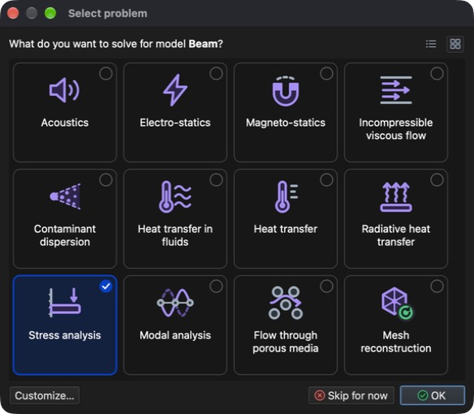
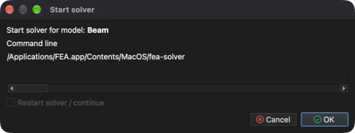
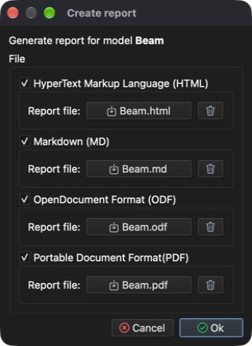
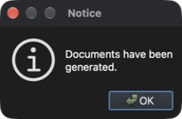
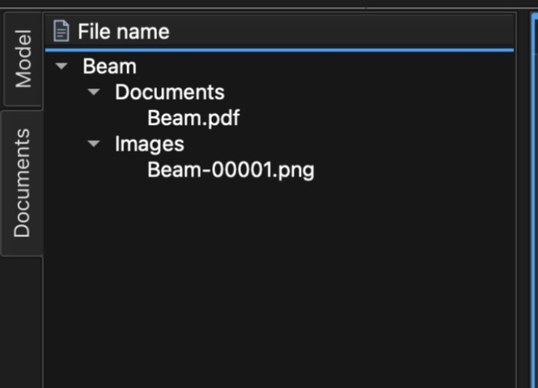

# Аналіз напружень і деформацій

Цей підручник показує, як налаштувати й розв’язати задачу **Stress analysis** (аналіз напружень). Для цього проста балка буде оперта на обох кінцях і навантажена посередині.

## 1. Завантажити модель

**Меню:** _Файл -> Відкрити модель_

З’явиться діалогове вікно **Відкрити модель**. Виберіть файл **Beam.rbm** і натисніть **Open** (Відкрити), щоб завантажити модель.

Оскільки цій моделі не призначено жодної фізичної задачі, невдовзі після завершення завантаження з’явиться діалогове вікно **Вибрати задачу**.

Клацніть плитку **Stress analysis** і підтвердьте кнопкою **Гаразд**.

## 2. Згенерувати 3D-сітку

Щоб розв’язати цю задачу, потрібно згенерувати об’ємну сітку.

**Меню:** _Геометрія -> Об’єм -> Згенеруйте тетраедральну сітку_

Ця дія показує діалогове вікно **Створіть 3D-сітку**.

Поки що достатньо заповнених значень. Підтвердьте кнопкою **Гаразд**.

Після генерування сітки в **дереві моделі** з’явиться нова сутність **Об’єм**. Щоб побачити згенеровану сітку, приховайте поверхневі сутності, покажіть лише **Об’єми** і в **Властивостях відображення** позначте **Як каркас**.

## 3. Призначити матеріал

Матеріал можна призначити лише вибраній сутності моделі. Сутності вибираються в **дереві моделі**. Щоб вибрати кілька сутностей, утримуйте під час вибору клавішу _Ctrl_ (_⌘ Cmd_ у macOS) або клавішу _Shift_, щоб вибрати діапазон. Коли всі сутності вибрано, матеріал можна призначити на вкладці **Матеріал** праворуч у головному вікні.

**Дерево моделі** і **список матеріалів** показано на знімку екрана нижче.

Матеріал призначено, коли прапорець перед його назвою позначено. У цьому підручнику використовується **Iron** (залізо).

_Примітка: усім сутностям моделі має бути призначено матеріал._

## 4. Призначити граничні умови

Граничні умови — це задані значення змінних поля (або пов’язаних величин, наприклад похідних) на границях поля. Граничні умови поділяються на **явні** та **неявні**. **Явні** умови виділено **жирним** шрифтом.

У цьому підручнику граничні умови буде призначено **поверхневим** сутностям так:

1. **Load**
    - _Weight_ (вага)
        - Weight = 1000 `[kg]`
2. **Left** і **Right**
    - _Displacement_ (переміщення)
        - Displacement in X direction = 0 `[m]`
        - Displacement in Y direction = 0 `[m]`
        - Displacement in Z direction = 0 `[m]`

Щоб призначити граничну умову **Weight**, виконайте такі кроки:

1. Виберіть сутність **Load** у **дереві моделі**.
2. Відкрийте вкладку **Граничні умови**, виберіть граничну умову **Weight** і позначте її прапорець.
3. У властивості **Weight** замініть значення **1** на **1000** `[kg]`.

Щоб призначити граничну умову **Displacement**, виконайте такі кроки:

1. Виберіть сутності **Left** і **Right** у **дереві моделі** (утримуйте _Ctrl_ / _⌘ Cmd_, щоб вибрати обидві).
2. На вкладці **Граничні умови** виберіть граничну умову **Displacement** і позначте її прапорець.
3. Переконайтеся, що всі значення властивостей дорівнюють **0** `[m]`.

## 5. Призначити умови середовища

Щоб гранична умова **Weight** працювала правильно, має бути призначена правильна умова середовища **Gravitational acceleration** (прискорення вільного падіння).

Умови середовища не позначаються прапорцем, як граничні умови. Відкрийте вкладку **Умови навколишнього середовища** і виберіть **Gravitational acceleration**, щоб перевірити її значення: 0, 0 і -9,80665 `[m/s^2]` у напрямках X, Y і Z.

## 6. Розв’язати задачу

Коли задачу правильно налаштовано, її можна розв’язати.

**Меню:** _Рішення -> Запустити розв’язувач_

Перш ніж розв’язувач зможе запуститися, модель має бути збережена. Модель **Beam** відкрито з файлу, тому вона зберігається в ньому автоматично; модель, яку ще ніколи не зберігали, спочатку показує діалогове вікно **Зберегти модель** (натисніть **Save** (Зберегти), а якщо файл із такою назвою вже існує, підтвердьте його заміну). Потім з’явиться діалогове вікно **Запустити розв’язувач**.

Натисніть кнопку **Гаразд**, щоб запустити процес розв’язувача.

Процес розв’язувача працює у фоновому режимі, а весь його вивід показується на вкладці **Вивід процесу** під 3D областю, як видно на знімку екрана нижче. Обчислення завершено, коли вивід закінчується рядком **SOLVER - END**.

## 7. Показати обчислені результати

Після успішного завершення процесу розв’язувача обчислені результати мають завантажитися автоматично. Щоб показати їх, їх потрібно застосувати до сутностей моделі. Це робиться на вкладці **Результати**. Результати показуються на вибраних сутностях моделі. Для цього поверніться на вкладку **Модель** під 3D областю, приховайте всі поверхневі сутності, покажіть лише **Об’єми** і виберіть **Volume 1** у **дереві моделі**.

### 7.1. Переміщення

У розкривному меню виберіть **Displacement** (якщо ще не вибрано). **Displacement** — векторна змінна; її можна показати як **Кольорову карту** (сутність зафарбовується за величиною переміщення) та/або як **Деформовану форму** (сутність згинається). Цього разу позначте прапорець **Деформована форма** і встановіть **Масштаб деформації та стрілок** на **500**, щоб побачити деформацію.

### 7.2. Напруження за Мізесом

Так само, як **Displacement**, покажіть **Von Mises stress** на вибраній сутності **Об’єм**: виберіть у розкривному меню **Von Mises stress - Scalar** і позначте **Кольорова карта**. Деформована форма, налаштована для **Displacement**, залишається видимою. Додатково позначте прапорець **Показати легенду**, щоб показати діапазон значень у 3D області.

**Von Mises stress** обчислюється на елементах, тому кожен елемент малюється одним кольором. Позначте **Згладжене відображення**, щоб усереднити значення елементів у вузлах і отримати неперервне зображення; це змінює лише відображення, а не результати.

## 8. Створити звіт

Іноді потрібно створити звіт, щоб опублікувати обчислені результати.

**Меню:** _Звіт -> Створити звіт_

Програма може створювати звіти в кількох форматах (HTML, Markdown, ODF і PDF), усі вони типово позначені. Цього разу достатньо створити лише документ **PDF**, тому зніміть позначки з усіх форматів, крім **Portable Document Format(PDF)**, і натисніть кнопку **Добре**.

Після створення звіту з’явиться повідомлення **Documents have been generated.** (Документи створено). Закрийте його кнопкою **Гаразд**.

Створені документи не показуються автоматично. Щоб переглянути їх, відкрийте вкладку **Документи** ліворуч у головному вікні, де вони наведені під назвою моделі (**Beam**): звіт у групі **Документи**, а зображення 3D області, використане у звіті, у групі **Зображення**. Двічі клацніть документ, який потрібно переглянути.

