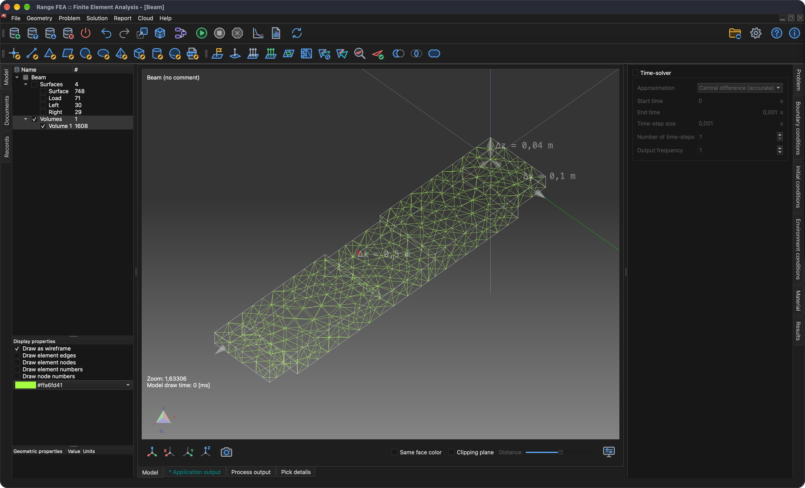

# Аналіз напружень і деформацій

Цей підручник продемонструє, як налаштувати та розв’язати задачу **Аналіз стресу**. З цієї причини проста балка буде підтримуватися з обох кінців з вантажем посередині.

## 1. Завантажити модель

**Меню:** _Файл -> Відкрити модель_

Відкриється діалогове вікно **Відкрити модель**. Виберіть файл **Beam.tmsh** і натисніть **Відкрити**, щоб завантажити модель.

Оскільки цій моделі не присвоєно жодної фізичної задачі, невдовзі після завершення завантаження моделі з’явиться діалогове вікно **Потік завдання задачі**.

Натисніть кнопку **Додати тип задачі**, і відобразиться діалогове вікно **Вибір типу задачі**. Знайдіть і поставте прапорець біля **Аналіз стресу** та натисніть кнопку **ОК**, щоб прийняти.

**Послідовність розв’язування задач** тепер має відображати 1 ітерацію **Аналіз стресу**. Натисніть **ОК**, щоб прийняти.

## 2. Створіть 3D-сітку

Щоб вирішити цю задачу, необхідно створити об’ємну сітку.

**Меню:** _Геометрія -> Об'єм -> Створити тетраедральну сітку_

Ця дія відкриє діалогове вікно **Створити 3D-сітку**.

На даний момент достатньо попередньо заповнених значень. Натисніть кнопку **ОК**, щоб прийняти.

Після створення сітки в **дереві моделі** з’являється нова сутність **Об’єм**. Щоб побачити згенеровану сітку, сховайте об’єкти поверхні, відобразіть лише **Об’єми** та встановіть прапорець **Намалювати як каркас** у **Властивості відображення**.

## 3. Роздайте матеріал

Матеріал можна призначити лише вибраній сутності моделі. Сутності можна вибрати в **Дереві моделей**. Щоб вибрати кілька об’єктів, утримуйте клавішу _Ctrl_ (_⌘ Cmd_ у macOS) під час вибору об’єктів або утримуйте клавішу _Shift_, щоб вибрати діапазон. Після вибору всіх об’єктів матеріал можна призначити на вкладці **Матеріал** у правій частині головного вікна.

**Дерево моделей** і **список матеріалів** можна побачити на знімку екрана нижче.

Матеріал призначається, коли встановлено прапорець перед назвою матеріалу. У цьому підручнику використовується **Залізо**.

_Примітка: для всіх сутностей моделі має бути призначений матеріал._

## 4. Задайте граничні умови

Граничні умови — це визначені значення змінних поля (або пов’язаних змінних, таких як похідні) на межах поля. Граничні умови можна розділити на **Явні** та **Неявні** умови. **Явні** умови виділено **сильним** шрифтом.

У цьому посібнику граничні умови будуть застосовані до **поверхневих** об’єктів, як описано нижче:

1. **Завантажити**
    - _Вага_
        - Вага = 1000 `[kg]`
2. **Ліворуч** і **Праворуч**
    - _Переміщення_
        - Переміщення в напрямку X = 0 `[m]`
        - Переміщення в напрямку Y = 0 `[m]`
        - Переміщення в напрямку Z = 0 `[m]`

Щоб застосувати граничну умову **Вага**, виконайте такі дії:

1. Виберіть **Завантажити** сутність у **Дереві моделі**.
2. Відкрийте вкладку **Граничні умови**, потім виберіть і позначте граничну умову **Вага**.
3. Замініть **1** на **1000** `[kg]` у полі значення властивості **Вага**.

Щоб застосувати граничну умову **Зміщення**, виконайте такі дії:

1. Виберіть **Лівий** і **Правий** об’єкти в **Дереві моделі** (утримуйте _Ctrl_ / _⌘ Cmd_, щоб вибрати обидва).
2. Виберіть і перевірте граничну умову **Переміщення** у вкладці **Граничні умови**.
3. Переконайтеся, що для всіх властивостей встановлено значення **0** `[m]`.

## 5. Призначте умови середовища

Щоб гранична умова **Вага** працювала належним чином, має бути призначено правильну умову середовища **Прискорення тяжіння**.

Умови середовища не перевіряються як граничні умови. Відкрийте вкладку **Умови навколишнього середовища** та виберіть **Прискорення тяжіння**, щоб перевірити його значення: 0, 0 і -9,80665 `[m/s^2]` у напрямку X, Y і Z.

## 6. Розв'яжи задачу

Якщо задачу правильно налаштовано, її можна вирішити.

**Меню:** _Рішення -> Запустити розв'язувач_

Модель має бути збережена перед запуском розв’язувача. Якщо його ще не було збережено, спочатку буде показано діалогове вікно **Зберегти модель**; натисніть **Зберегти**, щоб прийняти (якщо файл із такою назвою вже існує, підтвердьте його заміну). Потім буде показано діалогове вікно **Почати розв’язувач**.

Натисніть кнопку **Гаразд**, щоб розпочати процес розв’язування.

Процес Solver працює у фоновому режимі, і всі його результати відображаються на вкладці **Вивід процесу**, як це можна побачити на знімку екрана нижче.

## 7. Застосуйте обчислені результати

Після успішного завершення процесу розв’язувача обчислені результати мають бути завантажені автоматично. Щоб відобразити ці результати, їх потрібно застосувати до сутностей моделі. Це робиться у вкладці **Результати**. Результати застосовуються до вибраних сутностей моделі. Для цього приховайте всі поверхневі сутності та відображайте лише **Об’єми**.

### 7.1. Переміщення

У спадному меню виберіть **Зміщення** (якщо ще не вибрано). **Переміщення** є векторною змінною; його можна застосувати як **Скаляр** (сутність буде забарвлено своєю величиною) та/або як **Зміщення** (сутність буде згинатися). Цього разу встановіть прапорець **Зміщення** та встановіть **Масштаб** на **500**, щоб побачити деформацію.

### 7.2. Напруження за Мізесом

Подібно до **Переміщення** застосуйте **Напруження за Мізесом** до обраної сутності моделі **Об’єм**. Додатково встановіть прапорець **Відображати діапазон значень**, щоб відображати діапазон значень у 3D-області.

## 8. Складіть звіт

Іноді для публікації обчислених результатів необхідно створити звіт.

**Меню:** _Звіт -> Створити звіт_

Програмне забезпечення може створювати звіти в кількох форматах (HTML, Markdown, ODF і PDF), усі вони перевіряються за замовчуванням. Цього разу достатньо створити лише документ **PDF**, тому зніміть прапорці з усіх форматів, крім **Портативний формат документів (PDF)** і натисніть кнопку **Гаразд**.

Після створення звіту з’явиться повідомлення **Документи створено.**. Натисніть **ОК**, щоб закрити його.

Згенеровані документи не відображаються автоматично. Для цього перейдіть до дерева **Документи** і двічі клацніть документ, який ви хочете переглянути.

